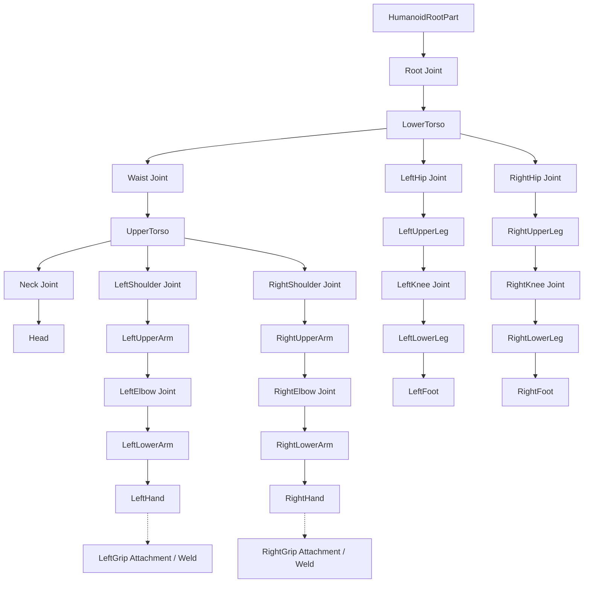
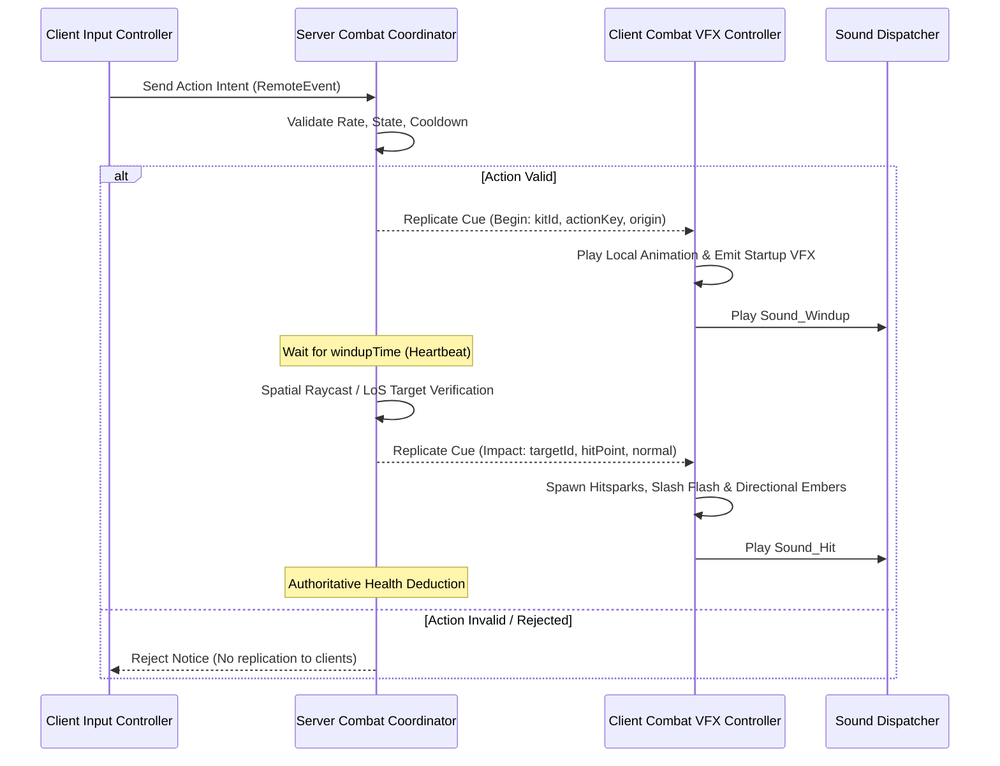

# Project Last Wave — Animation & VFX Contract

- Version: 1.0.0
- Baseline: Project Last Wave (`project-last-wave`)
- Stakeholders: Animation Artist R15, VFX Artist, Technical Artist, Gameplay Engineer
- Governance Mode: Standard Implementation Contract
- Authority: `docs/plans/plan-03-combat.md`, `docs/architecture/combat-build-design.md`, `docs/CONTEXT.md`

---

## 1. Scope & Objective

This contract specifies the authoritative interface and asset data schemas binding **R15 Animation Tracks**, **Client Visual Effects**, **Weapon Model Attachments**, and **Server Combat Phase Timing**. All assets authored for Project Last Wave must strictly comply with these schemas to guarantee seamless synchronization between visual presentation and server-authoritative damage resolution.

---

## 2. Standardized R15 Rig Architecture

### Joint & Constraint Hierarchy
All animations and attachments must target the standardized R15 armature (`ServerStorage.LastWaveRigReference.StandardR15`). Custom packages or scaling factors are strictly prohibited from altering joint pivots or reach metrics.



### Standard Joint Manifest
1. `Root` (`HumanoidRootPart` $\to$ `LowerTorso`)
2. `Waist` (`LowerTorso` $\to$ `UpperTorso`)
3. `Neck` (`UpperTorso` $\to$ `Head`)
4. `LeftShoulder` (`UpperTorso` $\to$ `LeftUpperArm`)
5. `RightShoulder` (`UpperTorso` $\to$ `RightUpperArm`)
6. `LeftElbow` (`LeftUpperArm` $\to$ `LeftLowerArm`)
7. `RightElbow` (`RightUpperArm` $\to$ `RightLowerArm`)
8. `LeftWrist` (`LeftLowerArm` $\to$ `LeftHand`)
9. `RightWrist` (`RightLowerArm` $\to$ `RightHand`)
10. `LeftHip` (`LowerTorso` $\to$ `LeftUpperLeg`)
11. `RightHip` (`LowerTorso` $\to$ `RightUpperLeg`)
12. `LeftKnee` (`LeftUpperLeg` $\to$ `LeftLowerLeg`)
13. `RightKnee` (`RightUpperLeg` $\to$ `RightLowerLeg`)
14. `LeftAnkle` (`LeftLowerLeg` $\to$ `LeftFoot`)
15. `RightAnkle` (`RightLowerLeg` $\to$ `RightFoot`)

Attachment Sockets for Equipment:
- `RightGripAttachment` (in `RightHand`): Primary melee blade/firearm grip point.
- `LeftGripAttachment` (in `LeftHand`): Secondary weapon / hybrid offhand grip point.
- `HatAttachment` (in `Head`): Headwear (e.g. Luffy Straw Hat).

---

## 3. Standardized Weapon Parts & Attachment Naming

All weapon models (`.glb` / `.rbxm`) must expose standard attachment points with exact case-sensitive names:

| Attachment / Part Name | Parent Object | Purpose | Orientation Standard |
|---|---|---|---|
| `Handle` | Weapon Root BasePart | Primary part containing touch/attachment sockets | Massless = true, CanCollide = false |
| `Grip_Attachment` | `Handle` | Point that aligns with character hand grip | $+Y$ Forward (blade direction), $+Z$ Up (hilt direction) |
| `MuzzlePoint` | `Handle` or Barrel Part | Emitter origin for bullets, shells, and projectiles | $+Z$ Forward (fire vector) |
| `Blade_Tip` | Weapon Blade Part | Tip point for slash ribbon cubic Bézier calculation | Aligned to outer tip apex |
| `Blade_Base` | Weapon Blade Part | Base point for slash ribbon cubic Bézier calculation | Aligned near hilt collar |
| `Blade_ChargeSurface` | Distinct MeshPart/Surface | Dedicated sub-mesh for dynamic charge tinting (Nero Exceed) | Separate material zone with Neutral state |

---

## 4. Animation Timing, Priority & Keyframe Markers

### Animation Track Priorities
- `Action4`: High-priority combat finishers, skill releases, and knockback recoveries.
- `Action3`: Standard combat attacks (LMB combos, RMB ranged attacks, Z/X skills).
- `Action2`: Charge loops, aim stances, and locomotion overrides.
- `Movement` / `Idle`: Default locomotion and baseline idle poses.

### Canonical Keyframe Markers
Every combat animation track must contain explicitly named keyframe markers placed at precise frame timestamps:

```
0.00s                       HitFrame (t_active)         Rest (1.00s)
  |------------------------------|----------------------------|
  ^ Startup Window               ^ Active Window              ^ Recovery Window
  [Marker: VFX_Start]            [Marker: HitFrame]           [Marker: Rest_Recover]
  [Marker: Sound_Windup]         [Marker: Sound_Hit]          [CFrame.identity]
```

1. `VFX_Start`: Fired when anticipation begins; triggers weapon trail emission or charge particles.
2. `Sound_Windup`: Fired when anticipation sound cue plays.
3. `HitFrame`: The exact visual apex of impact. Must match server `WeaponRegistry` active event timestamp within $\pm 0.03\text{s}$.
4. `VFX_Release`: Fired when a projectile, shockwave, or slash wave detaches from the weapon.
5. `Sound_Hit`: Fired when contact audio plays.
6. `Buffer_Open`: Timestamp after which late combo input buffering is accepted.
7. `Rest`: The final frame. **Rest Invariant**: At $t = 1.0$, all joints must restore to neutral $\text{CFrame.identity}$ to prevent frozen or displaced character limbs upon clip completion.

---

## 5. Server Synchronization & Timed Phase Events

The server coordinator (`CombatCoordinator.luau`) uses explicit phase time offsets defined in `WeaponRegistry.luau`. Animations must be synchronized with these numbers:

```luau
-- Example: Canonical Action Contract Schema
export type ActionPhaseContract = {
    clipDuration: number,      -- Total animation track duration in seconds
    windupTime: number,        -- Seconds from start to hit frame (Startup)
    activeTime: number,        -- Seconds of damage window (Active)
    recoveryTime: number,      -- Seconds from active window to rest (Recovery)
    bufferWindowTime: number,  -- Earliest time next combo input can be buffered
    cooldownTime: number,      -- Cooldown duration started upon accepted cast
}
```

### Invariant Rules for Server Alignment
1. `windupTime` must equal the timestamp of `HitFrame` within $\pm 0.03\text{s}$.
2. The server coordinator opens its spatial validation raycast/boxcast at $t = \text{windupTime}$.
3. Damage is resolved authoritative-side only. If the server rejects the request (due to cooldown, range, or obstacle), no damage occurs regardless of client animation playback.

---

## 6. VFX & Audio Trigger Event Pipeline



---

## 7. Cancellation, Interruption & Teardown Rules

1. **Unequip / Weapon Swap**:
   - Immediately stops all playing animation tracks for the previous kit.
   - Restores weapon sub-surfaces (e.g. Nero blade redness $\to$ neutral).
   - Cancels active charge loops and resets charge counters to zero.
2. **Character Death / Reset**:
   - Immediately tears down all active client Beams, Trails, and ParticleEmitters.
   - Destroys active summon models (Megumi Divine Dog, Toad, Nue) on both server and client.
   - Cleans all movement locks, dash envelopes, and camera shakes.
3. **Dash Interruption**:
   - Dash does not grant invulnerability frames (`i-frames`).
   - Dash does not cancel attack recovery windows or reset cooldowns.

---

## 8. Lifetime & Cleanup Guarantees (`Zero Orphan Instances`)

To satisfy Performance Gate `COMBO-RBX-11`:
1. **Explicit Expiry**: Every dynamic instance created by VFX (Trails, Beams, Attachments, Billboards, Sounds) must be scheduled for destruction using `Debris:AddItem(instance, lifetime)` or `task.delay(lifetime, function() ... end)`.
2. **Maximum Lifetime**: No visual effect instance may have a lifetime exceeding **3.0 seconds**.
3. **Ancestry Guard**: Every delayed destruction callback must verify instance ancestry before calling `:Destroy()`:
   ```luau
   task.delay(lifetime, function()
       if instance and instance.Parent then
           instance:Destroy()
       end
   end)
   ```
4. **Zero Client Damage Authority**: Client scripts are strictly prohibited from calculating target distances, querying enemy health, or executing damage deductions.
