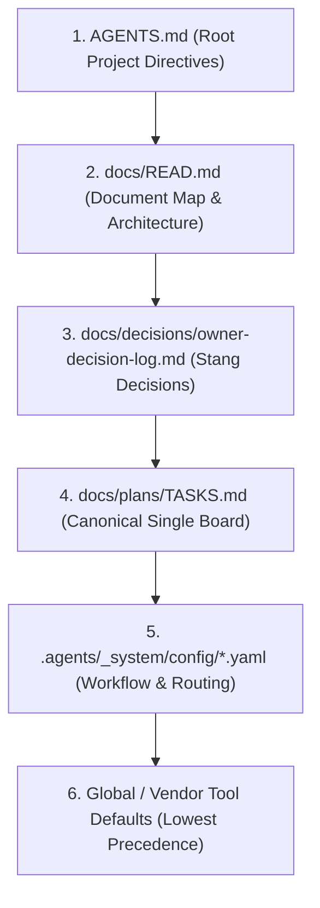
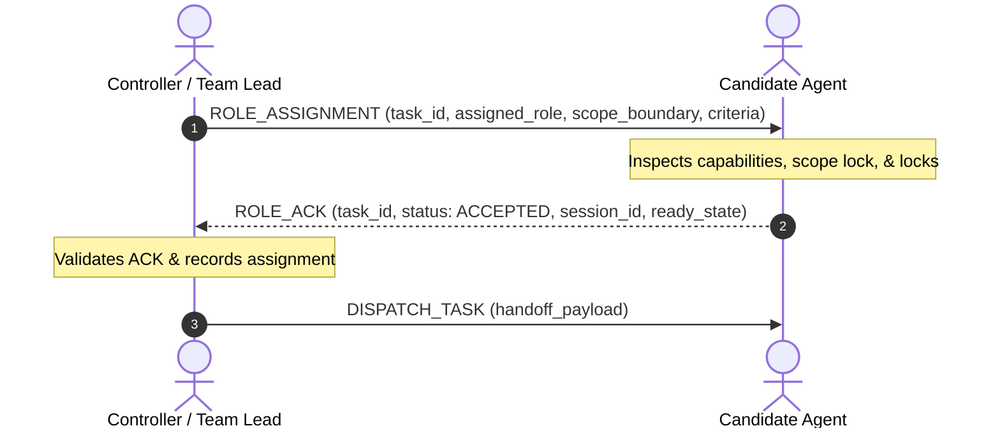

# Project Last Wave: Hierarchical Multi-Agent Workflow Contract
**Document ID:** `PLW-WFC-001`  
**Version:** `2.0.0`  
**Status:** `VERIFIED & LOCKED`  
**Governing Project:** `project-last-wave` (`C:\Users\Stang\roblox-game\project-last-wave`)  
**Project Owner:** Stang  

---

## 1. Executive Summary & Core Principles

This contract establishes the formal engineering and governance standard for all AI agents participating in the **Project Last Wave** Roblox production pipeline. It enforces strict separation of duties, single-writer integrity, lean context management, and deterministic verification.

### Core Principles
1. **Roblox Scope Lock:** This workflow activates strictly for Roblox Luau, R15 rigs, Rojo sync, and Studio development for `project-last-wave`. All other platforms (C#, Web, Next.js, etc.) are explicitly rejected.
2. **Project-First Precedence:** Local repository instructions and documentation take absolute precedence over external, vendor, or global tool defaults.
3. **Separation of Duties (SoD):** The author of a change cannot review, verify, or approve their own change.
4. **Single-Writer Lock:** Exactly one agent or process may modify any given file or Roblox Instance at any time.
5. **No Autonomous Git/Publish:** Agents deliver working-tree modifications and verification evidence. Autonomous `git commit`, `git push`, PR creation, or Roblox place publishing are strictly forbidden without explicit written authorization from Stang.

---

## 2. Project-First Precedence Hierarchy

In accordance with `MEM-ADR-0003` and `AGENTS.md`, all agents must resolve requirements and directives using this strict precedence hierarchy:



If a global tool setting or external agent memory contradicts `AGENTS.md` or `docs/READ.md`, the local project file strictly governs.

---

## 3. Governance Modes

Derived from `MEM-ADR-0003`, tasks operate under one of three governance modes:

| Governance Mode | Description | SoD Enforced | Review Requirement | Commit Policy |
|---|---|---|---|---|
| **`OWNER_STANDARD`** | Default production feature/combat work. Full lifecycle with specialist implementers and independent review. | Yes | Independent Reviewer + QA verification | Reviewer-Led proposal; explicit Stang approval to commit |
| **`STRICT_IMPLEMENTER`** | Isolated implementation (e.g. AGY implementer supervised by Codex controller). Scope-locked with manifest checksums. | Yes | Strict independent review and verification gate | Reviewer-Led proposal; explicit Stang approval to commit |
| **`SOLO_EXPRESS`** | Bounded hotfixes, documentation typography, or isolated visual tweaks. | No | Implementer self-check + static tests | Working tree delivery; explicit Stang approval to commit |

---

## 4. Role Assignment Handshake Protocol

Dynamic role allocation prevents agent identity confusion. Roles are never assumed based on model or pane names; they must be explicitly negotiated:



### Handshake Messages
1. **`ROLE_ASSIGNMENT`**: Sent by Controller. Contains `task_id`, `role_name`, `scope_boundary` (allowed files/instances), and `acceptance_criteria`.
2. **`ROLE_ACK`**: Returned by Candidate before receiving code. If Candidate lacks tools or is already locked, it replies with `REJECTED` and a clear reason.

---

## 5. Single Execution Board Architecture

To eliminate context bloat and token waste, all tasks must observe the Single Board standard:

- **Canonical Project Board:** `docs/plans/TASKS.md` (owns the overarching milestone roadmap).
- **Task Board (Per Slug):** `.agents/tasks/<task-slug>/TASKS.md` (owns the current active sprint/bug queue).
- **File Limits:**
  - `TASKS.md`: Soft target $\le 70$ lines. Compaction trigger at $90$ lines.
  - `NOTES.md`: Hard limit $< 80$ lines. Daily logs roll over into `archive-log.md`.
  - `CombatVFXController.luau`: Hard limit $< 199,000$ bytes.

### 4-Section Task Board Structure
```
[Live Turn Banner: Active Role | Board State | Round | Base SHA | Commit Policy]
---
Section 1: Workstreams (T-01..T-xx status checklist)
Section 2: Active Bug Queue (F-01..F-xx findings for current round only)
Section 3: Verification Gates (PASS / FAIL / STALE status + selective inline evidence)
Section 4: Closure, Commit Plan & Knowledge Promotion (Scattered diff summary & next step)
```

---

## 6. Single-Writer File Ownership Lock

- **Rule:** Exactly one agent may hold write ownership of any Luau file, documentation file, or Roblox DataModel instance at any moment.
- **Parallel Dispatch Rule:** Parallel subagents are permitted **only** when their target file sets and Roblox instances are completely disjoint.
- **Collision Handling:** If two agents attempt to touch the same file or script, the incoming agent must enter state `BLOCKED` and notify the Controller.

---

## 7. 3-Strike Circuit Breaker & Rework Protocol

```mermaid
flowchart TD
    ReviewerAudit["Independent Reviewer / QA Audit"] -->|Pass| ReadyForUAT["Ready for Stang UAT"]
    ReviewerAudit -->|Fail (Round 1)| ReworkRound2["Rework Attempt 1 (Implementer Round 2)"]
    ReworkRound2 --> StaleInvalidation["Invalidate Prior Approvals (STALE_REVIEW_REQUIRES_RERUN)"]
    StaleInvalidation --> ReAudit["Re-audit Diff"]
    ReAudit -->|Pass| ReadyForUAT
    ReAudit -->|Fail (Round 2)| CircuitBreaker["3-Strike Circuit Breaker Tripped!"]
    CircuitBreaker --> Escalate["Set Board State: ESCALATED -> Halt Subagents -> Alert Stang"]
```

1. **Stale Review Invalidation:** Any new diff produced during rework immediately invalidates earlier code reviews (`STALE_REVIEW_REQUIRES_RERUN`).
2. **Escalation Threshold:** After 2 failed review/QA rounds, the circuit breaker triggers *before* starting Round 3. Automated rework halts, and human intervention is required.

---

## 8. Selective Evidence Logging

- **Passing Checks:** Record command, exit code 0, and 1-line summary directly in `TASKS.md` Section 3. Do not generate `.log` files.
- **Failing Checks & Profiler:** Save output to `.agents/tasks/<slug>/run_XX/evidence/` (e.g. `repro-F01.log`) and link to it in `TASKS.md`.
