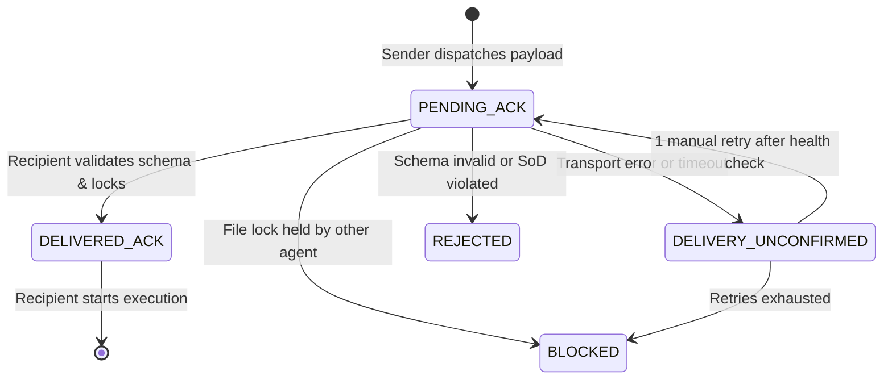

# Project Last Wave: Inter-Agent Handoff Contract
**Document ID:** `PLW-HND-001`  
**Version:** `2.0.0`  
**Status:** `VERIFIED & LOCKED`  
**Governing Project:** `project-last-wave` (`C:\Users\Stang\roblox-game\project-last-wave`)  
**Project Owner:** Stang  

---

## 1. Scope & Objective

This contract specifies the immutable wire format, validation rules, state machine, and behavioral invariants governing handoffs between agents in the Project Last Wave multi-agent workflow.

Every transition of work between:
- Controller / Team Lead $\longleftrightarrow$ Implementer
- Implementer $\longleftrightarrow$ Independent Reviewer
- Reviewer $\longleftrightarrow$ QA / Tester
- Team Lead $\longleftrightarrow$ Orchestrator / Owner

**must** conform strictly to this specification.

---

## 2. Invariants & Governance Rules

### 2.1 Separation of Duties (SoD) Invariants
- **`SENDER_NEQ_REVIEWER`**: The agent session that implemented a change cannot review, verify, or approve that change.
- **`AUTHOR_CANNOT_SELECT_REVIEWER`**: The implementer must not choose its own auditor; reviewer allocation is assigned strictly by the Team Lead or Controller.
- **`ZERO_PRIVILEGE_ESCALATION`**: Receiving or acknowledging a handoff payload grants zero authority to execute `git commit`, `git push`, merge branches, or publish to Roblox.

### 2.2 Single-Writer File Ownership Lock
- Only one agent may hold an active write lock on a target file or Roblox DataModel instance.
- Before beginning work, an Implementer must verify no other workstream claims write ownership.
- If a write conflict is detected, the candidate agent must yield with state `BLOCKED`.

---

## 3. Standard Handoff Payload Schema

All handoffs must be represented as structured YAML or JSON containing all 18 mandatory fields:

```yaml
task_id: "TASK-20261110-001"                    # String, ^TASK-\d{8}-\d{3}$
run_id: "run_01"                                # String, ^run_\d{2}$
handoff_id: "HND-0001"                          # String, ^HND-\d{4}$
idempotency_key: "c8e1a3d9-9f7a-42c2-9e8a-8a9d0f1b2c3d" # UUID v4 or content hash

sender:
  role: "gameplay-engineer"                     # Specialist role name
  governance: "implementer"                     # controller | implementer | browser-e2e-tester | specialist
  session_id: "sess-imp-4819"                   # Unique runtime session identifier

recipient:
  role: "independent-code-reviewer"             # Specialist role name
  governance: "specialist"
  session_id: "sess-rev-9281"

session_identity:
  subagent_type: "self"                         # self | research | delegate
  provider_model: "dynamic-resolved"            # Resolved via orchestrator_capabilities

scope:
  feature_id: "F-COMBAT-003"
  allowed_file_patterns:
    - "src/client/Controllers/CombatController.luau"
    - "src/shared/Network/CombatRemotes.luau"
  forbidden_file_patterns:
    - "src/server/**"

acceptance_criteria:
  - "Combo attack chain advances cleanly from light_1 to light_3"
  - "Attack cooldown resets to idle after 1.2s timeout"
  - "Selene and StyLua checks pass with exit code 0"

base_git_sha: "4f7a29e1c8d0b3a4e5f6a7b8c9d0e1f2a3b4c5d6"

changed_files:
  - "src/client/Controllers/CombatController.luau"
  - "src/shared/Network/CombatRemotes.luau"

change_summary:
  "Implemented 3-hit combo buffer window and network payload sanitization for attack intent."

relevant_assets:
  - "rbxassetid://125001756809464"             # Target Studio test place

test_commands:
  - "selene src/client/Controllers/CombatController.luau"
  - "stylua --check src/client/Controllers/CombatController.luau"

evidence_refs:
  - "inline: selene . (Exit 0, 0 errors)"
  - "inline: stylua --check . (Exit 0, 0 unformatted)"

outstanding_risks:
  - "Input buffer timing may feel slightly tight on mobile touch controls; requires G-VIS-07 check."

unresolved_findings: []

required_next_action: "INDEPENDENT_CODE_REVIEW"

delivery_state: "PENDING_ACK"                   # PENDING_ACK | DELIVERED_ACK | DELIVERY_UNCONFIRMED | BLOCKED | REJECTED
```

---

## 4. Delivery States & State Machine



### Protocol for `DELIVERY_UNCONFIRMED`
- **Blind Retries Forbidden:** Agents must never loop or spam handoff dispatches.
- If delivery confirmation is not received within the operational timeout, inspect recipient ready state. If still unconfirmed after 1 verification check, mark payload as `BLOCKED` and escalate to the Team Lead.

---

## 5. Rework & Circuit Breaker Workflow

When an Independent Reviewer or QA Tester identifies issues:

1. **Finding Classification:** Issues are assigned identifiers `F-01`, `F-02`, etc., with severity (`CRITICAL`, `HIGH`, `MEDIUM`, `LOW`).
2. **Handoff Return:** Recipient dispatches handoff back to the Implementer with `required_next_action: REWORK_ROUND_2`.
3. **Invalidation:** All previous gate approvals are marked `STALE - Re-run required`.
4. **Circuit Breaker:** If Round 2 rework fails to satisfy review criteria, the handoff payload must set `required_next_action: ESCALATE_TO_OWNER` with `delivery_state: BLOCKED`. Round 3 implementation must **never** be dispatched autonomously.
