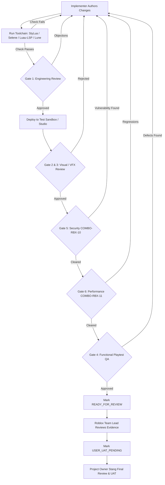

# Project Last Wave — Quality Gates Specification & Verification Standards

- Version: 1.0.0
- Baseline: Project Last Wave (`project-last-wave`)
- Standard: Quality First Standards per `MEM-BP-0005`, `MEM-ADR-0002` (SoD), `MEM-ADR-0003` (Project-First)
- Governance Authority: Project Owner (`Stang`), Roblox Team Lead, Independent Reviewers

---

## 1. Quality Philosophy & Evidence Disciplines

In Project Last Wave, **quality is proven through empirical evidence, never through assumption, optimism, or self-certification**. 

Every deliverable must pass through structured Quality Gates. Crucially, **unverified deliverables must be honestly reported using exact, standardized status descriptors**. It is strictly prohibited to mark a gate as `PASS` without verified, reproducible execution logs, metric baselines, or visual playback captures.

### Strict Separation of Duties (Zero Self-Certification)
Per `MEM-ADR-0002`, an engineer, artist, or designer who authors a change **cannot self-review or certify their own work**. Every gate evaluation must be conducted by an independent specialist (`independent-code-reviewer`, `visual-animation-reviewer`, `security-anti-exploit-specialist`, `performance-specialist`, or `roblox-qa-tester`).

---

## 2. Standardized Gate Status Definitions

All verification reports, task handoffs, and audit documents must use the following authoritative status taxonomy:

| Status Code | Meaning | Required Justification / Evidence |
|---|---|---|
| `PASS` | Fully verified, defect-free, and compliant with all gate criteria. | Complete execution log, zero test failures, zero lint warnings, and compliant metrics. |
| `FAIL` | Executed and confirmed to violate one or more criteria. | Specific error logs, stack traces, benchmark regressions, or exploit proofs. |
| `PARTIAL` | Some components pass, but specific edge cases or sub-criteria failed. | Itemized list of passing vs failing sub-checks with clear remediation path. |
| `UNVERIFIED` | Artifact exists on disk, but verification has not been attempted. | Explanation of why verification has not yet been initiated. |
| `NOT_RUN` | Test or check was intentionally skipped for the current scope. | Explicit reference to plan boundary or prerequisite task not yet scheduled. |
| `BLOCKED` | Verification cannot proceed due to external or dependency failure. | Exact blocker citation (e.g. broken plugin, missing environment secret, host error). |
| `STUDIO_RUNTIME_UNVERIFIED` | Static code/assets valid, but live Roblox Studio runtime playback/capture was not run. | Honest disclosure that asset appearance and animation playback await Studio test session. |
| `NOT_MEASURED` | Performance or memory scenario was not benchmarked against live runtime. | Honest disclosure that empirical frame time or memory metrics were not gathered. |

---

## 3. The 6 Mandatory Quality Gates

### Gate 1: Engineering Quality Gate
**Objective**: Guarantee that all Luau source code is robust, strictly typed, formatted, linted, modular, acyclic, and covered by unit/integration tests.

- **Lead Evaluator**: `independent-code-reviewer`
- **Applicable Files**: `src/`, `tests/`, `tools/`
- **Criteria**:
  1. *Formatting*: `stylua --check src tests` exits with code 0 (zero formatting issues).
  2. *Linting*: `selene src tests` exits with code 0 (zero warnings, zero errors).
  3. *Type Checking*: `luau-lsp analyze` with Roblox definitions exits with code 0.
  4. *Test Suite*: `lune run tests/init.spec.luau` passes with 100% assertions green and 0 failures.
  5. *Acyclicity*: Module dependency graph is strictly acyclic (`node tools/verify-project.mjs`).
  6. *Architecture*: Layering boundaries strictly respected (domain cannot import infrastructure or presentation).
  7. *Error Handling*: Nil guards, ancestry checks, and pcall wrapping on all external boundary calls.

### Gate 2: Animation Quality Gate
**Objective**: Ensure combat animations feature clear shonen anime silhouettes, dynamic weight, snappy keyframed cadence, and clean rest recovery without rig distortion.

- **Lead Evaluator**: `visual-animation-reviewer`
- **Applicable Files**: `assets/animations/`, `src/client/presentation/`
- **Criteria**:
  1. *R15 Normalization*: Authored exclusively for the standard R15 reference rig (`ServerStorage.LastWaveRigReference.StandardR15`).
  2. *Silhouette Clarity*: Key poses clearly readable in high-contrast combat viewports.
  3. *Keyframe Markers*: Canonical markers (`HitFrame`, `VFX_Start`, `Sound_Cue`, `Rest`) placed accurately.
  4. *Hit Timing Synchronization*: `HitFrame` marker aligned with server `WeaponRegistry.windupTime` ($\pm 0.03\text{s}$).
  5. *Rest Invariant*: Track finishes at $t = 1.0$ with neutral $\text{CFrame.identity}$ (no lingering frozen limbs).
  6. *Evidence Requirement*: Requires real Studio playback inspection or video/screenshot proof. **If Studio is not run, status MUST be reported as `STUDIO_RUNTIME_UNVERIFIED`**.

### Gate 3: VFX Quality Gate
**Objective**: Validate stylized anime visual effects, particle budgets, screen readability, and memory management.

- **Lead Evaluator**: `visual-animation-reviewer`, `vfx-artist`
- **Applicable Files**: `src/client/presentation/CombatVFXController.luau`, `assets/effects/`
- **Criteria**:
  1. *Controller Size Ceiling*: `CombatVFXController.luau` must remain strictly **under 199,000 bytes**.
  2. *3-Layer Anime Standard*: Emitters use black ink rim, vibrant saturated body, and white-hot impact core.
  3. *Readability*: Screen clarity preserved during 50+ mob engagements (no blinding bloom or camera occlusion).
  4. *Server Cue Binding*: VFX triggered solely via server cues or local input prediction, never dictating damage.
  5. *Zero Orphan Instances*: Every spawned Beam, Trail, and ParticleEmitter explicitly cleaned up within $\le 3.0\text{s}$ with ancestry guards.

### Gate 4: Game Feel & Functional Playtest Gate
**Objective**: Validate responsive input, combat pacing, impact feedback, combo buffering, and edge-case recovery.

- **Lead Evaluator**: `roblox-qa-tester`
- **Applicable Files**: Complete playable build / Studio sandbox
- **Criteria**:
  1. *Input Responsiveness*: Immediate visual and sound feedback upon valid attack execution.
  2. *Multi-Platform Support*: Validated on PC (keyboard/mouse), Mobile (touch buttons), and Gamepad.
  3. *Hitstop & Impact*: Heavy hits produce satisfying micro-freeze (0.04–0.08s) and directional spark bursts.
  4. *Combo Buffering*: Late buffer window allows buffering the next action without eating or dropping inputs.
  5. *UI Isolation*: Clicking HUD/UI buttons completely blocks unintended primary/secondary weapon attacks.
  6. *Single Modal Rule*: Never permits two selection modals open simultaneously.
  7. *Teardown Integrity*: Death, reset, or unequip cleanly cancels ongoing actions, summons, and movement locks.

### Gate 5: Security & Anti-Exploit Gate (`COMBO-RBX-10`)
**Objective**: Guarantee 100% server authority across combat, progression, and economy; eliminate client exploitation risks.

- **Lead Evaluator**: `security-anti-exploit-specialist`
- **Applicable Files**: `src/server/`, `src/shared/network/`
- **Criteria**:
  1. *Zero Client Damage Authority*: Client sends intent only; server calculates hit detection, origin, range, and damage.
  2. *Remote Validation*: All RemoteEvents strictly type-check parameters, rate-limit calls, and reject spoofed payloads.
  3. *Spatial Verification*: Server validates line-of-sight and maximum range using server-side raycasts/blockcasts.
  4. *Replay Protection*: Attack requests check generation and cooldown clocks to prevent rapid-fire macro spam.
  5. *Economy & Unlocks*: Currency deductions and Developer Product grants are durable, idempotent, and server-managed.

### Gate 6: Performance Gate (`COMBO-RBX-11`)
**Objective**: Guarantee fluid 60 FPS gameplay, low mobile memory footprint, and stable network replication during horde combat.

- **Lead Evaluator**: `performance-specialist`
- **Applicable Files**: Entire project runtime
- **Criteria**:
  1. *Framerate Under Load*: Stable 60 FPS (or $\ge 30\text{ FPS}$ on low-end mobile) during 4-player 50-zombie wave simulation.
  2. *Memory Budget*: Client memory footprint remains strictly **under 1.5 GB**.
  3. *Instance Leaks*: Instance count returns to baseline after wave clear (zero unparented orphan instances).
  4. *Network Bandwidth*: Combat replication traffic averages $< 25\text{ KB/s}$ per client during active combat.
  5. *Evidence Requirement*: Requires comparative baseline vs post-change metrics. **If unmeasured, status MUST be reported as `NOT_MEASURED`**.

---

## 4. Quality Gate Verification Workflow



---

## 5. Non-Negotiable Review Submission Template

Every task handoff or review submission must provide the following standard verification block:

```markdown
### Quality Gate Verification Summary

- Task ID: <TASK-ID>
- Implementer: <Implementer Profile>
- Reviewer: <Independent Reviewer Profile>
- Date / Commit: <Timestamp / Git SHA>

| Gate | Name | Status | Verified Evidence / Logs |
|---|---|---|---|
| Gate 1 | Engineering Quality | PASS | StyLua (0), Selene (0), Luau-LSP (0), Tests (54/54 passed) |
| Gate 2 | Animation Quality | STUDIO_RUNTIME_UNVERIFIED | Clips formatted to standard R15; live Studio playback pending |
| Gate 3 | VFX Quality | PASS | CombatVFXController (142 KB < 199 KB); zero orphan instances |
| Gate 4 | Game Feel & QA | PARTIAL | Sandbox 1v1 verified; 4-player horde playtest pending |
| Gate 5 | Security (COMBO-RBX-10) | PASS | Server raycast validation verified; zero client damage authority |
| Gate 6 | Performance (COMBO-RBX-11) | NOT_MEASURED | Local headless build only; Studio heap dump not gathered |

- **Next Action**: Submit for Owner UAT review under `USER_UAT_PENDING`.
```
