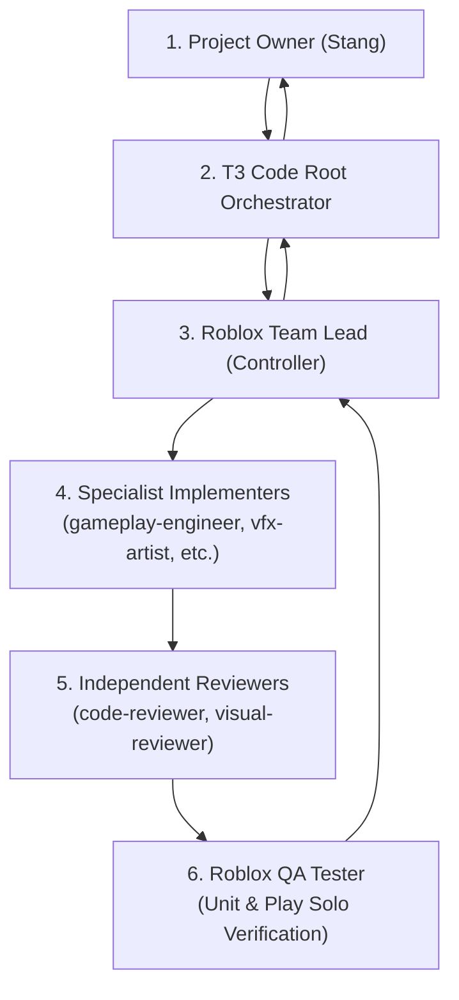
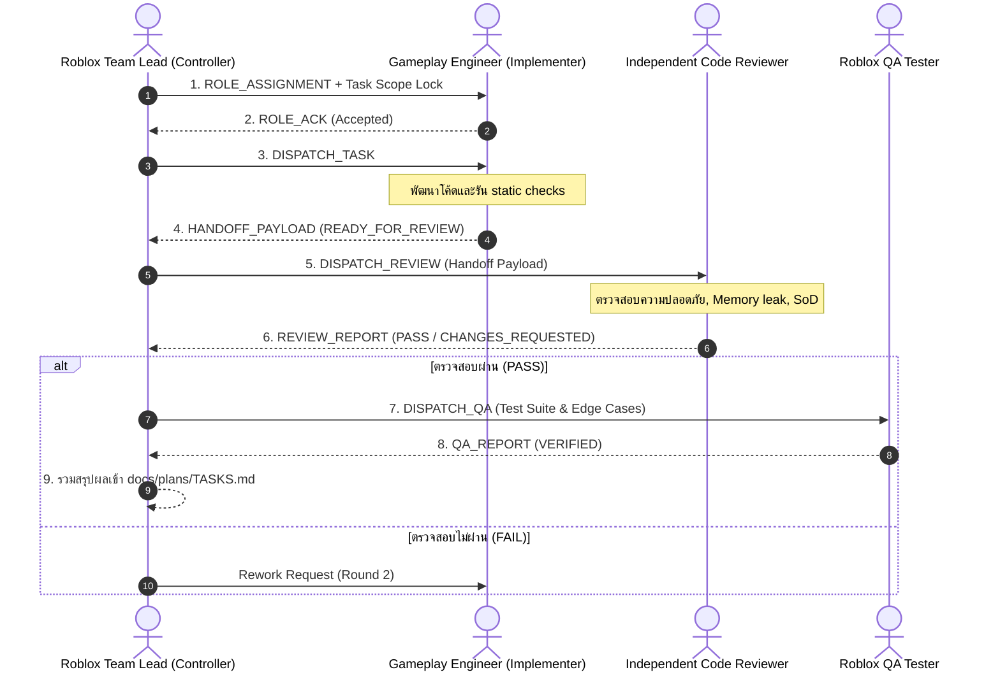
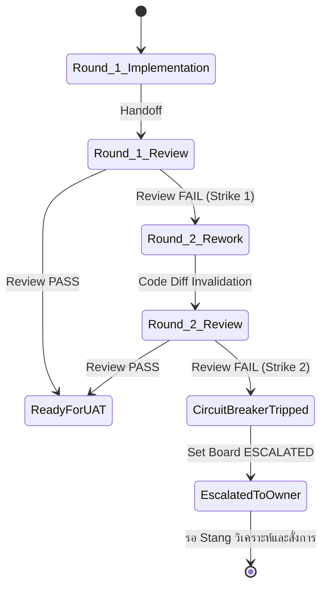

# Hierarchical Multi-Agent Delegation Architecture
**สถาปัตยกรรมการส่งต่องานแบบลำดับชั้นใน T3 Code (Thai & English)**  
**Document ID:** `PLW-WF-002`  
**Governing Project:** `project-last-wave` (`C:\Users\Stang\roblox-game\project-last-wave`)  
**Project Owner:** Stang  

---

## 1. บทนำและโครงสร้างลำดับชั้น (Hierarchical Architecture)

การทำงานในโปรเจกต์ Roblox ขนาดใหญ่ที่มีระบบต่อสู้ (Combat), ระบบแอนิเมชัน R15, เอฟเฟกต์ VFX, และความปลอดภัยบนเครือข่าย จำเป็นต้องมีการแบ่งความรับผิดชอบอย่างชัดเจน สถาปัตยกรรมนี้ใช้โมเดลลำดับชั้นแบบ 4 ชั้น:

---

## 2. การจัดการ Delegation ใน T3 Code (T3 Code Orchestration Mechanics)

### 2.1 Native Subagents เทียบกับ `delegate_task`
ในระบบ T3 Code มีกลไกการส่งต่องานสองรูปแบบหลัก:
1. **Native Subagents (`invoke_subagent`):** ใช้เมื่อ Agent ลูกทำงานภายใต้ Provider และ Model เดียวกันในสภาพแวดล้อมเดียวกัน เหมาะสำหรับการค้นคว้า อ่านไฟล์ หรือทำงานย่อยที่ไม่ต้องการ Workspace แยก
2. **`delegate_task`:** ใช้เมื่อต้องการกระจายงานข้าม Provider/Model, รันงานแบบ Asynchronous ในฉากหลัง, หรือรันงานใน Worktree แยก (`isolation: "worktree"`)
   - **กฎบังคับ:** ต้องเรียก `orchestrator_capabilities` อย่างน้อย 1 ครั้งในแต่ละ Thread ก่อนจะเรียก `delegate_task` แรกเสมอ เพื่อตรวจสอบรายการโมเดลและ Provider ที่พร้อมทำงานจริง

### 2.2 Topologies: Nested Delegation vs Centralized Team Lead Mediation
ระบบรองรับ Topology การส่งต่องาน 2 รูปแบบตามขีดความสามารถของ Runtime:

#### รูปแบบ ก: Direct Peer Sequential Handoff (เมื่อ Runtime รองรับการส่งต่อแบบ Nested)
Implementer สามารถส่งมอบ Payload ไปยัง Independent Reviewer ได้โดยตรงตาม Workflow DAG โดยไม่จำเป็นต้องเด้งกลับไปที่ Root ทุกขั้นตอน

#### รูปแบบ ข: Team-Lead-Mediated Sequential Handoff (เมื่อ Runtime จำกัดไม่ให้ Child Agent สปอว์น Agent ลูก)
ตามข้อกำหนดของ T3 Code: *"If you are a subagent or child, do the work yourself. Start no subagents unless your task says to."*
เมื่อ Child Agent ถูกจำกัดไม่ให้สั่งงาน Agent ซ้อนลงไปอีกชั้น **Roblox Team Lead** จะทำหน้าที่เป็นศูนย์กลางการกระจายงาน (Central Hub):
1. Team Lead เรียก `gameplay-engineer` (Implementer) ทำงานจนเสร็จ
2. Implementer ส่งมอบผลงานกลับมาที่ Team Lead พร้อม Handoff Payload
3. Team Lead ส่งมอบ Payload ต่อไปยัง `independent-code-reviewer`
4. เมื่อ Reviewer อนุมัติ Team Lead ส่งมอบต่อให้ `roblox-qa-tester`

---

## 3. กฎการรวมสิทธิ์หลายเจตนา (Multi-Intent Union Rule)

เมื่อคำสั่งงานมีหลายเจตนาผสมผสานกัน เช่น **"ทำระบบสกิลดาบฟันมีคลื่นดาบ VFX และส่งดาเมจไปยังเซิร์ฟเวอร์"** งานนี้จะตรงกับหลาย Category:
- `gameplay_combat` (`COMBO-RBX-02`)
- `vfx` (`COMBO-RBX-04`)
- `remote_event_damage_authority` (`COMBO-RBX-10`)

**หลักการ Multi-Intent Union:**
1. **รวม Specialist Profiles ทั้งหมด:** ระบบจะดึง `gameplay-engineer` + `vfx-artist` + `security-anti-exploit-specialist` + `independent-code-reviewer` + `roblox-qa-tester` เข้ามาร่วมทีม
2. **ผสาน Mandatory Quality Gates ทั้งหมด:** ต้องผ่านทั้ง `G-ENG-01`, `G-VFX-03`, `RBX-10` (Security), และ `RBX-11` (Performance)
3. **ห้ามตัด Gate ทิ้ง:** ห้ามข้ามขั้นตอนการตรวจความปลอดภัยหรือการตรวจ Reviewer เพียงเพื่อประหยัด Context Window

---

## 4. Single-Writer Lock ในการทำงานร่วมกันหลายคน

เพื่อป้องกันความเสียหายจากการที่ Agent หลายตัวเขียนทับไฟล์เดียวกัน:
- **Disjoint Files Rule:** การรัน Subagent ขนานกัน (Parallel) จะทำได้ **ก็ต่อเมื่อ** รายชื่อไฟล์ที่แต่ละตัวจะแก้ไข (`changed_files`) และ Instance บน Roblox DataModel ไม่ซ้อนทับกันอย่างสิ้นเชิง
- หากมีไฟล์ที่ต้องแก้ไขร่วมกัน (เช่น `src/shared/Configs/CombatConfig.luau`) งานจะต้องถูกจัดคิวให้ทำแบบตามลำดับ (Sequential Execution) เสมอ

---

## 5. วงจรรอบแก้บั๊ก และ 3-Strike Circuit Breaker

1. **Stale Review Invalidation:** เมื่อโค้ดมีการแก้ไขใหม่ในรอบ Rework ผลการตรวจ Reviewer เดิมจะถือว่าโมฆะทันที (`STALE_REVIEW_REQUIRES_RERUN`) และต้องเริ่มตรวจใหม่กับ Working Tree ปัจจุบัน
2. **Circuit Breaker:** หากการแก้บั๊กล้มเหลวครบ 2 รอบ ระบบจะ **ไม่เริ่มรอบที่ 3 เองเด็ดขาด** แต่จะเปลี่ยนสถานะบอร์ดเป็น `ESCALATED` หยุดการสั่งงาน Agent อัตโนมัติทันที และรวบรวมข้อบกพร่องรายงานต่อคุณ Stang
