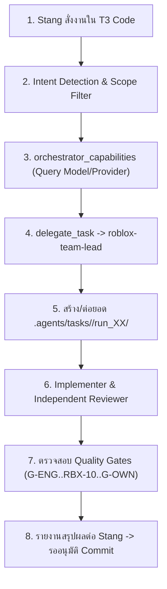

# T3 Code Quickstart Guide: Project Last Wave Multi-Agent Workflow
**คู่มือเริ่มต้นใช้งาน T3 Code Multi-Agent Workflow (Thai & English)**  
**Target Project:** `C:\Users\Stang\roblox-game\project-last-wave`  
**Governing Role:** System Configuration & Contracts (`gemini-3.8-flash`)  
**Project Owner:** Stang  

---

## 1. บทนำและภาพรวมระบบ (Overview & Core Philosophy)

ระบบ Multi-Agent Workflow สำหรับ **Project Last Wave** ออกแบบมาเพื่อควบคุมการพัฒนาเกมบน Roblox (Luau, R15 Rig, VFX, UI, Network Remotes, Studio) อย่างรัดกุม ป้องกันโค้ดชนกัน (Single-Writer Lock) ควบคุมขนาด Context Window ไม่ให้บวม (Single-Board Architecture ตาม `MEM-ADR-0003`) และบังคับให้การตรวจสอบเป็นอิสระต่อกัน (Separation of Duties - SoD)

### กฎเหล็กที่สำคัญที่สุด (Non-Negotiable Guardrails)
1. **Roblox Scope Lock:** ทำงานเฉพาะโปรเจกต์ `project-last-wave` เท่านั้น หากส่งงานนอกสโคป (เช่น React, C#, Next.js) ระบบจะปฏิเสธด้วยรหัส `WORKFLOW_NOT_APPLICABLE` ทันที
2. **Project-First Precedence:** เอกสารในโปรเจกต์ (`AGENTS.md` -> `docs/READ.md` -> `owner-decision-log.md` -> `docs/plans/TASKS.md`) มีสิทธิ์สูงสุดเหนือกว่าค่า Default ของภายนอกเสมอ
3. **No Autonomous Git/Publish:** Agent จะไม่ทำ `git commit`, `git push`, หรือกดเซฟ/พับลิช Place บน Roblox Studio โดยพลการอย่างเด็ดขาด ทุกอย่างจะส่งเป็น Working Tree และรอคำสั่งอนุมัติจากคุณ Stang เท่านั้น

---

## 2. ขั้นตอนการเริ่มงานใน T3 Code (Step-by-Step Task Execution)



### ขั้นตอนที่ 1: การสั่งงานผ่านข้อความปกติ (User Prompting)
คุณ Stang สามารถพิมพ์สั่งงานตามปกติในช่องแชทของ T3 Code ตัวอย่างเช่น:
> *"ช่วยปรับปรุงระบบคอมโบดาบ 3 ฮิต ใน CombatController ให้มี Hitstop 60ms และตรวจสอบ Anti-Exploit บน RemoteEvent ด้วย"*

### ขั้นตอนที่ 2: การตรวจสอบ Runtime Capabilities (`orchestrator_capabilities`)
ก่อนที่ Orchestrator จะเรียก Agent ย่อยผ่าน `delegate_task` ครั้งแรกในแต่ละ Thread ระบบจะเรียกเครื่องมือ:
```json
orchestrator_capabilities()
```
เพื่อตรวจสอบว่า Provider ปัจจุบันมีโมเดลอะไรพร้อมใช้งานบ้าง (เช่น Flash, Pro, Claude, GPT) โดย **จะไม่ Hardcode ชื่อโมเดลลงในคอนฟิก** เพื่อความยืดหยุ่นสูงสุด

### ขั้นตอนที่ 3: การสร้าง Task Directory และ Run Management
ระบบจะสร้างโฟลเดอร์งานแบบ Normalize ชื่อภาษาไทย/อังกฤษให้อ่านง่ายและปลอดภัยบน Windows เช่น:
```
.agents/tasks/sword-combo-3hit/
├── PLAN.md                  # สโคปและขอบเขตงาน
├── TASKS.md                 # Single Board ควบคุมสถานะ (<= 70 บรรทัด)
├── NOTES.md                 # บันทึกทางเทคนิค (< 80 บรรทัด)
├── archive-log.md           # บันทึกประวัติและรายการที่ถูก Compact ออกมา
└── run_01/                  # รอบการรันที่ 1
    ├── evidence/            # เก็บ log เฉพาะตอนรันเทสต์พัง หรือ MicroProfiler
    └── manifest.yaml        # รายการไฟล์ที่แก้พร้อม Checksum
```

> **ข้อสำคัญเรื่อง Run Continuation:**  
> หากคุณ Stang สั่งงานต่อเนื่องในหัวข้อเดิม หรือสั่งแก้บั๊กเดิม ระบบจะไม่สร้างโฟลเดอร์ Task ใหม่ซ้ำซ้อน แต่จะเพิ่มเป็น `run_02/`, `run_03/` ภายใต้โฟลเดอร์ Task เดิม เพื่อประหยัดพื้นที่และรักษาประวัติการทำงานให้เป็นระเบียบ

---

## 3. การควบคุมบอร์ดเดี่ยว (Single Board Governance)

บอร์ดเดี่ยว `TASKS.md` ภายในโฟลเดอร์งานจะประกอบด้วย 4 ส่วนสำคัญ:
1. **Live Turn Banner:** ระบุ Role ที่กำลังทำงาน (`IMPLEMENTER` หรือ `REVIEWER`), สถานะบอร์ด (`IN_PROGRESS`, `REWORK`, `ESCALATED`), และรอบการรัน (`Round 1/2`)
2. **Section 1 (Workstreams):** รายการงานย่อย `T-01`, `T-02`
3. **Section 2 (Active Bug Queue):** รายการข้อบกพร่อง `F-01`, `F-02` ประจำรอบปัจจุบัน (เมื่อแก้และตรวจผ่านแล้วจะถูก Auto-evict ไปยัง `archive-log.md` ทันที)
4. **Section 3 (Verification Gates):** สถานะการตรวจผ่าน Gates ทั้ง 8 ประตู (เช่น `G-ENG-01`, `RBX-10`)
5. **Section 4 (Closure & Commit Plan):** แผน Commit ฉบับร่างและลิงก์ชี้กลับไปยัง Master Board ที่ `docs/plans/TASKS.md`

---

## 4. Quality Gates และการตรวจสอบ (Verification Gates)

| Gate ID | หมวดหมู่ | ข้อกำหนดหลัก | ผู้รับผิดชอบ |
|---|---|---|---|
| **`G-ENG-01`** | Engineering | `selene .` และ `stylua --check .` ผ่าน Exit Code 0, Luau `--!strict` | `independent-code-reviewer` |
| **`G-ANIM-02`**| Animation | Event Marker (HitboxStart, HitboxEnd) บน R15 Rig ตรงตามจังหวะ | `visual-animation-reviewer` |
| **`G-VFX-03`** | VFX & Restraint| `CombatVFXController.luau` ขนาดไฟล์ต้อง **< 199,000 bytes** | `visual-animation-reviewer` |
| **`G-FEEL-04`**| Combat Feel | Hitstop (40-120ms) และ Impulse แรงผลักสมดุล | `game-designer` |
| **`RBX-10`**   | Anti-Exploit | Server-authoritative, ตรวจสอบ `typeof()`, `math.isfinite()`, ระยะทาง | `security-anti-exploit-specialist` |
| **`RBX-11`**   | Performance | Frame compute < 12ms, Heartbeat step < 4ms, คืนหน่วยความจำหมด | `performance-specialist` |
| **`G-VIS-07`** | Visual Review| UI Responsive บน Phone/Tablet/PC และเคารพ Safe Area Insets | `visual-animation-reviewer` |
| **`G-OWN-08`** | Owner Approval| สรุปผลชัดเจน และรอคำสั่งอนุมัติ Commit จากคุณ Stang | `roblox-team-lead` |

---

## 5. การแก้ปัญหาและ Circuit Breaker (Troubleshooting & Circuit Breaker)

### 1. เกิดข้อผิดพลาด `WORKFLOW_NOT_APPLICABLE`
- **สาเหตุ:** มีการสั่งงานเกี่ยวกับเว็บ (React, Next.js) หรือโปรเจกต์อื่นที่ไม่ใช่ Roblox
- **วิธีแก้:** ระบบจะบล็อกงานดังกล่าวเพื่อไม่ให้คอนฟิกของ Roblox ปนเปื้อน

### 2. สถานะขึ้น `ESCALATED` (3-Strike Circuit Breaker Tripped)
- **สาเหตุ:** Implementer ส่งงานแก้บั๊กแล้ว Reviewer ตรวจไม่ผ่านติดต่อกัน 2 รอบ
- **ผลลัพธ์:** ระบบจะตัดการวนลูปอัตโนมัติทันที เพื่อป้องกันการเสีย Token ฟรี และส่งรายงานแจ้งเตือนคุณ Stang เพื่อขอคำตัดสินใจหรือแนวทางแก้ไข

### 3. คำเตือนขนาดไฟล์ `CombatVFXController.luau`
- **สาเหตุ:** โค้ดของโมดูล VFX ใกล้ถึงเพดาน 199,000 bytes
- **วิธีแก้:** แยก Sub-modules หรือ Config ตารางเอฟเฟกต์ออกไปยัง `src/shared/Configs/VFXConfig.luau`
