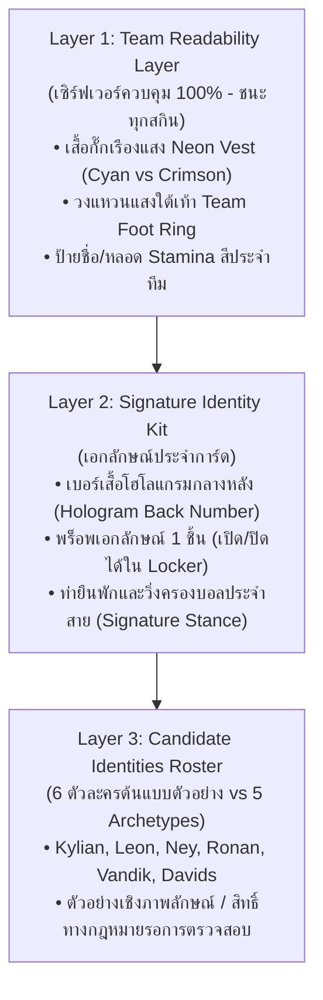
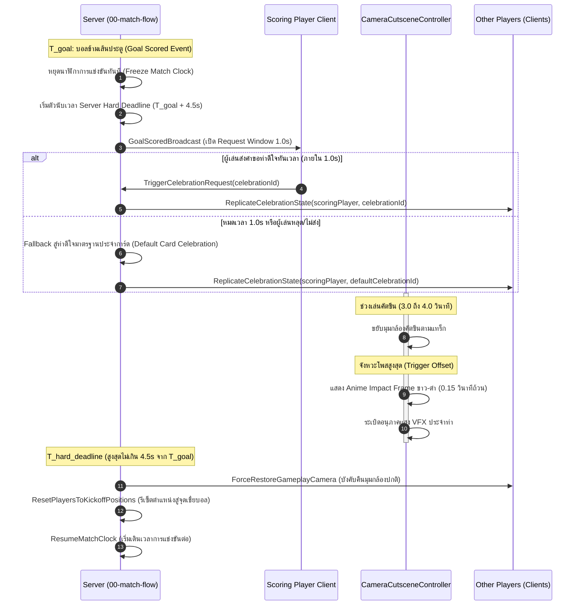

# Cage Zero — Monetization, Visual Identity & Celebration Architecture Spec

- **Task Assignment:** `DOCS-ARCH-20261024` — Foundation Architecture Extension under Plan 00
- **Location:** `docs/plan/phase-01-gameplay-demo/00-bootstrap-and-rig/assets/designs/monetization-identity-celebration.md`
- **Status:** **FOUNDATION ARCHITECTURE SPECIFICATION** (Accepted Owner Directives U4, U7, U8 Integrated; Product & Tuning Proposals Labelled PROPOSED / PENDING; Documentation only; runtime delivery remains `NOT IMPLEMENTED / DEFERRED`)
- **Authority:** Owner Decisions `U4, U7, U8` recorded in [primary HANDOFF](../HANDOFF.md#accepted-owner-decisions-u1u13-override-input-tables) (supersedes conflicting tables in input source `cage-zero-monetization-identity-celebration-spec.md`)
- **Associated Docs:** [upgrade-limit-break.md](./upgrade-limit-break.md), [HANDOFF.md](../HANDOFF.md), [data-schema.md](../../../../../design/data-schema.md), [architecture-and-network.md](../../../../../design/architecture-and-network.md)

---

## 1. Executive Summary & Context

เอกสารฉบับนี้กำหนดสถาปัตยกรรมและกรอบข้อกำหนดสำหรับ 3 ระบบเชื่อมโยงสำคัญของ Cage Zero ภายใต้แผนแม่บท **`00-bootstrap-and-rig`**:
1. **ระบบ Monetization & Starter Pack:** สเปกแพ็กเริ่มต้น การปฏิบัติตามกฎ Paid-Random ของ Roblox และการพักการพิจารณา Gamepass (U4, U7, U8)
2. **ระบบการแสดงเอกลักษณ์นักเตะและการแยกฝั่งทีม (Visual Identity & Team Readability):** การสวมทับ 3 เลเยอร์บน Custom R6 มาตรฐานเดียว เพื่อแยกฝั่งทีม Cyan/Crimson ชัดเจน และแสดงความเท่ของนักเตะ 6 ตัวอย่างต้นแบบโดยไม่ละเมิดลิขสิทธิ์
3. **ระบบสุ่มเอฟเฟกต์และท่าดีใจคัตซีน (3-Category FX Gacha & Celebration Cutscene):** สเปกตู้สุ่ม 3 หมวด, คัตซีนฉลองประตู 3–4 วินาทีพร้อม Anime Impact Frame 0.15 วินาที, และกลไก Signature Sync Bonus เพื่อความเท่โดยไม่บวกค่าพลังในสนาม (Zero Pay-to-Win)

---

## 2. แผนที่การเปรียบเทียบ 4 มิติ (AS-IS vs Source vs TARGET vs Consumer Seams)

| มิติการทำงาน | สภาพโค้ดปัจจุบัน (AS-IS) | ข้อเสนอในเอกสารต้นทาง (Input Source) | กติกาเป้าหมายที่ Owner ยืนยัน (TARGET) | จุดเชื่อมต่อและเกตในอนาคต (Consumer Seams) |
| :--- | :--- | :--- | :--- | :--- |
| **Starter Pack Bundle** | ไม่มีสินค้าหรือแพ็กเติมเงินใน Phase 1 | เสนอขายการ์ด Tier A + เสื้อ Street Rookie Jacket (มี 2 ช่อง Trait + คูณ Cash 1.5x) + ชุด FX + Cash | **แพ็กเกจมีเฉพาะ "การ์ดนักเตะ 1 ใบ + Cash" เท่านั้น**; ตัดเสื้อ Jacket, หิน Trait, และเอฟเฟกต์ลูกบอลออกจาก Bundle (U7) | `02-transactions` ตรวจสอบสถานะ `hasPurchasedStarterPack: boolean` |
| **Gamepasses 4 รายการ** | ไม่มีระบบ Gamepass ในโค้ดปัจจุบัน | เสนอเปิดขาย 4 Gamepasses: VIP Pass, Fast Roll, +5 Presets, Pro Trader 12 ช่อง | **เลื่อนการตัดสินใจ Gamepasses ทั้ง 4 รายการไป Grill เมื่อเริ่มแผนที่เกี่ยวข้อง (U8)**; ไม่เปิดขายหรือรับรองเป็นสิทธิ์ล่วงหน้า | `02-transactions`, `04-collection-and-economy`, `06-market`, `07-meta-ui` |
| **การกำกับดูแล Paid-Random** | ยังไม่มีระบบ Robux หรือ Gacha ในโค้ดปัจจุบัน | สุ่มด้วยเงิน Cash โดยอ้างกฎ Zero Pay-to-Win แต่ไม่มีการเชื่อมต่อ PolicyService | **ต้องตรวจสอบนโยบาย Roblox Paid-Random Items อย่างเคร่งครัด**: หาก Cash ซื้อด้วย Robux ได้ ตู้ Cash จะถือเป็น Paid-Random โดยอ้อม; ต้องเช็ก `PolicyService` | `PolicyService:GetPolicyInfoForPlayerAsync` -> `ArePaidRandomItemsRestricted` |
| **โมเดลผู้เล่นและเอกลักษณ์** | Custom R6 มาตรฐานเดียว, สเกล 4 Presets, ล็อกหน้าอนิเมะ, ไม่โหลด Avatar ผู้เล่น | โครง R6 สเกลความสูงตามการ์ด + เบอร์โฮโลแกรม + พร็อพ 1 ชิ้น + ท่ายืนประจำสาย | **คงโครงสร้าง Custom R6 มาตรฐานเดียว 100%**; สวมทับระบบ 3 เลเยอร์ (Team Bib Overlay + Signature Kit + Candidate Roster); ไม่แก้กระดูก | `RigAndCardService` และ `R6AnimationController` ในแผน 00/02/08 |
| **ตู้สุ่มเอฟเฟกต์ & ท่าดีใจ** | ยังไม่มีระบบเอฟเฟกต์หรือคัตซีนใน Phase 1 | เสนอตู้สุ่ม 3 หมวด (Ball FX, Movement FX, Celebration Cutscene) สุ่มด้วย Cash | **รับรองสเปกตู้สุ่ม 3 หมวดอย่างเป็นทางการ**; ท่าดีใจแสดงผล 3–4 วินาที + Impact Frame 0.15s หลังยิงเข้า; ซิงก์เฉพาะคอสเมติก (Zero P2W) | `00-match-flow` (ช่วงหยุดนาฬิกาแมตช์), `05-effect-gacha`, `07-meta-ui` |

---

## 3. ระบบ Monetization & การปฏิบัติตามกฎ Roblox Policy

### 3.1 Street Legend Starter Bundle (ซื้อได้ 1 ครั้งต่อบัญชี - U4, U7)
- **สิทธิประโยชน์ที่ได้รับ (Accepted Owner Directive U7):**
  1. **การ์ดนักเตะระดับ Tier A จำนวน 1 ใบ:** ได้รับการ์ดนักเตะระดับ Tier A จำนวน 1 ใบถ้วน *(กลไกการเลือกการ์ด เช่น การเลือก 1 จาก 3 สาย หรือการสุ่มจากชุดการ์ดเริ่มต้น จัดเป็น **PROPOSED / PENDING OWNER DECISION**)*
  2. **เงิน `Cash` ตั้งต้น:** จำนวนเงินมาตรฐานสำหรับใช้หมุนเวียนในการซ้อมและซื้อไอเทมพื้นฐาน *(จำนวน Cash ที่แน่นอนจัดเป็น **PENDING ECONOMIC TUNING**)*
- **สิ่งที่ถูกตัดออกตามคำสั่ง Owner อย่างเด็ดขาด (U7):**
  - **ตัดเสื้อแจ็กเก็ต ("Street Rookie Jacket") ออกอย่างถาวร:** ป้องกันการมีช่องใส่ Trait หรือสเตตัสแอบแฝง
  - **ตัดหิน Trait และช่องใส่ Trait บนชุดออก:** รักษาความสอดคล้องกับกติกา No Gear Traits
  - **ตัดชุดเอฟเฟกต์และ Mutations ออก:** ไม่แจกตัวคูณเงิน/EXP นอกเหนือจากระบบการ์ด
- **การควบคุมธุรกรรมทางเทคนิค:**
  - ผูกกับ `MarketplaceService.ProcessReceipt` บน Server แบบ Idempotent
  - บันทึกสถานะ `hasPurchasedStarterPack = true` ใน `PlayerProfileData` บน Datastore เพื่อป้องกันการซื้อซ้ำ 100%

### 3.2 รายการ Gamepasses ที่เลื่อนการตัดสินใจ (Deferred for Grill - U8)
รายการด้านล่างถูกบันทึกเป็น **ข้อเสนอดราฟต์ทางประวัติศาสตร์ (Labelled Historical Proposals)** โดยยังไม่เปิดใช้งานและรอการ Grill เมื่อเริ่มแผนงานจริง:
1. `VIP Cage Pass` (ข้อเสนอคูณเงิน/EXP 1.5x + ป้ายชื่อสีทอง) — *รอเปิด Grill ในแผน 02/04*
2. `Fast Roll & Multi-Summon (x3 / x5)` (ข้อเสนอสุ่มพร้อมกันและข้ามคัตซีน) — *รอเปิด Grill ในแผน 02/07*
3. `Tactical Loadout Slots (+5 Presets)` (ข้อเสนอขยายช่อง Preset สลับ Deck จาก 2 เป็น 7 ช่อง) — *รอเปิด Grill ในแผน 04/07*
4. `Pro Trader Booth` (ข้อเสนอขยายแผงตลาดจาก 6 เป็น 12 ช่อง) — *รอเปิด Grill ในแผน 06/07*

### 3.3 การปฏิบัติตามนโยบาย Roblox Paid-Random & Paid-Item Trading Policy (A-03 Compliance)
ตามข้อกำหนดอย่างเป็นทางการของ Roblox ([Paid Random Items Policy](https://create.roblox.com/docs/production/monetization/paid-random-items) และ [PolicyService API](https://create.roblox.com/docs/reference/engine/classes/PolicyService)):

1. **นิยามทางเศรษฐกิจ (Indirect Paid-Random & Paid-Item Scope):**
   - แม้ตู้สุ่ม (Gacha) จะเปิดด้วยเงินในเกม (`Cash`) แต่หากในเกมมีช่องทางนำเงินจริง (`Robux`) มาซื้อ Cash หรือตั๋วสุ่มได้ ตู้สุ่มนั้นจะถูกจัดเป็น **Paid-Random Item System** ตามกฎหมายและนโยบายของ Roblox ทันที
   - **ขอบเขตนโยบายการแลกเปลี่ยนไอเทมที่ได้จากเงินจริง (Paid-Item Trading Scope):** ครอบคลุมไอเทมทุกชิ้นที่ได้มาจากการใช้ Robux หรือเงินจริง ไม่จำกัดเฉพาะ Paid Gacha เท่านั้น แต่รวมถึง `StarterPack`, `DirectRobuxPurchase`, และไอเทมใดๆ ที่มีประวัติการได้มาเกี่ยวข้องกับเงินจริงตามโมเดล `ItemProvenance`
2. **การตรวจสอบสิทธิ์รายผู้เล่นแบบอิสระ 2 ด้าน (Two Independent Policy Gates):**
   - ก่อนการทำธุรกรรมหรือแสดงผลหน้าจอ UI เซิร์ฟเวอร์ต้องเรียกคำสั่ง `PolicyService:GetPolicyInfoForPlayerAsync(player)` เพื่อตรวจเช็กเกตอิสระ 2 ตัว:
     - **เกตที่ 1: การซื้อ/สุ่มไอเทม (`ArePaidRandomItemsRestricted`):** ควบคุมสิทธิ์การเข้าถึงตู้สุ่ม หากเป็น `true` (ผู้เล่นอยู่ในประเทศที่ควบคุมการสุ่ม เช่น เนเธอร์แลนด์ เบลเยียม หรือบัญชีที่ถูกจำกัด) **ระบบต้องปิดกั้นหรือซ่อนตู้สุ่มที่ใช้ Robux/Cash ที่ได้จาก Robux ทันที** *(ข้อเสนอทางเลือก เช่น Direct Purchase หรือ Battle Pass ถือเป็น **PROPOSALS** เพื่อการรองรับทางกฎหมาย)*
     - **เกตที่ 2: การแลกเปลี่ยน/ตั้งขาย (`IsPaidItemTradingAllowed` - Independent Gate):** ควบคุมสิทธิ์การแลกเปลี่ยนไอเทมที่ได้จากเงินจริง หากผู้เล่นมี `policyInfo.IsPaidItemTradingAllowed == false` เซิร์ฟเวอร์ต้องบล็อกการทำธุรกรรมไอเทม Paid-Item ทันที
3. **การบังคับใช้เกตนโยบายการเทรดครอบคลุมทุกฝ่ายและทุกช่องทาง (Comprehensive Live Trading Enforcement):**
   - **การเทรดแบบส่งต่อระหว่างผู้เล่น (P2P Trading):** Server จะต้องตรวจเช็ก `PolicyService` ของ **ผู้เล่นทั้งสองฝ่าย (Both Sender AND Receiver)** หากฝ่ายใดฝ่ายหนึ่งมี `IsPaidItemTradingAllowed == false` ธุรกรรมการแลกเปลี่ยนที่มีไอเทม Paid Items จะต้องถูกปฏิเสธทันที
   - **การซื้อขายผ่านตลาด/แผงค้า (Market Booth / Auction):**
     - ฝั่งผู้ขาย: ตรวจสอบ ณ เวลาตั้งแผง (`Listing Time`) หาก `IsPaidItemTradingAllowed == false` จะไม่อนุญาตให้นำไอเทม Paid Items ขึ้นวางขาย
     - ฝั่งผู้ซื้อ: ตรวจสอบ ณ เวลาสั่งซื้อ (`Purchase Time`) หากผู้ซื้อมี `IsPaidItemTradingAllowed == false` จะไม่อนุญาตให้ซื้อไอเทม Paid Items จากตลาด
   - **การตรวจเช็กสิทธิ์สดห้ามทดแทนด้วยค่าคงที่ (Live Check Mandatory):** ค่าแฟล็ก `isTradeable` ที่บันทึกค้างไว้ในตัวไอเทมเป็นเพียงสถานะสถิติของไอเทม (เช่น ไอเทมผูกมัดบัญชี) **ไม่สามารถนำมาใช้ทดแทนการตรวจเช็กสิทธิ์จริงจาก `PolicyService` ของผู้เล่น ณ เวลาทำธุรกรรมได้**
4. **การจัดการข้อผิดพลาดแบบปิดกั้นทันที (Fail-Closed Error Handling):**
   - หากการเรียก `PolicyService:GetPolicyInfoForPlayerAsync` ล้มเหลว, หมดเวลา (Timeout), หรือคืนค่าข้อผิดพลาด ระบบต้อง **ปฏิบัติตามหลัก Fail-Closed ทันที** (สันนิษฐานว่าถูกจำกัดสิทธิ์ไว้ก่อน: ปิดการเข้าถึง Paid Gacha และปิดการเทรด Paid Items ชั่วคราว) จนกว่าจะดึงค่า Policy สำเร็จ
5. **การเปิดเผยอัตราการสุ่มอย่างโปร่งใส (Mandatory Odds Disclosure):**
   - ต้องแสดงปุ่มตรวจสอบเรต (`Probability Table`) ที่ระบุตัวเลขเปอร์เซ็นต์จริงอย่างชัดเจนบนหน้าจอ UI ทุกตู้สุ่ม ก่อนที่ผู้เล่นจะกดจ่ายเงิน/ตั๋ว
6. **นโยบายการแลกเปลี่ยนระดับผลิตภัณฑ์ (Product Trading Policy Status):**
   - การตรวจสอบเกต `IsPaidItemTradingAllowed` ฝั่ง Server เป็นเกตบังคับตามระเบียบ Roblox
   - ข้อเสนอเพิ่มเติมที่ให้ *แบนการเทรดไอเทมที่ได้จากเงินจริงทั้งหมดทุกกรณี (Blanket Trade Ban)* จัดเป็น **PROPOSED PRODUCT CHOICE** รอการตัดสินใจจาก Owner ในแผนระบบเศรษฐกิจ

---

## 4. ระบบการแสดงเอกลักษณ์นักเตะและการแยกฝั่งทีม (3-Layer Visual Identity System)

เกมใช้โครงสร้างกระดูก **Single Standard Custom R6** เดียวกันทั้งเกม โดยปรับความสูง/ความกว้างตามการ์ด (`0.92`, `0.98`, `1.03`, `1.08`) และแสดงผลผ่านระบบ 3 เลเยอร์ดังนี้:



### 4.1 เลเยอร์ที่ 1: การแยกฝั่งทีมในสนาม (`Team Readability Layer` - ลำดับความสำคัญสูงสุด)
- **เสื้อกั๊กสตรีทเรืองแสงประจำทีม (`Neon Team Vest / Bib Overlay`):** สวมทับช่วงลำตัว (`Torso`) อัตโนมัติเมื่อเข้าสู่สนามแข่งขันจริง แยกสีชัดเจนระหว่าง:
  - **Team A:** สีฟ้าสว่างนีออน (**Cyan Neon** - `Color3.fromRGB(0, 230, 255)`)
  - **Team B:** สีแดงเพลิงนีออน (**Crimson Neon** - `Color3.fromRGB(255, 30, 60)`)
- **วงแหวนแสงใต้เท้าและป้ายผู้เล่น (`Team Foot Ring & Indicator`):**
  - แสดงวงแหวนแสงสีทีมแนบระนาบพื้นสนาม (`CageFloor` surface) ใต้เท้าผู้เล่น
  - ป้ายชื่อและหลอด Stamina เหนือศีรษะแสดงขอบสีประจำทีม
- **กฎการเรนเดอร์:** เลเยอร์นี้ควบคุมจาก Server และมีความสำคัญเหนือกว่าเสื้อผ้าแฟชั่นใดๆ เพื่อให้ผู้เล่นอ่านเกมและจ่ายบอลได้ทันทีในเสี้ยววินาที

### 4.2 เลเยอร์ที่ 2: ชุดเอกลักษณ์ประจำการ์ดนักเตะ (`Signature Identity Kit`)
- **เบอร์เสื้อและตราสัญลักษณ์โฮโลแกรมกลางหลัง (`Hologram Back Number & Emblem`):**
  - แสดงตัวเลขเรืองแสงแบบ 3D ลอยอยู่ด้านหลังเสื้อ (`Torso.BackAttachment`) ปรับขนาดและสีตามธีมการ์ด (เช่น `#10`, `#07`, `#09`, `#04`, `#08`, `#11`)
  - เมื่อการ์ดตีบวกถึงขั้น `+4` ตัวเลขจะเปลี่ยนเป็นโฮโลแกรมเคลื่อนไหว (`Animated Hologram`) พร้อมออร่าเรืองแสงที่หัวไหล่
- **พร็อพเอกลักษณ์ประจำการ์ด 1 ชิ้น (`Signature Accessory Toggle`):**
  - แต่ละการ์ดมีพร็อพเสริมประจำตัว 1 ชิ้นที่แนบเข้ากับชิ้นส่วน R6 (เช่น `Head` หรือ `Right Arm`)
  - ผู้เล่นสามารถเลือกเปิด/ปิด (`Toggle ON/OFF`) การแสดงผลพร็อพนี้ได้ในหน้า Locker
- **ท่ายืนพักและท่าวิ่งครองบอลประจำสาย (`Signature Stance`):**
  - ปรับคลิปแอนิเมชัน R6 ให้สะท้อนบุคลิกของนักเตะต้นแบบ (เช่น ท่าวิ่งหลังตรงกางแขนเล็กน้อย หรือท่าเลี้ยงก้มตัวซอยเท้าถี่) ภายใต้สถาปัตยกรรม `R6AnimationController` โดยไม่กระทบความเร็วเคลื่อนที่หรือ Hitbox ฟิสิกส์

### 4.3 เลเยอร์ที่ 3: กฎการตั้งชื่อหลบลิขสิทธิ์และ 6 ตัวละครต้นแบบ (Illustrative Candidate Roster - A-05 Compliance)
- **กฎเหล็กเพื่อการออกแบบสไตล์ Homage (Homage Naming Rules):**
  - ห้ามใช้ชื่อ-นามสกุลจริงของนักเตะ
  - ห้ามใช้ชื่อเล่นที่เป็นเครื่องหมายการค้าจดทะเบียน (เช่น `CR7`, `R9`, `LM10`)
  - ห้ามใช้ตราสัญลักษณ์สโมสรฟุตบอล ทีมชาติ หรือแบรนด์สินค้าจริง (เช่น `Nike`, `Adidas`, `Puma`)
  - ห้ามใช้ไฟล์เสียงพากย์หรือเสียงพูดจริงของนักฟุตบอล
- **ตาราง 6 ตัวละครต้นแบบตัวอย่าง (Illustrative Candidate Examples) เทียบกับ 5 Archetypes:**

| สายตัวละคร (5 Archetypes) | ชื่อการ์ดต้นแบบในเกม (6 ตัวเลือกตัวอย่าง) | แรงบันดาลใจ | สเกล R6 ตัวอย่าง | เบอร์โฮโลแกรม | พร็อพเอกลักษณ์ (1 ชิ้น) | ท่าโพส/บุคลิกในสนาม |
| :--- | :--- | :--- | :--- | :--- | :--- | :--- |
| **1. Speedster Striker** | **Kylian "Mach Shadow"** | เอ็มบัปเป้ / วินิซิอุส | `0.98` | `#09` นีออนม่วง | หน้ากากคาร์บอนครึ่งหน้าสีดำ | สปรินต์ก้มตัวต่ำ ซอยเท้าถี่ วิ่งตัดแนวรับ |
| **2. Cage Playmaker** | **Leon "Phantom Goat"** | ลิโอเนล เมสซี่ | `0.92` | `#10` ฟ้า-ทอง | ผ้าคาดผมสตรีทสีขาว | เลี้ยงบอลติดเท้า สับขาหลบในพื้นที่แคบ |
| **2. Cage Playmaker** | **Ney "Samba Crown"** | เนย์มาร์ จูเนียร์ | `0.98` *(ดูคำอธิบาย)* | `#11` เหลือง-เขียว | ผ้าคาดหัวสตรีทบราซิลเลียน | โยกคลึงบอล ลีลาแซมบ้า พักบอลจังหวะสอง |
| **3. Power Target** | **Ronan "Sky Sovereign"** | คริสเตียโน โรนัลโด้ | `1.03` | `#07` แดง-ทอง | เทปพันข้อมือสีขาวสไตล์นักสู้ | อกผาย ยืนปักหลักหน้ากรอบ โหม่งทรงพลัง |
| **4. Iron Stopper** | **Vandik "Iron Colossus"** | เวอร์จิล ฟาน ไดจ์ค | `1.08` | `#04` ส้มเหล็กไหล | สนับไหล่โฮโลแกรมข้างเดียว | ยืนคุมเชิงนิ่ง บล็อกทางยิง เข้าปะทะหนักแน่น |
| **5. Sweeper Destroyer** | **Davids "Neon Pitbull"** | เอ็ดการ์ ดาวิดส์ / ก็องเต้ | `1.03` | `#08` เขียวมรกต | แว่นตากันลมสปอร์ต (Sports Goggles) | วิ่งไล่ล่าไม่หยุด กัดติดผู้ถือบอล สไลด์กวาด |

> [!WARNING]
> **คำอธิบายเรื่องสเกลและข้อจำกัดทางกฎหมาย (A-05 Compliance Disclaimers):**
> 1. **คำอธิบายสเกลของ Ney (`0.98` vs `0.92`):** ในเดโม Plan 00 เดิม ค่า Preset ของ Ney_TierA ถูกกำหนดไว้ที่ `0.98` (ขณะที่ Leon_TierB อยู่ที่ `0.92`) ในขณะที่เอกสาร Archetype จัด Playmaker ไว้ที่ช่วง 0.92 สเกลที่ระบุในตารางนี้เป็น **ตัวอย่างเชิงภาพลักษณ์ (Illustrative Concept)** เพื่อสะท้อนความคล่องตัวแบบแซมบ้า การกำหนดสเกลและสเตตัสการ์ดจริงจะอิงตามการอนุมัติ Roster ขั้นสุดท้าย
> 2. **สถานะความปลอดภัยทางทรัพย์สินทางปัญญา (IP Legal Disclaimer - A-05 Compliance):** ตัวละครทั้ง 6 ตัวเป็นเพียง **กรณีศึกษาตัวอย่างเพื่อการออกแบบสถาปัตยกรรม (Illustrative Architectural Examples)** เท่านั้น ระบบไม่มีการให้คำรับรองความปลอดภัยทางกฎหมายใดๆ ทั้งสิ้น สิทธิ์ในชื่อ รูปลักษณ์ และเครื่องหมายการค้าถือเป็นประเด็นที่ยังไม่ได้รับการตรวจรับรอง (Unresolved Rights) ซึ่งจะต้องผ่านการตรวจสอบจากที่ปรึกษาทางกฎหมายจริงก่อนการพัฒนาหรือเปิดวางจำหน่าย

---

## 5. ระบบสุ่มเอฟเฟกต์ & ท่าดีใจ Cutscene Impact Frame (3-Category FX Gacha)

### 5.1 โครงสร้าง 3 หมวดในตู้สุ่ม `05-effect-gacha`
ผู้เล่นสามารถเลือกตู้สุ่มเฉพาะหมวดที่ต้องการได้ โดยใช้เงิน `Cash` ในเกม:
1. **หมวดที่ 1 — ชุดเอฟเฟกต์ลูกบอล (`Ball Action FX Set`):**
   - ปลดล็อก 1 ชุด จะแสดงผลครอบคลุมทั้ง **ยิงตรง (Direct Shot) + ยิงโค้ง (Curve Shot) + ส่งบอล (Pass)** เช่น ธีมลูกไฟเพลิงทมิฬ, คลื่นสายฟ้านีออน, มิติดำมืด Void
2. **หมวดที่ 2 — ชุดเอฟเฟกต์การเคลื่อนที่ (`Movement FX Set`):**
   - ปลดล็อก 1 ชุด จะแสดงผลครอบคลุมทั้ง **วิ่ง Sprint + กระโดด Directional Jump + ใช้ท่า Skill Move** เช่น รอยเท้าเรืองแสงบนพื้นสนาม, คลื่นกระแทกตอนกระโดด, ภาพเงาติดตา (Afterimage)
3. **หมวดที่ 3 — ท่าดีใจพร้อมคัตซีนอนิเมะ (`Signature Celebration & Impact Cutscene`):**
   - สวมใส่เพื่อแสดงผลฉลองหลังทำประตูสำเร็จในช่วงหยุดเวลาของแมตช์

### 5.2 กลไกและลำดับเวลาคัตซีนท่าดีใจหลังยิงประตู (Celebration Timeline & Deadline Origin - A-06 Compliance)
การแสดงผลท่าดีใจถูกกำหนดจุดเริ่มต้น จุดสิ้นสุด และการกู้คืนสถานะเกมอย่างเข้มงวดภายใต้อำนาจของ Server (`00-match-flow`) เพื่อให้สอดคล้องกันทุกมุมมองและป้องกันไม่ให้กระทบเวลาการแข่งขันจริง:



- **จุดเริ่มต้นของเส้นเวลา (Deadline Origin):** เส้นเวลาทั้งหมดเริ่มต้นขึ้น ณ วินาทีที่ลูกบอลข้ามเส้นประตู (**`T_goal`**) โดยโมดูล `00-match-flow` ของ Server ทำหน้าที่เป็นผู้ควบคุมเวลาและนาฬิกาแมตช์แต่เพียงผู้เดียว
- **ข้อกำหนดความยาวคัตซีนและ Impact Frame (Accepted Constants):**
  - ระยะเวลาการเล่นคัตซีน: **`3.0 ถึง 4.0 วินาที`** ตามสัญญาที่ยอมรับแล้ว
  - ระยะเวลา Anime Impact Frame: **`0.15 วินาทีถ้วน`** ณ ตำแหน่งเวลา `impactFrameTriggerOffsetSec`
- **ความสัมพันธ์เชิงคณิตศาสตร์และข้อจำกัดเวลา (Timing Arithmetic & Constraints - A-06 Compliance):**
  - เวลาการเล่นรวมนับจากทำประตูคือ:
    $T_{\text{elapsed}} = t_{\text{req\_delay}} + t_{\text{cutscene}}$
  - หากยอมให้ Client มีเวลาส่งคำขอ $t_{\text{req\_delay}} = 1.0\text{s}$ และคัตซีนมีความยาว $t_{\text{cutscene}} = 4.0\text{s}$ เวลาสิ้นสุดจะอยู่ที่ **$T_{\text{goal}} + 5.0\text{ วินาที}$** ซึ่งจะ **เกินเส้นตาย 4.5 วินาที** หากกำหนดเส้นตายตายตัวไว้ที่ 4.5s
  - ดังนั้น เพื่อรักษาสัญญาคัตซีน 3.0–4.0s และ Impact Frame 0.15s ให้คงอยู่ครบถ้วนโดยไม่ถูกตัดทอนกลางคัน ระบบนำเสนอ **ทางเลือกเชิงสถาปัตยกรรม (Architectural Alternatives - PROPOSED PENDING OWNER SELECTION)** ดังนี้:

  1. **ทางเลือกที่ 1 — ขยายเส้นตาย Server Dynamic Deadline เพดานสูงสุด 5.0s (PROPOSED):**
     - กำหนดให้ Server คำนวณเส้นตายแบบผันแปร: $T_{\text{deadline}} = T_{\text{goal}} + t_{\text{req\_actual}} + t_{\text{cutscene}}$ (โดยมีเพดานสูงสุดไม่เกิน **`5.0 วินาทีจาก T_goal`**)
     - ข้อดี: ทำให้เล่นคัตซีน 3.0–4.0s จบสมบูรณ์ทุกท่า ไม่มีการตัดภาพกระตุก ไม่ว่าจะส่งคำขอที่ 0.1s หรือ 1.0s
  2. **ทางเลือกที่ 2 — บีบหน้าต่างคำขอให้สั้นลงเหลือ 0.5s ภายใต้เส้นตายตายตัว 4.5s (PROPOSED):**
     - กำหนดหน้าต่างคำขอ Client สั้นลงเป็น **`ไม่เกิน 0.5 วินาที`** จาก `T_goal`
     - หาก $t_{\text{req}} \le 0.5\text{s}$ และคัตซีนสูงสุด 4.0s เวลารวม $0.5\text{s} + 4.0\text{s} = 4.5\text{s}$ จะพอดีกับ Hard Deadline **`4.5 วินาทีจาก T_goal`** อย่างสมบูรณ์
  3. **ทางเลือกที่ 3 — ใช้ระบบ Server Pre-selection ทันทีไม่ต้องรอ Client Request (PROPOSED):**
     - Server ทราบท่าดีใจที่ผู้เล่นสวมใส่อยู่แล้วใน `PlayerProfileDataExtension.equippedGoalCelebrationId` ดังนั้นเมื่อลูกเข้าประตู Server จะสั่งเล่นท่าดีใจทันทีที่ `T_goal` ($t_{\text{req}} = 0$)
     - คัตซีนจะจบลงที่ 3.0–4.0s พอดี และรีเซ็ตสู่จุดเขี่ยบอลภายใน 4.0–4.5s โดยไม่ต้องรอข้อความเครือข่ายจาก Client
  4. **ทางเลือกที่ 4 — ตัดจบหรือเร่งความเร็วแอนิเมชันแบบเกรซฟูล (Graceful Truncation / Speedup - PROPOSED):**
     - หาก Client ตอบสนองช้าเกินเกณฑ์แต่ยังต้องการเส้นตายตายตัว 4.5s คัตซีนจะทำการ Blend-out สู่มุมกล้องปกติอย่างนุ่มนวลก่อนถึง 4.5s

- **นโยบายการจัดการกรณีไม่ตอบสนองหรือหลุด (Fallback Policy - PROPOSED):**
  - หาก Client ไม่ส่งคำขอภายในหน้าต่างเวลาที่เลือก หรือผู้เล่นหลุดการเชื่อมต่อ Server จะสลับใช้ท่าดีใจมาตรฐานของการ์ด (Default Card Celebration) ทันที หรือข้ามคัตซีนเข้าสู่จุดเขี่ยบอล (ตัวเลือก Fallback จัดเป็น **PROPOSED BEHAVIOR**)
- **ประเด็นเชิงผลิตภัณฑ์ที่ยังเปิดอยู่ (Unresolved Choices - PROPOSED/PENDING):**
  - นโยบายการข้ามคัตซีน (การกดยืนยัน Skip) และมุมกล้องของคู่ต่อสู้/ผู้ชม จัดเป็น **PROPOSED OPTIONS** รอการ Grill ในแผนระบบแมตช์

---

### 5.3 กลไกการจับคู่เพื่อความเท่ (`Signature Sync Bonus` — Cosmetic Only)
ท่าดีใจทุกท่าสามารถนำไปใส่กับตัวละครใดก็ได้ แต่เมื่อนำไปใส่คู่กับ **"ตัวละครคู่บุญ"** ที่ตรงกัน จะได้รับเอฟเฟกต์พิเศษทางสายตา (`Awakened Sync Visual`) โดย **ไม่เพิ่มค่าสเตตัสในสนามเด็ดขาด (Zero Pay-to-Win)**:

| ชื่อท่าดีใจ (Celebration ID) | ลักษณะคัตซีนและจังหวะ Impact Frame | ตัวละครคู่บุญ (`Signature Sync`) | เอฟเฟกต์พิเศษเมื่อใส่ตรงคู่ (`Awakened Sync Visual`) |
| :--- | :--- | :--- | :--- |
| **`SovereignLanding`** | กระโดดหมุนตัวกลางอากาศ เท้ากระแทกพื้นตัดเข้า Impact Frame พื้นสนามแตกร้าว | **Ronan "Sky Sovereign"** | สายฟ้าสีแดง-ทองผ่าลงกลางหลัง พร้อมป้ายฉายาโฮโลแกรม *"THE SOVEREIGN"* |
| **`CelestialPoint`** | แพนกล้องเสยขึ้นฟ้า ชูสองนิ้วขึ้นฟ้า ลำแสงสีทองส่องลงมาในจังหวะ Impact Frame | **Leon "Phantom Goat"** | ปรากฏเงาดวงตาราชันย์สีทองเรืองแสงด้านหลัง และละอองดาวระยิบระยับรอบตัว |
| **`ZeroDegreeFold`** | สไลด์เข่าเข้ามาหน้ากล้อง กอดอกเชิดหน้า Impact Frame พร้อมเกล็ดน้ำแข็งนีออน | **Kylian "Mach Shadow"** | หน้ากากคาร์บอนเรืองแสงสีม่วง และเกิดรอยแยกมิติสีครามด้านหลังลำตัว |
| **`SambaSpotlight`** | โยกสเต็ปแซมบ้าแล้วโพสท่าชูมือ Impact Frame พร้อมพลุกราฟฟิตี้สีสันสดใส | **Ney "Samba Crown"** | พื้นใต้เท้าเปลี่ยนเป็นฟลอร์เต้นรำนีออน พร้อมมงกุฎแสงลอยเหนือศีรษะ |
| **`ColossusWall`** | ลอยตัวกางแขนรับแรงปะทะ Impact Frame พร้อมคลื่นพลังงานรูปหกเหลี่ยม | **Vandik "Iron Colossus"** | กำแพงป้อมปราการโฮโลแกรมยักษ์สีส้ม-ดำตั้งตระหง่านด้านหลังตัวละคร |

---

## 6. โครงสร้างข้อมูลสถาปัตยกรรม (Canonical Schema Extensions - A-04 Compliance)

```luau
-- หมวดหมู่ของคอสเมติกเอฟเฟกต์
export type CelebrationCategory = "GoalCelebration" | "BallAction" | "Movement"

-- โครงสร้างข้อมูลท่าดีใจในแคตตาล็อก (Canonical Celebration Definition)
export type CelebrationDefinition = {
    celebrationId: string,              -- เช่น "SovereignLanding", "CelestialPoint"
    displayName: string,
    category: CelebrationCategory,
    rarity: "Common" | "Rare" | "Epic" | "Legendary",
    
    -- การกำหนดเวลา (A-04 & A-06 Compliance: แยก Duration ออกจาก Offset อย่างชัดเจน)
    cutsceneDurationSec: number,        -- ระยะเวลาคัตซีนรวม: 3.0 ถึง 4.0 วินาที
    impactFrameDurationSec: number,     -- ระยะเวลา Impact Frame: 0.15 วินาทีถ้วน
    impactFrameTriggerOffsetSec: number,-- วินาทีที่ตัดเข้า Impact Frame นับจากเริ่มคัตซีน
    
    signatureCharacterId: string?,      -- รหัสตัวละครคู่บุญสำหรับปลดล็อก Signature Sync Bonus
    animationClipId: string,            -- แอนิเมชันท่าร่าง R6 ของตัวละคร
    cameraTrackAnimationId: string?,    -- แอนิเมชันสำหรับขยับมุมกล้อง
    vfxId: string?,                     -- รหัสเอฟเฟกต์อนุภาค
    sfxId: string?,                     -- รหัสเสียงประกอบคัตซีน
}

-- ข้อมูลคลังไอเทมและโปรไฟล์ผู้เล่นส่วนขยาย (Persistent Profile Extension)
export type PlayerProfileDataExtension = {
    -- บันทึกสถานะการซื้อ Starter Bundle (ซื้อได้ครั้งเดียวตาม U7)
    hasPurchasedStarterPack: boolean,
    
    -- เศษการ์ดสำหรับ Limit Break (หมายเหตุ: อัตราแปลง Duplicate เป็น Shard เป็น PENDING GRILL)
    cardShards: { [characterId: string]: number },
    
    -- คลังเอฟเฟกต์และท่าดีใจที่ครอบครอง
    ownedCelebrationIds: { string },
    equippedBallActionFxId: string?,
    equippedMovementFxId: string?,
    equippedGoalCelebrationId: string?,
    
    -- พร็อพเอกลักษณ์ที่เปิดใช้งาน (Locker Toggle)
    signatureAccessoryEnabled: boolean,
    
    -- ข้อมูลการจัดทีมและ Preset (PROPOSED: ความจุช่องและเงื่อนไขปลดล็อกรอ Grill แผน 04/07)
    activeLoadoutPresetIndex: number,
}
```

---

## 7. สถานะการตัดสินใจและการกำกับดูแล (Governance Matrix)

| หัวข้อการออกแบบ | สถานะการตัดสินใจ | คำอธิบายและแนวทาง |
| :--- | :--- | :--- |
| **องค์ประกอบ Starter Bundle** | **ACCEPTED (U7)** | ได้การ์ด 1 ใบ + Cash เท่านั้น; ตัดเสื้อ Jacket/Mutation/FX ออกทั้งหมด |
| **สถานะ Gamepasses 4 รายการ** | **DEFERRED FOR GRILL (U8)** | พักการตัดสินใจ Gamepasses ทั้ง 4 ตัวไว้ก่อน รอ Grill เมื่อเปิดแผนงานจริง |
| **การกำกับ Roblox Paid-Random** | **ACCEPTED SEAM** | บังคับเชื่อมโยง `PolicyService` ตรวจสิทธิ์ และเปิดเผยเรตสุ่มอย่างโปร่งใส |
| **ระบบแยกฝั่งทีม 3 เลเยอร์** | **ACCEPTED TARGET** | เสื้อกั๊ก Cyan/Crimson ชนะสกิน; เบอร์โฮโลแกรม + พร็อพ 1 ชิ้น; สเกล 4 Presets คงเดิม |
| **รายชื่อ 6 ตัวละครต้นแบบ** | **ILLUSTRATIVE PROPOSAL** | เป็นชุดตัวอย่างเพื่อการออกแบบสถาปัตยกรรม ไม่ใช่แคตตาล็อกสุดท้าย; สิทธิ์เครื่องหมายการค้ายังไม่รับรอง ต้องผ่านการตรวจทางกฎหมาย |
| **ระบบสุ่ม 3 หมวดและคัตซีน** | **ACCEPTED TARGET** | สุ่ม Ball FX, Movement FX, Celebration; คัตซีน 3–4s + Impact Frame 0.15s; Sync เพื่อความเท่ |
| **การแลกเปลี่ยนเอฟเฟกต์และท่าดีใจ** | **ACCEPTED TARGET** | ไม่มีระบบ P2P สำหรับเอฟเฟกต์/ท่าดีใจ; ของซ้ำตั้งขายแผง Cash หรือย่อยเป็นแต้มแลก |
