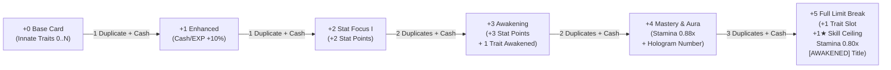

# Cage Zero — Upgrade & Limit Break Architecture Spec (`+0` to `+5` Awakening & Stamina Pipeline)

- **Task Assignment:** `DOCS-ARCH-20261024` — Foundation Architecture Extension under Plan 00
- **Location:** `docs/plan/phase-01-gameplay-demo/00-bootstrap-and-rig/assets/designs/upgrade-limit-break.md`
- **Status:** **FOUNDATION ARCHITECTURE SPECIFICATION** (Accepted Owner Directives U1–U13 Integrated; Product & Tuning Proposals Labelled PROPOSED / PENDING; Documentation only; runtime delivery remains `NOT IMPLEMENTED / DEFERRED`)
- **Authority:** Owner Decisions `U1–U13` recorded in [primary HANDOFF](../HANDOFF.md#accepted-owner-decisions-u1u13-override-input-tables) (supersedes conflicting tables in input source `cage-zero-upgrade-limit-break-spec.md`)
- **Associated Docs:** [monetization-identity-celebration.md](./monetization-identity-celebration.md), [HANDOFF.md](../HANDOFF.md), [data-schema.md](../../../../../design/data-schema.md), [architecture-and-network.md](../../../../../design/architecture-and-network.md)

---

## 1. Executive Summary & Context

เอกสารฉบับนี้กำหนดสถาปัตยกรรมและโครงสร้างข้อมูลสำหรับ **ระบบตีบวกการ์ดตัวละคร (`+0` ถึง `+5` Limit Break & Awakening)** ของโปรเจกต์ Cage Zero โดยทำหน้าที่เป็นเอกสารรากฐาน (Foundation Architecture Spec) ในแผน **`00-bootstrap-and-rig`** เพื่อรองรับระบบเศรษฐกิจ การเติบโต และการจัดการทรัพยากรของตัวละครในอนาคต

### หลักการสำคัญตามข้อตกลงของ Owner (U1–U13 Principles):
1. **ตัดระบบ Cooldown ในการเล่นออก (No Gameplay Cooldowns - U2):** เกมเป้าหมาย (TARGET) ใช้ระบบบริหารหลอด **Stamina** ร่วมกับ **Recovery Lockout / End-Lag / Action Lifecycle** โดยไม่มีคูลดาวน์รายท่าขวางการเล่น (เป็นข้อกำหนดการออกแบบเป้าหมาย ไม่ใช่การลบคูลดาวน์ในโค้ดปัจจุบัน)
2. **แต้มสเตตัสอิสระจำกัดที่ขั้น `+2` และ `+3` เท่านั้น (U6):** ผู้เล่นได้รับแต้มอัปเกรด Base Stats ที่ขั้น `+2` (2 แต้ม) และ `+3` (3 แต้ม) รวมทั้งสิ้น **5 แต้ม** (+0.01 ต่อแต้ม) โดยผลรวม $Base + Custom$ ต้องไม่เกินเพดานสมดุล **`1.15x`** (ไม่มีการแจกแต้มที่ `+1` หรือ `+4`)
3. **การตื่นรู้ของ Trait (Trait Awakening) เกิดขึ้นที่ขั้น `+3` จำนวน 1 สกิล (U1, U9):** ผู้เล่นเลือก Trait ติดตัวละครที่มีอยู่เดิม 1 รายการเพื่ออัปเกรดเป็นขั้น `Tier II`; หากตัวละครมี 0 Trait ที่ขั้น `+3` สิทธิ์การตื่นรู้นี้จะถูก **ฝากสิทธิ์ไว้ (Banked Right)** เพื่อนำไปใช้กับ Trait ที่ได้รับในอนาคต (เช่น สล็อตพิเศษที่ `+5`)
4. **ช่อง Trait พิเศษ 1 ช่องที่ขั้น `+5` (U1, U10, U13):** ปลดล็อกช่องใส่ Trait ประจำตัวละครเพิ่ม **1 ช่องถ้วน** โดยเลือกได้จาก Trait ทั้งหมดที่ปล่อยในเกม (ปัจจุบัน 16 รายการ) และ **ต้องไม่ซ้ำกับ Trait ที่ตัวละครมีอยู่เดิมเด็ดขาด** (ไม่มีระบบหิน Trait บนชุด, ไม่ใช่สล็อตที่ 3 ตายตัว)
5. **เพดานดาวสกิล `+1★` ย้ายไปขั้น `+5` (U5, U11):** ปลดล็อกเพดานดาวสกิลที่ขั้น `+5` (เพิ่มจากค่าตั้งต้น +1★, สูงสุดไม่เกิน `5★`) ช่องติดตั้งสกิล (Equip Slots) คงที่ **3 ช่อง** เสมอ; ตัวละครที่มีพื้นฐาน 5★ ตั้งแต่ต้นจะ **ไม่ได้รับส่วนลด Stamina 15% ซ้อน**
6. **โครงสร้างส่วนลดต้นทุน Stamina (U3, U12):**
   - ขั้น `+4`: ลด Stamina เฉพาะ Skill Moves 3 ช่อง และปุ่ม Dash ลงเหลือ **`0.88x`** (ลด 12%)
   - ขั้น `+5`: ใช้โปรไฟล์สุดท้าย โดย Skill Moves, Dash, Slide Tackle, Quick Poke, และ Body Check ใช้ต้นทุน **`0.80x`** (ลด 20%) แทนที่โปรไฟล์เดิม (ไม่คูณทับซ้อน)
   - ต้นทุนพื้นฐานที่เป็น 0 (เช่น การจับบอล, วอลเลย์/โหม่ง, การยิงจังหวะแรก) จะคงเป็น 0 ตามเดิม ไม่มีการสร้างค่าธรรมเนียมใหม่มาเพื่อรับส่วนลด

---

## 2. แผนที่การเปรียบเทียบ 4 มิติ (AS-IS vs Source vs TARGET vs Consumer Seams)

| มิติการทำงาน | สภาพโค้ดปัจจุบัน (AS-IS) | ข้อเสนอในเอกสารต้นทาง (Input Source) | กติกาเป้าหมายที่ Owner ยืนยัน (TARGET U1–U13) | จุดเชื่อมต่อและเกตในอนาคต (Consumer Seams) |
| :--- | :--- | :--- | :--- | :--- |
| **โครงสร้างสเตตัสตัวละคร** | `CardConfigs.luau` กำหนดการ์ดแบบ Flat 4 Presets, ค่าสเตตัสกลาง 1.00x ใน Demo | เสนอแจกแต้ม Stat ที่ `+1` (2 แต้ม) และ `+4` (3 แต้ม) รวม 5 แต้ม | **ย้ายแต้ม Stat ไปที่ `+2` (2 แต้ม) และ `+3` (3 แต้ม) รวม 5 แต้มถ้วน** (+0.01/แต้ม); เพดาน Base รวมแต้ม $\le 1.15$ | `OwnedCardInstance.customStatAllocations` ใน `data-schema.md`; คำนวณผ่าน Derivation Seam |
| **ระบบ Cooldown vs Stamina** | มี Cooldown ใน `AirLeanSolver`, `DuelEngineService` (โค้ดปัจจุบันยัง PAUSED) | ตัด Cooldown ออกทั้งหมด ใช้การลด Stamina แทน | **TARGET ไม่มี Cooldown รายท่า** แต่คงระบบ Recovery/End-Lag/Stamina ไว้อย่างเข้มงวด (ห้ามแก้โค้ดปัจจุบัน) | `Movement-Stamina Seam` ในแผน 02/03; Server-side action lifecycle validation |
| **การปลดล็อกดาวสกิล (`Skill Move Ceiling`)** | เพดานดาวผูกติดกับการ์ดเริ่มต้น 1 ใบ (เพดาน 5★ ฟรี) ติดตั้ง 3 ช่อง | ปลดล็อกเพดานสกิล `+1★` ที่ขั้น `+3` (หากมี 5★ อยู่แล้วให้ส่วนลด Stamina 15% ท่า 4★–5★) | **ย้ายการปลดล็อกเพดานสกิล `+1★` ไปที่ขั้น `+5` (สูงสุดไม่เกิน 5★); ไม่มีส่วนลด 15% เพิ่มสำหรับตัว 5★ เดิม**; ช่องติดตั้งคงที่ 3 ช่อง | `effectiveSkillCeiling = math.min(baseStars + (level >= 5 and 1 or 0), 5)` ใน `RigAndCardService` |
| **การตื่นรู้ของ Trait (Awakening)** | ยังไม่มี Trait ในโค้ด runtime 00; ในสเปก 02/03 มี 16 Innate Traits | อัปเกรด Trait ช่องที่ 1 เป็น Tier II ที่ `+2`, อัปเกรด Trait ช่องที่ 2 ที่ `+5` (สมมติว่ามีการ์ดละ 2 Traits) | **เลือกตื่นรู้ (Awaken) Trait ที่ตัวละครมีอยู่เดิม 1 รายการที่ขั้น `+3`**; หากมี 0 Trait ให้ **ฝากสิทธิ์ไว้ (Banked Right)** เพื่อใช้ภายหลัง; ไม่มีการบังคับอัปเกรดช่อง 1 หรือ 2 | `selectedAwakenedTraitId` และ `bankedAwakeningRight: boolean` ใน `OwnedCardInstance` |
| **การเพิ่มช่อง Trait พิเศษ** | ไม่มีช่อง Trait บนการ์ด; Target ตัด Trait slots บนชุด Battle Threads ออก | ปลดล็อกช่อง Trait ช่องที่ 3 ใส่หิน Trait เพิ่มได้ที่ขั้น `+5` (สมมติ 3 ช่องตายตัว) | **ปลดล็อกช่อง Trait ประจำตัวละครเพิ่ม 1 ช่องถ้วนที่ขั้น `+5`**; เลือก Trait ใดก็ได้ที่ปล่อยในเกม และ **ห้ามซ้ำกับ Trait เดิม**; ไม่มีระบบหิน Trait | `additionalTraitId: TraitId?` ใน `OwnedCardInstance`; ตรวจสอบความไม่ซ้ำบน Server |
| **ส่วนลด Stamina จากการตีบวก** | ไม่มีส่วนลด Stamina ในโค้ดปัจจุบัน | `+4` ลด 12% (Skill+Dash); `+5` ลดเพิ่ม 8% รวมเป็น 20% (Skill+Dash+Tackles) | **`+4` ลด 12% (`0.88x`) เฉพาะ Skill+Dash; `+5` ปรับโปรไฟล์สุดท้ายเป็น `0.80x` (ลด 20%) ทุกท่า** (ไม่คูณซ้อน) | `GetStaminaCostMultiplier(cardInst, actionType)` ใน `BallService` / `SkillMoveService` |
| **การใช้วัตถุดิบการ์ดซ้ำ (Duplicates)** | ยังไม่มีระบบคลังการ์ดหรือกระเป๋าไอเทมใน Phase 1 | ใช้การ์ดซ้ำ 1/1/2/2/3 ใบ (รวม 9 ใบ) + Cash, โอกาสสำเร็จ 100% | **โครงสร้างวัตถุดิบ 1/1/2/2/3 ใบ (รวม 9 ใบ) + Cash ติด 100%**; รายละเอียดอัตราแลก Shard/ราคา Cash รอ Grill | `02-transactions` Atomic Transaction / Inventory Consume Seam |

---

## 3. แผนผังผลลัพธ์การตีบวกระดับ `+0` ถึง `+5` (The Canonical Upgrade Map)

การอัปเกรดสำเร็จ **100% เสมอ** (ไม่มีการแตก ไม่ลดขั้น ไม่สุ่มล้มเหลว) โดยใช้การ์ดตัวละครซ้ำ (`Duplicate Cards`) หรือเศษการ์ด (`Card Shards`) ร่วมกับเงิน `Cash`:



### รายละเอียดผลประโยชน์แต่ละระดับ (Level Breakdown):

| ระดับ | ชื่อขั้น | สิ่งที่ได้รับตามสัญญาทางการ (U1–U13 Verified) | วัตถุดิบที่ใช้ | การบันทึกข้อมูลทางเทคนิค (Target Data Model) |
| :--- | :--- | :--- | :--- | :--- |
| **`+0`** | **Base Card** | • สเตตัสพื้นฐานตาม Archetype (13 Outfield Base Stats ในช่วง 0.90–1.15)<br>• Innate Traits ประจำตัวจำนวนผันแปร (`0, 1, 2, ...` รายการ)<br>• เพดานสกิลพื้นฐาน (`2★` ถึง `5★`) ติดตั้งได้ 3 ช่อง | การ์ดเริ่มต้นจากการสุ่ม/Bundle | `upgradeLevel = 0`, `allocatedPoints = 0` |
| **`+1`** | **Enhanced** | • **โบนัสฟาร์มประจำการ์ด:** เพิ่มเงินรางวัล `Cash +10%` และค่าประสบการณ์ `EXP +10%` หลังจบแมตช์เมื่อสวมใส่การ์ดนี้ลงเล่น<br>*(ไม่มีแต้ม Stat Point ในขั้นนี้)* | การ์ดซ้ำ `1 ใบ` (หรือ Shards) + `Cash` | `rewardMultipliers = { cash = 1.10, exp = 1.10 }` คำนวณใน `PostMatchSettlement` |
| **`+2`** | **Stat Focus I** | • **แต้ม Custom Stat Point อิสระ 2 แต้ม (+0.02):** เลือกอัปเกรดค่า Base Stat ที่ต้องการได้ 2 ครั้ง ครั้งละ `+0.01` (ผลรวมสเตตัสต้องไม่เกิน `1.15x`)<br>*(ยังไม่มีการตื่นรู้ Trait ในขั้นนี้)* | การ์ดซ้ำ `1 ใบ` + `Cash` | `totalCustomPointsEarned = 2`<br>`customStatAllocations: { [StatId]: number }` |
| **`+3`** | **Awakening Choice** | • **แต้ม Custom Stat Point เพิ่มอีก 3 แต้ม (+0.03):** รวมเป็น 5 แต้ม (+0.05) ภายใต้เพดาน `1.15x`<br>• **สิทธิ์ปลดล็อก Trait ขั้นตื่นรู้ 1 สกิล (Awaken ONE Trait - U1, U9):** เลือก Trait ติดตัวที่มีอยู่เดิม 1 รายการเพื่ออัปเกรดเป็น `Tier II`<br>*(หากตัวละครมี 0 Trait สิทธิ์นี้จะถูกฝากไว้ใน `bankedAwakeningRight = true` จนกว่าจะมี Trait ให้เลือก; ไม่มีการเพิ่มดาวสกิลในขั้นนี้)* | การ์ดซ้ำ `2 ใบ` + `Cash` | `totalCustomPointsEarned = 5`<br>`selectedAwakenedTraitId = TraitId?`<br>`bankedAwakeningRight = (hasNoTraits)` |
| **`+4`** | **Stamina Mastery & Aura** | • **ประหยัดพลังงานสกิลและการพุ่ง (Stamina Cost Reduction 12%):** การกดใช้ Skill Moves 3 ช่อง และการกดปุ่ม Dash ใช้ Stamina ลดลงเหลือ **`0.88x`** (`staminaCost = baseCost * 0.88`)<br>• **ปลดล็อก Visual Effect:** เบอร์เสื้อโฮโลแกรมกลางหลังแบบเคลื่อนไหว (`Animated Hologram Back Number`) และออร่าเรืองแสงที่หัวไหล่<br>*(ไม่มีแต้ม Stat Point ในขั้นนี้)* | การ์ดซ้ำ `2 ใบ` + `Cash` | `staminaCostProfile = "Mastery_Level4"` (Skill & Dash cost x0.88)<br>`unlockedAuraTier = 1` |
| **`+5`** | **Full Limit Break (MAX)** | • **ปลดล็อกช่องใส่ Extra Character Trait 1 ช่อง (U1, U10, U13):** เลือกใส่ Trait เพิ่มได้อีก 1 รายการจากแคตตาล็อก Trait ทั้งหมดที่ปล่อยในเกม โดย **ห้ามซ้ำกับ Trait เดิมที่มีอยู่**<br>• **ปลดล็อกเพดานดาวสกิล +1★ (U5, U11):** เพิ่มเพดานดาวสกิลขึ้น 1 ขั้น (2★→3★, 3★→4★, 4★→5★, 5★→5★) ติดตั้งได้ 3 ช่องคงเดิม *(ตัว 5★ เดิมไม่ได้รับส่วนลด 15% ซ้อน)*<br>• **ประหยัดพลังงานขั้นสุดยอด (Stamina Cost 0.80x Final Profile):** Skill Moves, Dash, Slide Tackle, Quick Poke และ Body Check ใช้ Stamina ลดลงเหลือ **`0.80x`** (ลด 20% ทั่วถึง)<br>• **ปลดล็อก Cosmetic พิเศษ:** คัตซีนท่าดีใจแบบ Awakened Impact Frame สีทองนีออน และฉายา `[AWAKENED +5]` | การ์ดซ้ำ `3 ใบ` + `Cash` | `additionalTraitId = TraitId`<br>`effectiveSkillCeiling = math.min(baseStars + 1, 5)`<br>`staminaCostProfile = "FullAwakening_Level5"` (Cost x0.80 ทุกการเคลื่อนไหว)<br>`hasAwakenedImpactFrame = true` |

*(รวมใช้วัตถุดิบการ์ดซ้ำทั้งหมดตั้งแต่ `+0` ถึง `+5` = `1 + 1 + 2 + 2 + 3` = **9 ใบ** นอกเหนือจากการ์ดหลักใบแรก)*

---

## 4. ตารางสอบกลับ Trait ปกติ (Tier I) สู่ขั้นตื่นรู้ (Tier II) ทั้ง 16 รายการ

เมื่อผู้เล่นเลือกตื่นรู้ Trait ที่ขั้น `+3` (หรือใช้สิทธิ์ที่ฝากไว้หลังปลดล็อก Trait ที่ `+5`) ประสิทธิภาพของ Trait นั้นจะเปลี่ยนจาก `Tier I` เป็น **`Tier II`** โดยมุ่งเน้น **ความต่อเนื่อง การลดการใช้ Stamina และการฟื้นฟูพลังงาน** (ไม่มีระบบลด Cooldown รายท่า ตาม U2):

> [!NOTE]
> **เกณฑ์การออกแบบขั้นตื่นรู้ (Tier II Governance & Invariants - A-01 Compliance):**
> 1. **การคงเงื่อนไขและผลเดิม (Preserve Tier I Conditions):** การอัปเกรดเป็น Tier II จะเพิ่มหรือขยายเฉพาะพารามิเตอร์ที่กำหนด โดยคงเงื่อนไขการทำงานและข้อจำกัดของ Tier I ไว้อย่างครบถ้วน
> 2. **เพดานฟิสิกส์คงที่ (Physics Caps Preserved):** ค่าการเด้งสะท้อนกำแพง (`restitution`) ของ Wall-Breaker Tier II ต้องถูกจำกัดเพดานความปลอดภัยไว้ที่ **`1.15`** เสมอ (`math.min(baseRestitution + 0.20, 1.15)`)
> 3. **การคืนเอฟเฟกต์ลด Stamina ของเหยื่อใน Bulldozer Impact ตาม Source (Source Victim Drain Restored - A-01 Review 002):** คืนเอฟเฟกต์ทำให้เหยื่อที่ถูกชนเสีย Stamina เพิ่มขึ้นตาม Source โดยกำหนดปริมาณตัวเลขเป็น **`PENDING TUNING`** (ไม่แต่งตัวเลขลอยๆ) และคงระยะเวลาชะงักของผู้ถูกชนไว้ที่ **`+0.15s` ตาม Tier I เดิม** (ถอด `+0.25s` ที่แต่งเพิ่มออก)
> 4. **รัศมีบล็อกแบบ Physical Target Band:** Iron Wall Block ใช้รัศมีตกกระทบเชิงกายภาพ (Target Band `3–4 Studs` ด้านหน้าผู้บล็อก) แทนการสุ่มตัวเลขลอย ๆ
> 5. **การแทนที่ Hitbox อย่างชัดเจน (Hitbox Replacement):** Clean Sweeper กำหนดให้ระยะ Hitbox กวาดบอลรวมเป็น `+1.1 Studs` แทนที่ระยะ `+0.8 Studs` ของ Tier I (ไม่ใช่การบวกทบเป็น +1.9 Studs)
> 6. **การสอบกลับขนาดตัวเลขคืน Stamina ตาม Source (Preserve Source Refund Magnitudes 10/12/15/20%):** คงขนาดตัวเลขการคืน Stamina ตามสเปก Source ดั้งเดิม (Trivela `+10%`, Wall-Breaker `+12%`, Lightning Poke `+15%`, Iron Wall `+20%`) โดยกำหนดรูปแบบฐานการคิด (`% Max Stamina` vs `% Action Cost` หรือแต้มคงที่) และการ Dedupe (1 ครั้ง/ทริกเกอร์) เป็น **PROPOSED / PENDING TUNING**; สำหรับ Velvet Touch กำหนดการดูดบอลแรกไม่เสีย Stamina (`trapStaminaCost = 0`) ตาม Source (ถอดทางเลือก 80% ออกเด็ดขาด)

| หมวดหมู่ | รหัส / ชื่อ Trait | ผลปกติขั้นมาตรฐาน (`Tier I`) | ผลขั้นตื่นรู้ (`Awakened Tier II`) | กลไกทางเทคนิคใน Luau (Seams & Conditions) | สถานะความสมบูรณ์ |
| :--- | :--- | :--- | :--- | :--- | :--- |
| **สายยิง/ชิ่ง** | **1. Whipped Finesse** | ความเร็วลูกยิงโค้ง Direct Curve `0.95x` และมุดลงท้ายวิถี | ความเร็วลูกยิงโค้งเพิ่มเป็น `0.98x` และลดการเสีย Stamina ขณะชาร์จยิงโค้งลง `20%` (คงผลวิถีลูกมุดลงท้ายวิถีเดิม) | `chargeStaminaDrain *= 0.80`<br>`ballCurveSpeedMultiplier = 0.98` | ACCEPTED TARGET SPEC |
| **สายยิง/ชิ่ง** | **2. Trivela Master** | ดีดไซด์ก้อยเร็วต้น `+10%` สลับทิศสปิน 1 ครั้งเทียบกับลูกปั่น | ขยายองศามุมดีดไซด์ก้อยให้ติดง่ายขึ้น และฟื้นฟู Stamina คืน `+10%` เมื่อยิงเข้ากรอบประตู (คงการดีดไซด์ก้อยเร็วต้นและสลับทิศสปิน) | ตรวจสอบ `OnTargetShotEvent`<br>คืน Stamina `+10%` ตาม Source (ฐานคิดและ dedupe 1 ครั้ง/ลูกยิง เป็น `PROPOSED / PENDING TUNING`) | REVISED (A-01 COMPLIANT)<br>*ขนาดคืน 10% ตาม Source / ฐานคิด PENDING* |
| **สายยิง/ชิ่ง** | **3. Knuckle Emperor** | ชาร์จยิงโซน Sweet Spot (`85%–95%`) บอลส่ายไร้สปิน | ขยายโซน Sweet Spot เป็น **`80%–96%`** พร้อมออร่าสายฟ้านีออนที่ลูกบอล (คงพฤติกรรมบอลส่ายไร้สปินเดิม) | `isSweetSpot = (chargeRatio >= 0.80 and chargeRatio <= 0.96)`<br>คง `ballSpin = Vector3.zero` | ACCEPTED TARGET SPEC |
| **สายยิง/ชิ่ง** | **4. Wall-Breaker** | บอลชิ่งกำแพงกรงครั้งแรกได้รับ restitution `+0.15` (cap 1.15) | ได้รับโบนัส restitution `+0.20` **โดยผลรวมต้องไม่เกินเพดาน `1.15` (Restitution Cap 1.15 Preserved)** และฟื้น Stamina คืน `+12%` เมื่อผู้ยิงวิ่งไปรับบอลชิ่งเอง | `restitution = math.min(baseRestitution + 0.20, 1.15)`<br>ตรวจเช็ก `lastKickerId == receiverId` คืน Stamina `+12%` ตาม Source (ฐานคิดเป็น `PROPOSED / PENDING TUNING`) | REVISED (A-01 COMPLIANT)<br>*Cap 1.15 คงที่ / คืน 12% ตาม Source* |
| **เทคนิค/เคลื่อนที่** | **5. Second Wind (`#10`)** | เมื่อไม่ Sprint และไม่ติด Recovery อัตราฟื้น Stamina `+25%` | อัตราฟื้น Stamina เพิ่มเป็น **`+35%`** และลดเวลาหน่วงก่อนเริ่มฟื้นฟู (`regenDelay`) ลง `50%` (คงเงื่อนไขไม่ Sprint และไม่ติด Recovery) | `staminaRegenRate *= 1.35`<br>`regenDelayTimer *= 0.50` เมื่อ `not isSprinting and not inRecovery` | ACCEPTED TARGET SPEC |
| **เทคนิค/เคลื่อนที่** | **6. Velvet Touch (`#13`)** | รับบอลแรงเข้าครองได้ทันที `maxTrapSpeed * 1.25` | รับบอลแรงเข้าครองได้สูงขึ้นเป็น `maxTrapSpeed * 1.35` และการดูดบอลแรกไม่เสีย Stamina (`trapStaminaCost = 0` ตาม Source) | `maxTrapSpeedThreshold *= 1.35`<br>`trapStaminaCost = 0` (ตาม Source ดั้งเดิม ไม่มีทางเลือก 80%) | REVISED (A-01 COMPLIANT)<br>*Source Parity: trapStaminaCost = 0* |
| **เทคนิค/เคลื่อนที่** | **7. One-Touch Specialist (`#14`)** | ยิง/ส่งจังหวะแรกเบี่ยงเบนเป็น 0, ลดเวลาวืดใน Phase 2 ลง `30%` | ยิงหรือส่งจังหวะแรกใช้ Stamina ลดลง `25%` และลดเวลาเสียหลักเมื่อเตะวืดลง `45%` (คงคุณสมบัติความแม่นยำและ zero deviation เดิม) | `firstTimeActionCost *= 0.75`<br>`whiffRecoveryDuration *= 0.55` (Phase 2 contract) | ACCEPTED TARGET SPEC |
| **เทคนิค/เคลื่อนที่** | **8. Acrobat / Sky Striker (`#15`)** | โหม่งและวอลเลย์กลางอากาศแรงขึ้น `+12%` มุมกดลงกรอบ | โหม่ง/วอลเลย์แรงขึ้น **`+16%`** และลดการใช้ Stamina ขณะกดกระโดด Directional Jump ลง `20%` (คงเงื่อนไขวิถีมุมกดลงกรอบ) | `jumpStaminaCost *= 0.80`<br>`aerialStrikePowerMultiplier = 1.16` | ACCEPTED TARGET SPEC |
| **เทคนิค/เคลื่อนที่** | **9. Quick Footwork (`#17`)** | ลดช่วงหน่วงจบท่าร่วม (`commonEndLag`) ของสกิล 1–5 ดาวลง `20%` | ลดช่วงหน่วงจบท่าร่วมลงเป็น **`28%`** และลดการใช้ Stamina ของการกดสกิลต่อเนื่องลง `10%` (คงการใช้กับสกิล 1–5 ดาว) | `commonEndLag *= 0.72`<br>`comboSkillCostMultiplier = 0.90` | ACCEPTED TARGET SPEC |
| **เทคนิค/เคลื่อนที่** | **10. Lightning Poke (`#18`)** | ลดเวลาออกท่าและเวลาชะงักของ Quick Poke ลง `20%` | ออกท่าไวขึ้นเป็น **`25%`** และคืน Stamina `+15%` เมื่อจิ้มโดนบอลสำเร็จ (คงระยะและ hit-recovery เดิม) | `pokeStartupTime *= 0.75`<br>ตรวจ `hitPart == Ball` คืน Stamina `+15%` ตาม Source (ฐานคิดเป็น `PROPOSED / PENDING TUNING`) | REVISED (A-01 COMPLIANT)<br>*ขนาดคืน 15% ตาม Source / ฐานคิด PENDING* |
| **เทคนิค/เคลื่อนที่** | **11. Elastic Recovery (`#19`)** | ลุกไวหลังสไลด์หรือพุ่งชนวืดลง `25%` | ลุกไวขึ้นเป็น **`35%`** และลดการเสีย Stamina เมื่อสไลด์หรือพุ่งชนวืดลง `50%` (คงการทำงานครอบคลุมทั้งสไลด์และพุ่งชน) | `whiffRecoveryLockout *= 0.65`<br>`whiffStaminaPenalty *= 0.50` | ACCEPTED TARGET SPEC |
| **กองหลัง/รับ** | **12. Iron Wall Block (`D1`)** | บล็อกแล้วความเร็วบอลลดเหลือ `25%` ตกในรัศมี `4–6 Studs` | บอลตกในระยะฟิสิกส์เป้าหมายด้านหน้าผู้บล็อก **`3–4 Studs Physical Target Band`** และคืน Stamina ทันที `+20%` เมื่อบล็อกสำเร็จ (คงการลดความเร็วบอลเหลือ 25% เดิม) | บอลสะท้อนตามระนาบสัมผัสตกลงในระยะ `3–4 Studs`<br>คืน Stamina `+20%` ตาม Source (ฐานคิดเป็น `PROPOSED / PENDING TUNING`) | REVISED (A-01 COMPLIANT)<br>*Target Band 3–4 / คืน 20% ตาม Source* |
| **กองหลัง/รับ** | **13. Bulldozer Impact (`D2`)** | พุ่งชนบอลหลุดตามทิศหันหน้า, ผู้ถูกชนชะงักนานขึ้น `+0.15s` | ลดการใช้ Stamina ของปุ่มพุ่งชน (Body Check) ลง `20%`, ผู้ถูกชนเสีย Stamina เพิ่มขึ้น (คืนเอฟเฟกต์ตาม Source โดยปริมาณเป็น `PENDING TUNING`), และคงระยะเวลาชะงักผู้ถูกชนที่ `+0.15s` ตาม Tier I เดิม (ถอด `+0.25s` ออก) | `bodyCheckCost *= 0.80`<br>`victimStaggerDuration += 0.15` (คง Tier I เดิม)<br>`victimStaminaLoss = PENDING_TUNING` (คืนเอฟเฟกต์ตาม Source) | REVISED (A-01 COMPLIANT)<br>*คืน victim drain / คง stagger Tier I* |
| **กองหลัง/รับ** | **14. Clean Sweeper (`D3`)** | ขยาย Hitbox สไลด์กวาดบอลนำหน้าตัวคน `+0.8 Studs` | ขยาย Hitbox กวาดบอลนำหน้าตัวคนรวมเป็น **`+1.1 Studs` (แทนที่ระยะเดิม ไม่ใช่การบวกทบเป็น 1.9)** และลด Stamina ท่าสไลด์ลง `15%` | `slideHitboxOffsetZ = baseOffset + 1.1` (แทนที่ +0.8 เดิม)<br>`slideStaminaCost *= 0.85` | REVISED (A-01 COMPLIANT)<br>*ระบุชัดเจนเป็นการแทนที่โบนัสเดิม* |
| **กองหลัง/รับ** | **15. Shadow Chaser (`D5`)** | วิ่งไล่หลังผู้ถือบอลในระยะ $le 25$ Studs ความเร็ว `+7%` | ความเร็ววิ่งไล่กวดเพิ่มเป็น **`+9%`** และใช้ Stamina ขณะ Sprint ไล่กวดน้อยลง `20%` (คงเงื่อนไขระยะ $le 25$ Studs หลังผู้ถือบอล) | `chaseSpeedMultiplier = 1.09` เมื่ออยู่ในระยะกวด<br>`sprintDrainRate *= 0.80` | ACCEPTED TARGET SPEC |
| **กองหลัง/รับ** | **16. Cage Guardian (`D7`)** | ในโซน 1/3 หน้าประตูตัวเอง ใช้ Stamina กด Dash/Slide/ชน ลดลง `25%` | ในโซนหน้าประตูตัวเอง ใช้ Stamina กด Dash, Slide และพุ่งชน **น้อยลงถึง `35%`** (คงขอบเขตพื้นที่ป้องกัน 1/3 หน้าโกล) | `defensiveThirdCostMultiplier = 0.65` เมื่ออยู่ในแดนป้องกันตนเอง | ACCEPTED TARGET SPEC |

---

## 5. สถาปัตยกรรมข้อมูลและการประมวลผล (Technical Data Model & Seams)

### 5.1 การแยก Persistent Owned Card Record ออกจาก Runtime Derived Profile (A-04 Canonical Schema)
เพื่อความเข้ากันได้และการออกแบบที่ถูกต้องตามหลัก Domain Modeling ระบบแยก **Persistent State** (ข้อมูลที่บันทึกลง DataStore จริง) ออกจาก **Runtime Derived Profile** (ข้อมูลที่คำนวณสดในหน่วยความจำตอนเริ่มแมตช์/ตอน Spawn) โดยไม่มีการบันทึกค่าอนุพันธ์ (Derived Values) ค้างไว้ในฐานข้อมูล:

```luau
-- ============================================================================
-- 1. ข้อมูลแม่แบบถาวร (Immutable Catalog Definition - จัดเก็บในโค้ด/ตารางกลาง)
-- ============================================================================
export type CharacterDefinition = {
    characterId: string,              -- รหัสตัวละคร เช่น "ronan_base", "leon_base"
    displayName: string,
    tier: "B" | "A" | "S",
    archetypeId: ArchetypeId,         -- "SpeedsterStriker", "CagePlaymaker", etc.
    heightScale: number,              -- 0.92, 0.98, 1.03, 1.08 ตาม R6 Profile (alias: baseHeightScale)
    widthScale: number,               -- (alias: baseWidthScale)
    baseSkillMoveStarsCeiling: number,-- 2★ ถึง 5★ (Ronan 3★, Ney 4★, Leon 5★, Vandik 2★)
    baseStats: { [OutfieldStatId]: number }, -- 13 ค่าสเตตัสฐาน (0.90..1.15) (alias: baseStatModifiers)
    innateTraitIds: { TraitId },      -- Trait ติดตัวละครเริ่มต้น (จำนวนผันแปร: 0, 1, 2, ... รายการ)
    signatureIdentityKitId: string,
    defaultCelebrationId: string,
}

-- ============================================================================
-- 2. ข้อมูลการถือครองการ์ดที่บันทึกลงฐานข้อมูล (Persistent Owned Card Instance)
-- หมายเหตุ A-04: บันทึกเฉพาะ Mutable Source State เท่านั้น ห้ามบันทึกค่าที่ Derive ได้
-- ============================================================================
export type OwnedCardInstance = {
    cardUid: string,                  -- UUID เฉพาะตัวของการ์ดใบนี้ (ห้ามใช้ซ้ำ)
    characterId: string,              -- ชี้กลับไปยัง CharacterDefinition.characterId
    ownerUserId: number,              -- รหัสผู้เล่น Roblox เจ้าของการ์ด
    upgradeLevel: number,             -- ระดับ Limit Break: 0 ถึง 5
    
    -- การจัดสรรแต้มสเตตัสอิสระ (ได้จาก +2: 2 แต้ม และ +3: 3 แต้ม รวมสูงสุด 5 แต้ม)
    allocatedCustomStats: { [OutfieldStatId]: number }, -- แต่ละแต้มเพิ่ม +0.01 (Base + Custom <= 1.15)
    
    -- การตื่นรู้ Trait (ได้สิทธิ์ที่ +3 ตาม U1, U9)
    awakenedTraitId: TraitId?,        -- Trait ที่ผู้เล่นเลือกให้อยู่ในขั้น Tier II (เลือกได้ 1 รายการ)
    bankedAwakeningRight: boolean,    -- true หากตอนถึง +3 ตัวละครมี 0 Trait (ฝากสิทธิ์ไว้ใช้ภายหลัง)
    
    -- สล็อต Trait พิเศษ (ได้ที่ +5 ตาม U1, U10, U13)
    extraTraitId: TraitId?,           -- Trait อิสระช่องพิเศษ (เลือกจากทั้งเกม ห้ามซ้ำกับ innateTraitIds)
    
    acquiredTimestamp: number,        -- เวลาที่ได้รับไอเทม (UNIX Epoch)
    isLocked: boolean,                -- ล็อกป้องกันการเผลอย่อยหรือใช้เป็นวัตถุดิบ (PROPOSED ELIGIBILITY)
    provenance: ItemProvenance,       -- ประวัติที่มาของไอเทมเพื่อรองรับ Roblox Policy
}

-- ข้อมูลประวัติการได้มาของไอเทม
export type ItemProvenance = {
    sourceType: "FreeGacha" | "PaidGacha" | "StarterPack" | "MatchReward" | "DirectRobux",
    acquiredTimestamp: number,
    isTradeable: boolean,             -- ควบคุมตาม PolicyService (IsPaidItemTradingAllowed)
    transactionReceiptId: string?,
}

-- ============================================================================
-- 3. ข้อมูลโปรไฟล์ที่คำนวณสดในหน่วยความจำ (Runtime Derived Profile)
-- หมายเหตุ A-04: คำนวณแบบ Pure Function ฝั่ง Server และแคชไว้เฉพาะช่วงแมตช์/สปอว์น
-- ============================================================================
export type StaticCardProfile = {
    effectiveBaseStats: { [OutfieldStatId]: number }, -- Base + Custom Allocations (capped 1.15)
    effectiveSkillCeiling: number,                -- Base Ceiling + (Level >= 5 and 1 or 0) capped at 5★
    staminaProfile: StaminaDiscountProfile,       -- U3 exact 5 action groups: Level 4 -> 0.88x (Skill/Dash), Level 5 -> 0.80x (5 groups)
    resolvedTraits: { ResolvedTraitEffect },      -- รายการ Traits และระดับ Tier ที่เปิดใช้งานจริง
}

-- หมายเหตุ A-04: ระบุเจาะจง 5 กลุ่มแอ็กชันตามคำสั่ง Owner U3 อย่างเคร่งครัด (ไม่ใช่คำว่า All Actions กำกวม)
-- กลุ่มที่ได้รับส่วนลดที่ +5 ได้แก่: 1. Skill Moves (3 ช่อง), 2. Sprint/Dash, 3. Slide Tackle, 4. Quick Poke, 5. Body Check
-- แอ็กชันอื่นนอกเหนือจาก 5 กลุ่มนี้ (เช่น ยิงตรง, ยิงโค้ง, โหม่ง/วอลเลย์, กระโดด, ดูดบอล, First-time shot) ไม่ได้รับส่วนลด
export type StaminaDiscountProfile = {
    skillMovesMultiplier: number,                 -- 1.00 (Lv 0..3), 0.88 (Lv 4), 0.80 (Lv 5)
    sprintDashMultiplier: number,                 -- 1.00 (Lv 0..3), 0.88 (Lv 4), 0.80 (Lv 5)
    slideTackleMultiplier: number,                -- 1.00 (Lv 0..4), 0.80 (Lv 5)
    quickPokeMultiplier: number,                  -- 1.00 (Lv 0..4), 0.80 (Lv 5)
    bodyCheckMultiplier: number,                  -- 1.00 (Lv 0..4), 0.80 (Lv 5)
}

export type ResolvedTraitEffect = {
    traitId: TraitId,
    tier: "TierI" | "TierII",
    isAwakened: boolean,
}
```

### 5.2 สัญญาการประมวลผลและการล้างแคช (Derivation, Dynamic Evaluation & Cache Contract - A-04 Compliance)
เพื่อป้องกันความสับสนระหว่างข้อมูลสถิติต่อการเกิด (Static Derived Data) กับเอฟเฟกต์เชิงเงื่อนไขที่ผันแปรตามสถานการณ์ในสนาม (Dynamic Conditional Trait Effects) ระบบกำหนดสัญญาสถาปัตยกรรมแยกออกเป็น 2 ชั้นอย่างเคร่งครัด:

1. **Static Derived Profile (`StaticCardProfile` - คำนวณครั้งเดียวตอน Spawn และแคชได้):**
   - คำนวณผ่านฟังก์ชันบริสุทธิ์ `ComputeStaticCardProfile(def, inst)`
   - **สูตรคำนวณสเตตัสฐานสุทธิ:**
     $\text{StaticBaseMultiplier}(S) = \min\Big(\text{BaseStat}(S) + \big(\text{AllocatedPoints}(S) \times 0.01\big), 1.15\Big)$
   - เพดานสมดุล `1.15` บังคับเฉพาะผลรวมของ `Base + Custom Allocations` ตาม U6 เท่านั้น
   - ส่วนลด Stamina กำหนดตรงตาม **5 กลุ่มแอ็กชันเฉพาะของ U3**:
     - ระดับ `+4`: Skill Moves และ Dash คิดต้นทุน `0.88x`
     - ระดับ `+5`: Skill Moves, Sprint/Dash, Slide Tackle, Quick Poke, และ Body Check คิดต้นทุน `0.80x` (แทนที่โบนัส +4, ไม่คูณทบซ้ำ, และแอ็กชันฐาน 0 cost คงเดิม)
   - **สัญญาการล้างแคช (Cache Invalidation Contract):** แคชของ `StaticCardProfile` จะคงอยู่ในหน่วยความจำ Server จนกว่าจะเกิดการตีบวกสำเร็จ (`UpgradeSuccess`) หรือจัดสรรแต้มใหม่ (`StatAllocated`) ซึ่งจะสั่ง **Invalidate ทันที**

2. **Dynamic Action Context Evaluation (`EvaluateActionStat` - ประเมินสดรายแอ็กชัน ห้ามแคชค้าง):**
   - เอฟเฟกต์ Trait เชิงเงื่อนไขในสนาม (เช่น Shadow Chaser วิ่งกวดหลังในระยะ $\le 25$ Studs, Cage Guardian ในพื้นที่ 1/3 หน้าประตู, หรือ Second Wind ขณะไม่สปรินต์) **จะถูกประเมินสด ณ เสี้ยววินาทีที่เกิดแอ็กชันใน Gameplay Services** (`DuelEngineService`, `BallService`, `R6ActionPoseController`)
   - **ห้ามนำบัฟเงื่อนไขเหล่านี้ไปแคชไว้ในหน่วยความจำระดับ Spawn/Session เด็ดขาด** เพราะตำแหน่งและบริบทของผู้เล่นเปลี่ยนตลอดเวลา
   - **สูตรคำนวณสเตตัสไดนามิกระหว่างเล่น:**
     $\text{RuntimeDynamicStat}(S, \text{Context}) = \text{StaticBaseMultiplier}(S) \times \prod \text{ConditionalTraitMultipliers}(S, \text{Context}) + \sum \text{ConditionalTraitDeltas}(S, \text{Context})$

```luau
-- 1. ฟังก์ชันคำนวณโปรไฟล์สถิติตอน Spawn (แคชได้)
function ComputeStaticCardProfile(def: CharacterDefinition, inst: OwnedCardInstance): StaticCardProfile
    local effectiveBaseStats = {}
    for statId, baseVal in pairs(def.baseStats) do
        local customBonus = (inst.allocatedCustomStats[statId] or 0) * 0.01
        -- เพดานสมดุล 1.15 บังคับเฉพาะ Base + Custom Allocations ตาม U6
        effectiveBaseStats[statId] = math.min(baseVal + customBonus, 1.15)
    end
    
    -- เพดานดาวสกิล: ระดับ +5 ได้รับ +1★ (สูงสุดไม่เกิน 5★) ตาม U5
    local skillCeiling = def.baseSkillMoveStarsCeiling
    if inst.upgradeLevel >= 5 then
        skillCeiling = math.min(skillCeiling + 1, 5)
    end
    
    -- โปรไฟล์ส่วนลด Stamina 5 กลุ่มแอ็กชันตาม U3
    local staminaProfile: StaminaDiscountProfile = {
        skillMovesMultiplier = 1.00,
        sprintDashMultiplier = 1.00,
        slideTackleMultiplier = 1.00,
        quickPokeMultiplier = 1.00,
        bodyCheckMultiplier = 1.00,
    }
    if inst.upgradeLevel == 4 then
        staminaProfile.skillMovesMultiplier = 0.88
        staminaProfile.sprintDashMultiplier = 0.88
    elseif inst.upgradeLevel >= 5 then
        staminaProfile.skillMovesMultiplier = 0.80
        staminaProfile.sprintDashMultiplier = 0.80
        staminaProfile.slideTackleMultiplier = 0.80
        staminaProfile.quickPokeMultiplier = 0.80
        staminaProfile.bodyCheckMultiplier = 0.80
    end
    
    return {
        effectiveBaseStats = effectiveBaseStats,
        effectiveSkillCeiling = skillCeiling,
        staminaProfile = staminaProfile,
        resolvedTraits = ResolveActiveTraits(def, inst),
    }
end

-- 2. ฟังก์ชันประเมินสดรายแอ็กชันในสนาม (ห้ามแคช)
function EvaluateActionStat(staticProfile: StaticCardProfile, statId: OutfieldStatId, context: ActionContext): number
    local baseVal = staticProfile.effectiveBaseStats[statId] or 1.00
    local multiplier = 1.00
    local delta = 0.00
    
    -- คำนวณ Trait เชิงเงื่อนไขแบบไดนามิกตามสภาพแวดล้อมจริง
    for _, trait in ipairs(staticProfile.resolvedTraits) do
        local traitMult, traitDelta = QueryTraitRuntimeEffect(trait.traitId, trait.tier, statId, context)
        multiplier *= traitMult
        delta += traitDelta
    end
    
    return (baseVal * multiplier) + delta
end
```

### 5.3 ความปลอดภัยของธุรกรรมตีบวก (Durable Single-Owner Invariants - A-02 Compliance)
เพื่อความถูกต้องตามสถาปัตยกรรม Roblox DataStore และป้องกันการสูญหายของข้อมูล ระบบกำหนด **Durable Single-Owner Aggregate Invariants** โดยปรับปรุงข้อกำหนดเรื่องธุรกรรมที่ไม่แน่นอนและการบันทึก Dedupe ให้รัดกุมตามเกณฑ์ Review 002:

1. **การรวมการตรวจสอบ การตัดทรัพยากร และการบันทึก Dedupe ภายใน Durable Atomic Commit เดียว:**
   - Client ส่งคำขอพร้อม `requestId: string` (Client Idempotency Key)
   - การตรวจสอบสิทธิ์การ์ด, การหักการ์ดซ้ำ/เศษการ์ด, การหักเงิน Cash, การเพิ่มระดับ `upgradeLevel += 1`, และการบันทึกประวัติคำขอสำเร็จ (`processedRequestIds[requestId] = { result, timestamp }`) **จะต้องถูกประมวลผลและคอมมิตร่วมกันอย่างสมบูรณ์ภายในคอลแบ็กของ `DataStore:UpdateAsync` ครั้งเดียวบนคีย์ Aggregate ของผู้เล่นเจ้าของ** (เช่น `playerProfileDataStore:UpdateAsync(playerKey, function(currentProfile) ... end)`)
   - **การตรวจสอบสิทธิ์ต้องตรวจสอบกับ State ล่าสุดที่กำลังจะคอมมิตเสมอ:** (ตรวจสอบว่าการ์ดยังอยู่, ยังไม่ถึงเลเวล 5, ไม่ติดล็อก `isLocked`, เงินและวัตถุดิบเพียงพอ) เพื่อป้องกัน Race Condition จากคำขอคู่ขนาน
2. **การจัดการธุรกรรมที่ไม่แน่นอนและการกระทบยอด (Uncertain Result & Reconciliation Protocol):**
   - หากการเรียก `UpdateAsync` หมดเวลา (Timeout), ขาดการเชื่อมต่อ, หรือคืนค่าข้อผิดพลาดที่ไม่สามารถระบุผลลัพธ์ได้ชัดเจน (เช่น HTTP 500/503 จาก Roblox Backend) **ระบบต้องไม่สันนิษฐานว่าธุรกรรมปลอดภัยหรือไม่เกิดขึ้น (An uncertain result does NOT establish non-commit)**
   - ระบบต้อง **ห้ามรายงานผลล้มเหลวแบบสรุปเอาเอง และห้ามตัดของซ้ำตอน Retry แบบไม่ตรวจสอบ:**
   - เมื่อ Client หรือ Server ทำการลองใหม่ (Retry) หรือเมื่อผู้เล่นโหลดข้อมูลโปรไฟล์ใหม่ ฟังก์ชันใน `UpdateAsync` จะต้องตรวจสอบ `processedRequestIds[requestId]` ก่อนเป็นลำดับแรก:
     - หากพบว่า `requestId` ได้รับการคอมมิตสำเร็จไปแล้วในรอบก่อนหน้า ให้ส่งคืนผลลัพธ์สำเร็จเดิมกลับไปทันทีโดย **ไม่ตัดทรัพยากรซ้ำ**
     - หากไม่พบ `requestId` และ State ยังเข้าเกณฑ์ครบถ้วน จึงจะดำเนินการคอมมิตการเปลี่ยนแปลง
3. **การเผยแพร่สถานะหลังบันทึกสำเร็จ (Publish After Durable Success):**
   - Server จะ Replicate การเปลี่ยนแปลงไปยัง Client และยิงแจ้งเตือนระบบอื่น **หลังจากที่ข้อมูลบันทึกลง Persistent Storage สำเร็จเรียบร้อยแล้วเท่านั้น**
   - ไม่มีการอ้างสิทธิ์การทำ Rollback ข้ามหลาย Store อัตโนมัติ (No Native Cross-Store ACID Claim); การกู้คืนผลลัพธ์ในกรณีระบบขัดข้องรุนแรงจะดำเนินการผ่าน Durable Retry และ Idempotent Reconciliation
4. **ตัวอย่างโค้ดสถาปัตยกรรมระดับแนวคิด (Illustrative Pseudocode):**
```luau
-- ตัวอย่าง Illustrative Pseudocode บน DataStore Object (ไม่ใช่ DataStoreService โดยตรง)
local success, updatedProfile = pcall(function()
    return playerProfileDataStore:UpdateAsync(playerProfileKey, function(currentData)
        if not currentData then return nil end
        
        -- ตรวจสอบ Dedupe จากคำขอก่อนหน้า
        if currentData.processedRequestIds and currentData.processedRequestIds[requestId] then
            return currentData -- ส่งคืนข้อมูลเดิม ไม่ตัดซ้ำ
        end
        
        -- ตรวจสอบความถูกต้องกับสถานะปัจจุบันที่กำลังจะคอมมิต (State Being Committed)
        local card = currentData.ownedCards[targetCardUid]
        if not card or card.upgradeLevel >= 5 or card.isLocked then
            error("INVALID_CARD_STATE")
        end
        if not HasRequiredMaterials(currentData, card.upgradeLevel, duplicateUids) then
            error("INSUFFICIENT_MATERIALS")
        end
        
        -- ทำการหักวัตถุดิบและอัปเกรดภายใน Commit เดียวกัน
        ConsumeMaterials(currentData, duplicateUids, requiredCash)
        card.upgradeLevel += 1
        
        -- บันทึกสถานะคำขอเพื่อป้องกัน Idempotency ซ้ำ
        currentData.processedRequestIds = currentData.processedRequestIds or {}
        currentData.processedRequestIds[requestId] = {
            status = "COMPLETED",
            newLevel = card.upgradeLevel,
            timestamp = os.time(),
        }
        
        return currentData
    end)
end)
```
5. **สถานะสถาปัตยกรรมที่ยังเปิดอยู่ (Architecture Status):**
   - การเลือกใช้โมดูลจัดเก็บ (`ProfileStore` vs Wrapper บน `DataStoreService`), กลไก Session Locking, และโปรโตคอลการทำธุรกรรมข้ามผู้เล่น จัดเป็น **PROPOSED / PENDING ARCHITECTURE**

---

## 6. สถานะการตัดสินใจและข้อพิจารณาที่ยังเปิดอยู่ (Decisions & Governance Matrix)

| ประเด็นการออกแบบ | สถานะการตัดสินใจ | คำอธิบายและแนวทางปฏิบัติ |
| :--- | :--- | :--- |
| **สูตรการคิดต้นทุน Stamina** | **ACCEPTED (U2, U3, U12)** | `+4` ใช้ 0.88x (Skill/Dash), `+5` ใช้ 0.80x (Skill/Dash/Tackles); ท่าที่ 0 cost คงเป็น 0; ไม่มี Cooldown ในเป้าหมาย |
| **จำนวนแต้มและการวางตำแหน่ง Stat** | **ACCEPTED (U1, U6)** | รวม 5 แต้ม (+2 ได้ 2 แต้ม, +3 ได้ 3 แต้ม); เพดาน Base รวมแต้ม $\le 1.15$; Conditional Trait ทะลุได้ |
| **โควตาและการเลือก Trait Awakening** | **ACCEPTED (U1, U9)** | ตื่นรู้ได้ 1 Trait ที่ขั้น `+3`; หากมี 0 Trait ให้ฝากสิทธิ์ไว้ (`bankedAwakeningRight`) ห้ามแจกของอื่นทดแทน |
| **สล็อตและแคตตาล็อก Trait พิเศษที่ `+5`** | **ACCEPTED (U1, U10, U13)** | ปลด 1 สล็อตถ้วน; เลือกได้จาก Trait ทั้งหมดที่ปล่อยในเกม; ห้ามซ้ำกับ Trait เดิมเด็ดขาด; ไม่ใช้หิน Trait |
| **การขยายเพดานดาวสกิล** | **ACCEPTED (U5, U11)** | ย้ายไปขั้น `+5` (+1★, สูงสุด 5★); ช่องติดตั้งคงที่ 3 ช่อง; ตัวที่มี 5★ แต่ต้นไม่ได้รับส่วนลด 15% ซ้อน |
| **สิทธิ์ซื้อและเนื้อหา Starter Bundle** | **ACCEPTED (U4, U7)** | ได้การ์ด 1 ตัว + Cash เท่านั้น; ตัดเสื้อ Jacket/Mutation/FX ออกทั้งหมด; ไม่มีสเตตัสแอบแฝง |
| **ราคา Cash และจำนวน Shard ในการตีบวก** | **DEFERRED (PENDING GRILL)** | ตัวเลขราคากลาง เงิน Cash ต่อขั้น และอัตราการแปลงเศษการ์ด (Shard Ratio) รอสรุปเมื่อเปิดระบบเศรษฐกิจ Phase 2 |
| **ระบบรีเซ็ตแต้มสเตตัส (Stat Respec)** | **PROPOSED (PENDING DECISION)** | มีข้อเสนอให้ใช้เงิน Cash หรือไอเทมพิเศษเพื่อรีเซ็ตแต้ม `customStatAllocations` คืนมาจัดสรรใหม่ รอตัดสินใจใน Phase 2 |
| **การเปลี่ยนตัวเลือก Trait ที่ตื่นรู้/สล็อตเสริม** | **PROPOSED (PENDING DECISION)** | การเปลี่ยนตัวเลือก `selectedAwakenedTraitId` หรือ `additionalTraitId` ภายหลังมีค่าธรรมเนียมหรือไม่ รอตัดสินใจใน Phase 2 |
