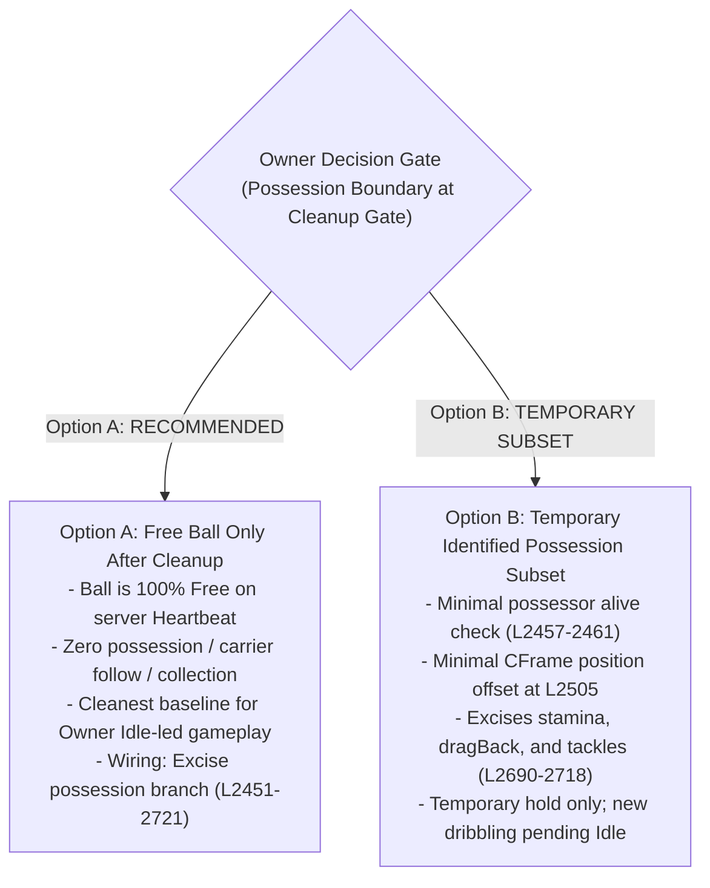
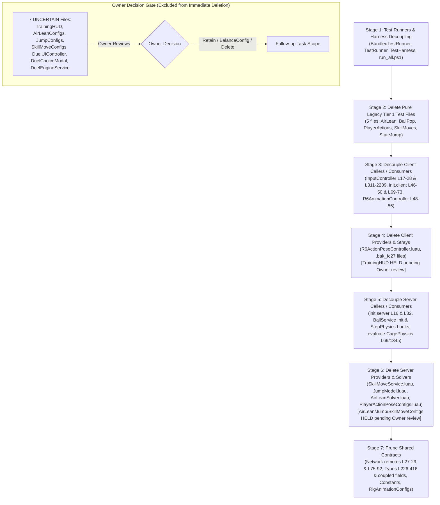

# Gate 1 Discovery — Legacy Plan 02 Dependency & Removal Manifest

> **Authority & Context:** Gate 1 Read-Only Dependency Discovery (Ref: `dependency-discovery-HANDOFF.md`, `review-008.md`, `review-009.md`, `review-010.md`, `review-011.md`, `review-012.md`, `discovery-spot-audit.md`).
> **Baseline Commit:** HEAD `25a67d5575e31034a5a08290873b9c401357d33a` | **Seed Diff Base:** `617f523..HEAD` (34 modified/added files across `src/` and `tests/`).
> **Contract & Stop Gate Notice:** Strictly READ-ONLY dependency mapping and discovery manifest. ZERO code removal, zero source edits, zero Studio operations, zero Git mutations, and zero new gameplay/Idle authoring are authorized. STOP BEFORE removing old code or writing new gameplay. Owner confirmation is required after manifest verification; Owner leads new gameplay authoring starting from **Idle standing pose first**.

---

## 1. Executive Summary & Standardized Line Arithmetic (RF-F14)

Investigation of the 34-file seed from `git diff --name-status 617f523 HEAD -- src tests` categorizes the files into exactly 4 distinct action groups:

| Category | File Count | `Get-Content` Lines | `Split-Lines` (w/ EOF `\n`) | Non-Empty Lines | Total Bytes | Category Purpose |
| :--- | :---: | :---: | :---: | :---: | :---: | :--- |
| **Group 1: Pure REMOVE** | 10 | 14,750 | 14,760 | 13,350 | 627,904 | Added Plan 02 mechanics files & standalone legacy tests with zero external dependants |
| **Group 2: REPLACE / ISOLATE** | 3 | 579 | 582 | 505 | 21,281 | Modules requiring replacement or decoupling from legacy constraints |
| **Group 3: UNCERTAIN (Pending Owner)** | 7 | 1,613 | 1,620 | 1,426 | 56,038 | Feature configs, HUDs, and Duel subsystems **EXCLUDED from immediate cleanup**; held pending Owner direction |
| **Group 4: Shared Modified Files** | 14 | 14,346 | 14,360 | 13,046 | 526,441 | Plan 00/01 foundation files with legacy hunks to surgically excise |
| **TOTAL** | **34** | **31,288** | **31,322** | **28,327** | **1,231,664** | **Complete Seed Diff Scope (10 + 3 + 7 + 14 = 34)** |

> [!NOTE]
> **Standardized Line Metric Definitions (RF-F11 / RF-F14):**
> 1. **`Get-Content` Lines:** The exact line count as read by PowerShell `Get-Content <file>` (matching 1-based editor line numbering in Roblox Studio and VS Code). Every repository source file has a trailing newline `\n`, which PowerShell strips from its array length.
> 2. **`Split-Lines` (POSIX raw split):** Raw buffer split by newline (`raw.split('\n')`), producing $N + 1$ elements due to the trailing empty element after the EOF newline.
> 3. **Non-Empty Lines:** Source lines containing non-whitespace characters (matching legacy `Measure-Object -Line` behavior).

---

## 2. Seed 34-File Categorized Inventory

### 2.1 Group 1: Pure REMOVE (10 Files — 14,750 Get-Content / 14,760 Split / 13,350 Non-Empty Lines)
These files were added entirely during Plan 02 for R6 action poses, skill moves, and dedicated legacy tests. They have 0 incoming consumers outside legacy code and will be deleted entirely in Stage 2 and Stage 4/6:

1. `src/client/character/R6ActionPoseController.luau` (Added, 891 GC / 892 split / 792 non-empty lines) — Motor6D CFrame pose controller for R6 rigs.
2. `src/server/services/SkillMoveService.luau` (Added, 347 GC / 348 split / 295 non-empty lines) — Server skill move resolver (Chop, Stepover, Marseille).
3. `src/shared/configs/PlayerActionPoseConfigs.luau` (Added, 3,927 GC / 3,928 split / 3,793 non-empty lines) — R6 joint CFrame offsets and timing maps.
4. `src/client/controllers/InputController.luau.bak_fc27` (Added, 2,164 GC / 2,165 split / 1,972 non-empty lines) — Stray backup file from prior refactor.
5. `src/server/services/BallService.luau.bak_fc27` (Added, 3,330 GC / 3,331 split / 3,030 non-empty lines) — Stray backup file from prior refactor.
6. `tests/e2e/Tier1_AirLeanPhysics.luau` (Added, 529 GC / 530 split / 444 non-empty lines) — Dedicated unit tests for legacy R6 air lean.
7. `tests/e2e/Tier1_BallPopPhysics.luau` (Added, 340 GC / 341 split / 276 non-empty lines) — Dedicated unit tests for legacy ball pop mechanic.
8. `tests/e2e/Tier1_PlayerActions.luau` (Added, 2,187 GC / 2,188 split / 1,877 non-empty lines) — Dedicated unit tests for legacy slide/kick/tackle intents.
9. `tests/e2e/Tier1_SkillMovesAndDefense.luau` (Added, 622 GC / 623 split / 539 non-empty lines) — Dedicated unit tests for legacy skill moves & cage press.
10. `tests/e2e/Tier1_StateJumpPhysics.luau` (Added, 413 GC / 414 split / 332 non-empty lines) — Dedicated unit tests for legacy jump latch & flight FSM.

### 2.2 Group 2: REPLACE / ISOLATE (3 Files — 579 Get-Content / 582 Split / 505 Non-Empty Lines)
Modules requiring replacement or decoupling from legacy constraints:

11. `src/client/controllers/CameraShiftLockController.luau` (Added, 213 GC / 214 split / 180 non-empty lines) — Contains legacy `SetSlideLock` and `SetAirborneJumpLock`. Decoupled from legacy state dependencies.
12. `src/shared/AirLeanSolver.luau` (Added, 244 GC / 245 split / 216 non-empty lines) — Pure pitch/roll math solver. Decoupled from client input; retained or isolated for future aerial mechanics.
13. `src/shared/JumpModel.luau` (Added, 122 GC / 123 split / 109 non-empty lines) — Pure kinematic jump curve solver. Decoupled from BallService.StepPhysics and InputController.

### 2.3 Group 3: UNCERTAIN / PENDING OWNER REVIEW (7 Files — 1,613 Get-Content / 1,620 Split / 1,426 Non-Empty Lines)
> [!IMPORTANT]
> **EXCLUSION FROM IMMEDIATE CLEANUP (RF-F15):**
> These 7 files are **EXPLICITLY EXCLUDED** from the immediate deletion scope. They are NOT unconditionally deleted. Their consumer requires in active controllers are decoupled/isolated so the foundation runs cleanly, while the files themselves remain intact pending Owner direction:

14. `src/client/controllers/TrainingHUD.luau` (Added, 662 GC / 663 split / 587 non-empty lines) — Debug HUD displaying legacy charge/stamina bars. HELD: Decoupled from `init.client.luau` and `InputController.luau`, file retained pending Owner review.
15. `src/shared/configs/AirLeanConfigs.luau` (Added, 48 GC / 49 split / 42 non-empty lines) — Air lean tuning angles. HELD pending Owner review of aerial control tuning.
16. `src/shared/configs/JumpConfigs.luau` (Added, 49 GC / 50 split / 41 non-empty lines) — Jump velocity and landing lag timings. HELD pending Owner review of jump feel.
17. `src/shared/configs/SkillMoveConfigs.luau` (Added, 270 GC / 271 split / 251 non-empty lines) — Skill move definitions and timing schemas. HELD pending Owner review.
18. `src/client/controllers/DuelUIController.luau` (Modified, 31 GC / 32 split / 22 non-empty lines) — Duel UI prompt controller. HELD (unbootstrapped in client).
19. `src/client/ui/screens/DuelChoiceModal.luau` (Modified, 139 GC / 140 split / 119 non-empty lines) — Modal UI for duel choices. HELD (unbootstrapped in client).
20. `src/server/services/DuelEngineService.luau` (Modified, 414 GC / 415 split / 364 non-empty lines) — Duel state resolver. HELD (unbootstrapped in server).

### 2.4 Group 4: Shared Modified Files (14 Files — 14,346 Get-Content / 14,360 Split / 13,046 Non-Empty Lines)
Foundation files modified in `617f523..HEAD` requiring surgical hunk removal without disturbing foundation behavior:

21. `src/client/character/R6AnimationController.luau` (Modified, 813 GC / 814 split / 710 non-empty lines)
22. `src/client/controllers/InputController.luau` (Modified, 2,208 GC / 2,209 split / 2,013 non-empty lines)
23. `src/client/init.client.luau` (Modified, 75 GC / 76 split / 61 non-empty lines)
24. `src/server/init.server.luau` (Modified, 32 GC / 33 split / 24 non-empty lines)
25. `src/server/services/BallService.luau` (Modified, 3,365 GC / 3,366 split / 3,066 non-empty lines)
26. `src/server/services/CagePhysicsService.luau` (Modified, 3,839 GC / 3,840 split / 3,544 non-empty lines)
27. `src/shared/Constants.luau` (Modified, 228 GC / 229 split / 213 non-empty lines)
28. `src/shared/Network.luau` (Modified, 296 GC / 297 split / 270 non-empty lines)
29. `src/shared/Types.luau` (Modified, 419 GC / 420 split / 381 non-empty lines)
30. `src/shared/configs/RigAnimationConfigs.luau` (Modified, 270 GC / 271 split / 262 non-empty lines)
31. `tests/e2e/BundledTestRunner.luau` (Modified, 2,190 GC / 2,191 split / 1,978 non-empty lines)
32. `tests/e2e/TestHarness.luau` (Modified, 313 GC / 314 split / 278 non-empty lines)
33. `tests/e2e/TestRunner.luau` (Modified, 244 GC / 245 split / 198 non-empty lines)
34. `tests/e2e/run_all.ps1` (Modified, 54 GC / 55 split / 48 non-empty lines)

---

## 3. Targeted Retained-Function Internal Closure & Exact Boundaries (RF-F11, RF-F12, RF-F13)

### 3.1 `BallService.Init()` Internal Partition (Lines 3320–3363)
To ensure internal syntactic and semantic closure after legacy provider removal, every statement inside `BallService.Init` is classified:

| Source Range | Internal Statement / Block | Status | Targeted Action & Completed Structure Rationale |
| :--- | :--- | :---: | :--- |
| **L3321–L3324** | `if isInitialized then return end; isInitialized = true` | **RETAIN** | Initialization guard. |
| **L3326–L3328** | `BallService.EnsureBallInstance()` `BallService.ResetBall()` | **RETAIN** | Core foundation ball instance creation and placement at center court. |
| **L3330–L3335** | `RunService.Heartbeat:Connect(function(dt) BallService.StepPhysics(dt) end)` | **RETAIN** | Server Heartbeat stepping loop for autonomous ball physics. |
| **L3337–L3341** | `Network.GetRemoteEvent("BallActionRequest").OnServerEvent:Connect(... BallService.HandleActionRequest ...)` | **REMOVE** | **Excise completely.** `HandleActionRequest` (L2981–3319) is a removed legacy router for slide, tackle, burst, and skill intents. Server ball simulation does not listen to legacy action packets. |
| **L3343–L3347** | `for _, player in ipairs(Players:GetPlayers()) do setupPlayerLifecycle(player) end` `Players.PlayerAdded:Connect(setupPlayerLifecycle)` | **ADAPT** | Retain player registration, but **ADAPT `setupPlayerLifecycle` (L2852–2980)**: excise legacy stamina, flight state, and jump disabling (`hum.JumpPower = 0`). Replace with clean foundation lifecycle: track team side and listen to `Humanoid.Died` for ball possession release. |
| **L3349–L3362** | `Players.PlayerRemoving:Connect(function(player) ...)` | **ADAPT** | **Excise L3351–L3356** (`pendingCagePresses` clearing for removed cage press mechanic). **RETAIN L3357–L3361**: if removing player is ball possessor, release ball possession (`ballState.possessorUserId = nil; ballState.state = "Free"; syncBallAttributes()`). |

- **Completed Function Structure:** `BallService.Init()` will cleanly initialize ball geometry, start the Heartbeat physics loop, bind minimal player join/leave lifecycle for team tracking and possession cleanup, with ZERO remote listeners to removed action routers.

---

### 3.2 `BallService.StepPhysics(dt)` Exact Internal Partition & Solver Calls (RF-F11, RF-F12)
Review 011 and Review 012 verified the exact line ranges and literal helper calls in `BallService.StepPhysics`:

| Source Range | Code Branch / Logic Subset | Status | Exact Literals, Helper Calls & Dependencies |
| :--- | :--- | :---: | :--- |
| **L2274–L2450** | **Player State Loop** (`for userId, st in pairs(playerStates) do ...`) | **REMOVE** | **Excise entire block (L2274–2450).** Deletes legacy stamina drain/recovery, dash decay, directional jump FSM calling `JumpModel.ResolveFlightState`, slide recovery, and cage press wall splatting. |
| **L2451–L2721** | **Possessed Ball Branch** (`if ballState.state == "Possessed" ...`) | **EXCISE / OWNER CHOICE** | - **L2457–L2461 (RETAIN in Option B):** Check possessor alive/present; release ball if dead or disconnected.
- **L2462–L2689 (EXCISE):** Delete skill-busy checks, stamina exhaustion checks, auto DragBack triggers (`isDraggingBack`, `dragBackEndTime`, `RequestDragBack`), and close control modifiers.
- **L2690–L2721 (EXCISE):** Delete opponent contact slows, slide tackle interrupts, and off-balance stumbles (`st.offBalanceUntil`, `otherSt.opponentContactSlowUntil`).
- **Cleanup Gate Options (RF-F13):** Prepared for Owner decision between Option A (Free ball only, no carrier follow) vs Option B (Temporary minimal possession subset). No invented 1.8-stud dribble algorithm. |
| **L2722–L2723** | `else` / `-- Free or InFlight Ball` | **RETAIN** | Branch boundary between possessed and free ball physics. |
| **L2724–L2775** | **Free Ball Solver Subset** (Exact helper calls & inherited tuning) | **RETAIN (Baseline + Inherited Tuning)** | **Exact Source Statements:**
- **L2725:** Calls `CagePhysicsService.IsPositionOnElevatingRamp(ballState.position)` (elevating ramp check).
- **L2728–L2731:** Inherited `ballState.curveImpulse` integration & decay (`ballState.velocity += curveImpulse * dt`). (Inherited tuning; kept pending Owner confirmation).
- **L2734–L2737:** Turf vertical velocity suppression when `onGround`.
- **L2740–L2745:** Gravity integration: checks `if ballState.inFlightAction == "Pass"` to select `Constants.PASS_GRAVITY_ACCELERATION_Y` vs `Constants.GRAVITY_ACCELERATION_Y`. (Inherited Pass tuning).
- **L2748:** Calls `CagePhysicsService.StepBallCageCollision(prevPos, currentVel, dt)`. **(NOTE: `ComputeReboundVelocity` and `EnforcePolytopeContainment` are internal to `CagePhysicsService`, not direct calls here).**
- **L2751–L2760:** Turf settling vs upward bounce velocity threshold.
- **L2763–L2768:** Rolling friction: checks `if ballState.inFlightAction == "Pass"` to select `Constants.PASS_GROUND_ROLLING_FRICTION` vs `Constants.GROUND_ROLLING_FRICTION`.
- **L2769–L2774:** **Ball-Rest Check:** checks `if nextVel.Magnitude < Constants.BALL_REST_THRESHOLD_SPEED then nextVel = Vector3.zero; nextPos = Vector3.new(nextPos.X, r, nextPos.Z); ballState.state = "Free"; ballState.inFlightAction = nil end`. **(NOTE: This is a ball-rest settling check, NOT a goal-scoring check; there is NO CheckGoalScored call here).** |
| **L2776–L2829** | **Legacy Ball Collection & Interception Loop** (`for userId, st in pairs(playerStates) do ...`) | **REMOVE / PENDING** | **Excise legacy loop (L2776–2829).** Contains legacy `kickerCooldownWindow` based on `inFlightAction` (BallPop, QuickPoke, FakeShot, KnockOn), `st.dislodgedCooldownUntil`, swept proximity calculation, high-speed deflection (>65 studs/s), and `BALL_COLLECT_RADIUS` auto-possession. Deleting this removes all `playerStates` references from free-ball physics.
- **Post-Cleanup Policy:** Ball reception/collection policy is marked **PENDING TECHNICAL CONTRACT & OWNER AERIAL/GROUND CONTROL SPEC** (Owner Q1 relative approach speed limit; no blanket auto-catch). |
| **L2830–L2850** | **Final Part Synchronization** (Position update, roll spin, CFrame, attributes) | **RETAIN** | **Core Foundation Part Sync:**
- Updates `ballState.position = nextPos` and `ballState.velocity = nextVel` (L2831–2832)
- Calculates ball roll spin CFrame (`ballSpinRotation` L2835–2844)
- Updates physical Workspace Ball Part `CFrame = CFrame.new(ballState.position) * ballSpinRotation` (L2846–2848)
- Syncs attributes via `syncBallAttributes()` (L2849) |

---

### 3.3 `InputController.Init()` & `bindChar` Exact Internal Partition (Lines 1294–2150)
The internal structure of `InputController` is partitioned into exact functional blocks:

| Source Range | Internal Sub-routine / Closure | Status | Detailed Action & Dependency Closure |
| :--- | :--- | :---: | :--- |
| **L17–L28** | Top-level module requires | **REMOVE** | **Excise in Stage 3.** Delete top-level requires for `AirLeanSolver` (L17), `JumpModel` (L18), `PlayerActionPoseConfigs` (L20), `JumpConfigs` (L21), `SkillMoveConfigs` (L22), `R6ActionPoseController` (L26), and decouple `TrainingHUD` (L28). |
| **L1294–L1301** | `InputController.Init()` entry & guard | **RETAIN** | Initialization guard and local player reference. |
| **L1302–L1528** | `local function bindChar(char: Model)` closure | **ADAPT** | **Do NOT slice mid-function.** Adapt closure as a unified unit:
- **L1303–L1327:** Retain disconnect of old character connections.
- **L1328–L1349 (Action State Resets):** REMOVE calls to `clearChargeSnapshot()`, `CameraShiftLockController.SetSlideLock(false)`, `CameraShiftLockController.SetAirborneJumpLock(false)`, `cancelDashPhysics(char)`, and `R6ActionPoseController.ResetPoses(char)`.
- **L1353–L1356 (Jump Suppression):** **EXCISE.** Delete lines forcing `hum.JumpPower = 0`, `hum.JumpHeight = 0`, and disabling `HumanoidStateType.Jumping`. Restores default Roblox locomotion.
- **L1358–L1396 (Landing Pose & Lag Connections):** **EXCISE.** Delete connections calling `R6ActionPoseController.TriggerLandingRecovery` and flight FSM resets.
- **L1398–L1410 (Humanoid.Died):** **RETAIN.** Clean up character connections on death.
- **L1411–L1527 (Action Remote Listeners):** **EXCISE.** Delete listeners for `ActionStatus`, `ResolvedAction`, and `CagePressWallSplat`. |
| **L1530–L1548** | Window focus & JumpRequest hooks | **ADAPT** | Retain window focus release; remove custom discrete jump latch from `JumpRequest`. |
| **L1550–L1912** | `RunService.RenderStepped` loop | **EXCISE** | **Remove completely.** Deletes per-frame air lean pitch/roll motor overrides, locked flight velocity, and ground slide clamping. |
| **L1913–L2032** | `UserInputService.InputBegan` keybinds | **ADAPT** | **Excise legacy action keys:** Q (Dash), E (Pop), Space (Discrete Jump latch), Shift (Slide), LeftClick (Kick/Charge), 1/2/3 (Skills), F (Tackle). Retain standard ShiftLock toggle and camera-relative WASD vector calculation. |
| **L2033–L2150** | `UserInputService.InputEnded` key releases | **EXCISE** | Delete legacy charge release, sprint release, and jump latch release handlers. |
| **L2151–L2209** | Legacy flight & jump getters | **EXCISE** | Delete getters for `ReleaseJumpKey`, `IsJumpConsumed`, `GetFlightState`, `GetLandingLagRemaining`, `GetChargeSnapshot`. |

---

### 3.4 Shared Contracts: Exact Types & Remotes Corrections (RF-F11)

#### A. Exact Literal Field Names in `src/shared/Types.luau` (`PlayerMovementSnapshot` L321–360)
The exact field names in `Types.luau` matching line-numbered source:
- **Line 342:** `chargeCurveSide: CurveSideIntent?,` (Literal field name)
- **Line 357:** `activeSkillMove: SkillMoveId?,` (Literal field name)
- **Line 358:** `activeTackle: TackleActionType?,` (Literal field name)
- **Coupled Types Field Pruning Set:**
  - In `BallSnapshot` (L309–319): Line 318 (`inFlightAction: KickActionType?`) must be excised.
  - In `PlayerMovementSnapshot` (L321–360): Excise Line 330 (`TeamActionContext`), Line 341 (`chargeAction: ChargeActionType?`), Line 342 (`chargeCurveSide: CurveSideIntent?`), Line 343 (`chargeCurveStyle`), Line 344 (`chargeKickFoot`), Lines 349–351 (`airLean*`), Line 352 (`jumpFacingF0`), Line 353 (`flightState: FlightState?`), Line 354 (`flightId`), Line 355 (`airOffensiveBudget`), Line 356 (`landingLagRemaining`), Line 357 (`activeSkillMove: SkillMoveId?`), Line 358 (`activeTackle: TackleActionType?`), and Line 359 (`commonSkillRecoveryRemaining`).

#### B. Exact Remote Locations in `src/shared/Network.luau`
- **`RemoteNames` table keys (Lines 27–29):**
  - Line 27: `SkillMoveRequest = "SkillMoveRequest",`
  - Line 28: `SkillMoveReplicate = "SkillMoveReplicate",`
  - Line 29: `TackleActionRequest = "TackleActionRequest",`
- **`Definitions` table entries (Lines 75–92):**
  - Lines 75–80: `SkillMoveRequest` definition block (`RemoteEvent`, `ClientToServer`, `Module 03`)
  - Lines 81–86: `SkillMoveReplicate` definition block (`RemoteEvent`, `ServerToClient`, `Module 03`)
  - Lines 87–92: `TackleActionRequest` definition block (`RemoteEvent`, `ClientToServer`, `Module 03`)

---

## 4. Static Dependency Graph & Runtime Bootstrap Closure (RF-F12)

### 4.1 Active Bootstrapped Pipelines
1. **Server Active Pipeline:** `init.server.luau` (32 Get-Content lines):
   - `Network.Init(10.0)` (L19) -> `CagePhysicsService.Init()` (L22) + `RetireBootstrapFixtures` (L23) -> `RigAndCardService.Init()` (L26) -> `BallService.Init()` (L29) -> `SkillMoveService.Init()` (L32, to be removed in Stage 5).
2. **Client Active Pipeline:** `init.client.luau` (75 Get-Content lines):
   - `Network.Init(remaining)` (L26) -> `R6AnimationController.Init(remaining)` (L44) -> `R6ActionPoseController.Init()` (L49, to be decoupled in Stage 3) -> `CameraShiftLockController.Init()` (L60) -> `InputController.Init()` (L66) -> `TrainingHUD.Init()` (L72, to be decoupled in Stage 3).

### 4.2 Dormant Prototype Files (Unbootstrapped in Server/Client)
- `FreeKickService.luau`, `ParryService.luau`, `MatchService.luau`, `DuelEngineService.luau`, `DuelUIController.luau`, `DuelChoiceModal.luau`, and `EventManagerService.luau` are **NOT bootstrapped**.
- These files represent standalone prototype drafts. They do NOT dictate active foundation requirements. Obsolete methods in `BallService` (e.g. `SpawnBall` / `StepBallPhysics` called by `MatchService`) will NOT be preserved.

---

## 5. Post-Cleanup Runtime Contract & Possession Boundary Options (RF-F13)

### 5.1 Immediate Post-Cleanup Runtime Contract (Syntactic Wiring & Baseline Only)
> [!IMPORTANT]
> **NO UNAUTHORIZED NEW GAMEPLAY OR R15 PROMISES DURING CLEANUP (RF-F13):**
> 1. **Existing Rig Foundation Unchanged (Module 00 Custom R6):**
>    - The character rig remains the existing Module 00 Custom R6 foundation spawned by `RigAndCardService`.
>    - Transition to Player Avatar R15 normalized (Target Delta 001 / Review 004 / 005) is **NOT implemented during cleanup**. R15 begins ONLY after Owner explicitly authorizes and leads new gameplay starting from **Idle standing pose first**.
> 2. **Foundation Free Ball Simulation:**
>    - Active physical Part in `Workspace.Ball`.
>    - Server Heartbeat steps cage containment (`CagePhysicsService.StepBallCageCollision`), gravity, turf settling, rolling friction, and physical Part CFrame/velocity synchronization.
> 3. **Zero Legacy Plan 02 Mechanics:**
>    - No stamina drain, no burst dash, no slide tackles, no cage wall splatting, no shooting zones, no RNG mistake focus buffs, no R6 Motor6D action poses.

### 5.2 Possession Boundary at Cleanup Gate — Bounded Owner Decision Options (RF-F13)
To establish an unambiguous, executable cleanup contract without inventing new follow algorithms or premature dribbling mechanics, two concrete options are prepared for Owner decision at the deletion gate:

- **Option A (Recommended for Clean Restart): Free Ball Only After Cleanup.**
  - **Scope:** The ball spawns at center court in `state = "Free"` and is stepped purely by autonomous cage physics (`StepBallCageCollision`, gravity, turf settling, rolling friction). Zero possession, zero carrier dribble following, and zero player ball collection after cleanup.
  - **Rationale:** Leaves zero half-baked or pending dribble kinematics in code. Provides a 100% clean, pristine baseline for Owner to author new gameplay starting from **Idle standing pose first**.
  - **Minimal Wiring Changes:**
    - In `BallService.Init()`: L3337–3341 removed; `setupPlayerLifecycle` adapted for team tracking only (no jump suppression).
    - In `BallService.StepPhysics()`: Excise the entire player state loop (L2274–2450) and possession branch (L2451–2721); ball is stepped purely as Free (L2722–2775).
    - In `BallService.SetPossessor()`: Kept as a simple state setter or no-op until new gameplay is authored.
- **Option B: Retain Precisely Identified Existing Possession Subset Temporarily.**
  - **Scope:** Temporarily retain the minimal existing possession branch (Lines 2453–2461 and CFrame positioning at L2505), while excising stamina exhaustion, dragBack attributes, and tackles/off-balance stumbles (L2690–2718).
  - **Rationale:** Allows a player to hold the ball at a temporary offset if Owner specifically wants to test moving with the ball before Idle authoring.
  - **Minimal Wiring Changes:**
    - Retains `ballState.state == "Possessed"` check and basic offset positioning, while excising legacy action dependencies (`isDraggingBack`, `st.stamina`, `tryResolveCagePressWallSplat`, `advancePendingSkillContact`, off-balance stumbles).
- **Owner Stop Instruction:** Neither option is selected or implemented now. Codex Controller will present Option A (Recommended) and Option B to Owner for decision at the cleanup gate!

### 5.3 Test Suite Expectations vs Acceptance Goals (RF-F13)
- Passing the retained test suite after cleanup is an **acceptance goal**, NOT an immediate guaranteed outcome.
- The 5 pure Tier 1 test files are deleted in Stage 2 because their tested mechanics are removed.
- Retained integration tests (Tiers 2–4) currently assert on removed Plan 02 mechanics and will require test-hunk adaptation.

---

## 6. Corrected Seven-Stage Removal Execution Sequence & Atomic Barrier (RF-F15)

The removal order strictly enforces **Consumer-before-Provider** across all modules. Furthermore, UNCERTAIN items are explicitly **HELD / EXCLUDED from immediate deletion** pending Owner decision:

> [!IMPORTANT]
> **Atomic Edit Boundary & Studio Sync Barrier (RF-F15):**
> 1. **Consumer Before Provider:** Client callers (Stage 3) are decoupled BEFORE client providers (Stage 4) are deleted. Server callers (Stage 5) are decoupled BEFORE server providers (Stage 6) are deleted.
> 2. **Uncertain Items Excluded:** The 7 UNCERTAIN files are NOT deleted in Stage 4 or Stage 6. Their caller hooks are decoupled, and the files remain untouched until Owner decides.
> 3. **Sync Barrier:** Studio sync / hot-reloading must remain stopped/disconnected during file edits.
> 4. **Non-Runnable Intermediate States:** Intermediate states between Stage 1 and Stage 7 are explicitly non-runnable edit steps within a single atomic surgery. No runtime execution or test runs will be attempted until Stage 7 is complete and verified.

---

## 7. Checkpoint History & Baseline Preservation Note (RF-F14)

- Commit `617f523` was the checkpoint prior to Plan 02 Argon rework.
- Subsequent commit `25a67d5` added essential Gritty Lighting fixes to `CagePhysicsService.luau` per Owner §14.4.
- Therefore, blind `git checkout 617f523 -- <file>` is prohibited; all changes must be applied via **surgical hunk removal**.

---

## 8. Complete 34-Seed File Source Fingerprints

| # | Status | Source File Path | `Get-Content` Lines | `Split-Lines` | Non-Empty Lines | Bytes | SHA256 Hash |
| :---: | :---: | :--- | :---: | :---: | :---: | :---: | :--- |
| 1 | A | `src/client/character/R6ActionPoseController.luau` | 891 | 892 | 792 | 31,512 | `1e9bf741770416a6cd56009e98e870ea63c701a67b0c9d4b6038bd9c407d4d7f` |
| 2 | M | `src/client/character/R6AnimationController.luau` | 813 | 814 | 710 | 24,245 | `6e3a0a2a190e08e7fcf1810e17511e5906c32b7cda7c21b67d370acb7d85669a` |
| 3 | A | `src/client/controllers/CameraShiftLockController.luau` | 213 | 214 | 180 | 7,566 | `9c8c366ef910531dd5b384bd3417571cc0ad4a7555a2edda7f7ae76348fc553a` |
| 4 | M | `src/client/controllers/DuelUIController.luau` | 31 | 32 | 22 | 826 | `f0b9b2e5a3e1fa70749eb45c34a8c6777f920179654722bd1962409a5966c538` |
| 5 | M | `src/client/controllers/InputController.luau` | 2208 | 2209 | 2013 | 81,952 | `3b5d87dab23a151031e2be01b727fdd0251ab20c8e6d4765dcae0120419e04c4` |
| 6 | A | `src/client/controllers/InputController.luau.bak_fc27` | 2164 | 2165 | 1972 | 80,252 | `07232cb3444f71a3c6bb1328dda9691bb04d792109e71d52146f4f172fe9962a` |
| 7 | A | `src/client/controllers/TrainingHUD.luau` | 662 | 663 | 587 | 24,943 | `c45584f0b306d71ea26d9bac6e7d896b2f5b5220a26a31eb880e109a309eb1f1` |
| 8 | M | `src/client/init.client.luau` | 75 | 76 | 61 | 3,641 | `4731c0449a26ad48f1ae3385c3103643f61d64653c0f2b50799539bbc0c86c93` |
| 9 | M | `src/client/ui/screens/DuelChoiceModal.luau` | 139 | 140 | 119 | 4,033 | `a07c87593b29251fd16a23c21b96951baa4d49ec0a2016afaa6da51c51c4bf8e` |
| 10 | M | `src/server/init.server.luau` | 32 | 33 | 24 | 1,525 | `17d24b2f5199fda3f3a8bbf2cc6c469c2f7252428f48d4fc3456dcdf07926b2b` |
| 11 | M | `src/server/services/BallService.luau` | 3365 | 3366 | 3066 | 128,835 | `8428841655f8a02e42b89df7aa71aa17648515e271dd96b321b9199ab830e2dd` |
| 12 | A | `src/server/services/BallService.luau.bak_fc27` | 3330 | 3331 | 3030 | 127,081 | `74283c0d6d62ebf03ea7191c5d8a7b59c0de4d064869fae52706b2cf06269bfd` |
| 13 | M | `src/server/services/CagePhysicsService.luau` | 3839 | 3840 | 3544 | 134,755 | `6917748947501e306b14530691076e19d3a35145f514d89fa7c6999a49234eac` |
| 14 | M | `src/server/services/DuelEngineService.luau` | 414 | 415 | 364 | 13,349 | `38a1bc895b047995eb7ce6479c88ed25cdccee348edba9022ff485c7f9149b1e` |
| 15 | A | `src/server/services/SkillMoveService.luau` | 347 | 348 | 295 | 11,923 | `26fd2d97fefa7bca3ce7dd9bdee3f2becce3ea4c86e86161d52eb15274ef01c4` |
| 16 | A | `src/shared/AirLeanSolver.luau` | 244 | 245 | 216 | 9,731 | `b61e8bda9cbd30f69a94b532d04fa082a644c0cd9a759ff0d946d2a8e2b6dd40` |
| 17 | M | `src/shared/Constants.luau` | 228 | 229 | 213 | 7,525 | `da340ae6b09bfc42ce6681b8c1871da5315621b38a17c77162bc25c0471292b6` |
| 18 | A | `src/shared/JumpModel.luau` | 122 | 123 | 109 | 3,984 | `ca95fc70e3a7199f326bd79ca18ad2d6e047afc09fe3e75ed5564800178435bc` |
| 19 | M | `src/shared/Network.luau` | 296 | 297 | 270 | 9,931 | `217668ce752348d046bf0f7963a3a72ff7133ff5ad57fafb9aea7d4a7abf96a5` |
| 20 | M | `src/shared/Types.luau` | 419 | 420 | 381 | 9,799 | `64b9e53831833c3d90f5563beeffa2171ee9abb3ea9662878c8d6216f17a0c59` |
| 21 | A | `src/shared/configs/AirLeanConfigs.luau` | 48 | 49 | 42 | 1,857 | `e78f8325e6527ce69152f7dfdbd675589c68a7e303d8e543aec906c44ca2151e` |
| 22 | A | `src/shared/configs/JumpConfigs.luau` | 49 | 50 | 41 | 1,581 | `57d83dc538ea4d59ea803979ccffce1805522cfc12098ebf3b88abed5c728c8d` |
| 23 | A | `src/shared/configs/PlayerActionPoseConfigs.luau` | 3927 | 3928 | 3793 | 192,720 | `ba0ecbb542ec1134d8b742cd2cb9afdd06892d238e89adbc4b9a2fb3d190794f` |
| 24 | M | `src/shared/configs/RigAnimationConfigs.luau` | 270 | 271 | 262 | 10,012 | `e6bff0c9c2e1d1de841d9f83a1f99396cc0ba01fb89bd36aa29bb6a10e82c028` |
| 25 | A | `src/shared/configs/SkillMoveConfigs.luau` | 270 | 271 | 251 | 9,449 | `f079ab6d49817d017b60a08637efb405c197a107ed25442997277549b064cfef` |
| 26 | M | `tests/e2e/BundledTestRunner.luau` | 2190 | 2191 | 1978 | 91,657 | `c9f3bb0fabedad70f1cbc912aac4944734548d26f0337a4d2cbced1eda1d586c` |
| 27 | M | `tests/e2e/TestHarness.luau` | 313 | 314 | 278 | 9,927 | `0715455c938e5585364973078c5590469495f03f666bc1096ae49d4ab5bc960b` |
| 28 | M | `tests/e2e/TestRunner.luau` | 244 | 245 | 198 | 10,213 | `cf8f795ddb68d05487962d8da27a5e5640c237f2b461a6cc994a5a220f9114f8` |
| 29 | A | `tests/e2e/Tier1_AirLeanPhysics.luau` | 529 | 530 | 444 | 24,280 | `4cd6397b14b5c9fe2d0f50a01251d99073e62afd4ef17d1b7799ab2fb57b05ad` |
| 30 | A | `tests/e2e/Tier1_BallPopPhysics.luau` | 340 | 341 | 276 | 13,474 | `0ed2f4be7eb475807112928ae723fafeebe67e12b10c91b6a235c08501538c43` |
| 31 | A | `tests/e2e/Tier1_PlayerActions.luau` | 2187 | 2188 | 1877 | 103,367 | `4fe3da7a349d44f2f9d19223aeed08eec4f0d0d70f9849d2e55218adf1ea6659` |
| 32 | A | `tests/e2e/Tier1_SkillMovesAndDefense.luau` | 622 | 623 | 539 | 27,544 | `5185125aad90c4baa0049fb2e9eb6e51e30157ab16607739e2fa3bf5cc1a5981` |
| 33 | A | `tests/e2e/Tier1_StateJumpPhysics.luau` | 413 | 414 | 332 | 15,751 | `7a753656998afd184f7d1c26586b4e3c6e44d47c3f872dfd48c97b13d107a81b` |
| 34 | M | `tests/e2e/run_all.ps1` | 54 | 55 | 48 | 2,424 | `559b99f902a2599851d80440645ca4e624f6618a0595bd9b6e530ec73da05351` |

---

## 9. Stop Gate Enforcement

> [!IMPORTANT]
> **STOP GATE CONFIRMATION:**
> This document concludes the read-only discovery phase. NO code deletion, source editing, Studio testing, or Git commit operations are permitted. Codex Controller will present this manifest, concrete scope, and the Option A/B possession choice to Owner for confirmation. Work will stop until Owner explicitly authorizes code removal and leads new gameplay starting from **Idle standing pose first**.
