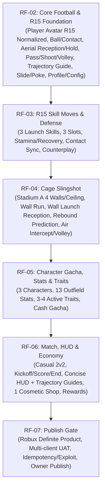

# Release-First Track — Master Plan (Phase 1 Restart on Player Avatar R15 Equal Size)

- **Track State:** PROPOSED / DOCUMENTATION_SYNCED (Implementation NOT AUTHORIZED; awaiting Owner approval)
- **Authority:** Owner Directive 2026-10-25 ([owner-r15-restart.md](assets/owner-r15-restart.md)), Primary [HANDOFF.md](assets/HANDOFF.md), and Target Spec `C:/Users/Stang/Downloads/cage-zero-phase1-release-first-plan02-onward.md` (SHA256: `a8d64cac20758916f74f853c852ba17a2a96047634a72e3e75f41a221179ea46`).
- **Owner:** Stang
- **Controller / Reviewer:** Codex
- **Implementer (Docs):** agyplan w2:p49
- **Target Rig:** Player Avatar R15 (Normalized to Same Body Dimensions) (Supersedes Custom Blocky R15 target appearance per Owner Target Delta 2026-10-25; preserves player visual appearance while enforcing uniform body dimensions and collision/contact geometry across all players; body size does NOT change from character stats/cards).
- **Core Product Identity:** **CAGE SLINGSHOT — Turn the Walls Into Your Weapon.**

---

## 1. Executive Summary & Directive

ตามคำสั่ง Owner Override & Owner Delta วันที่ 2026-10-25:
1. **ยกเลิก Legacy Plan 02 (`02-player-actions`) และ Plan 03 (`03-dribble-duel`)**: มีสถานะเป็น `CANCELLED_BY_OWNER / SUPERSEDED_FOR_R15_RESTART` ยุติ task queue และอำนาจดำเนินงานเดิม ไม่ใช่การผ่าน (PASS/APPROVED) และไม่นับเป็นการปิดงาน
2. **ถอด Runtime เก่าของ Plan 02/03 เพื่อ R15 Restart (Owner Delta 2026-10-25)**: ตาม [legacy-plan02-removal.md](assets/legacy-plan02-removal.md) เจ้าของต้องการนำ Animation/Gameplay เก่าที่สร้างตั้งแต่ Plan 02 ออกจริง โดย RF-02 ต้องเริ่มด้วย **Removal & Cleanup Gate (Preflight)** จัดทำ removal manifest แบบ READ-ONLY (ระบุ file/symbol/hunk: KEEP / REMOVE / REPLACE / UNCERTAIN) ก่อนลงมือถอดโค้ดจริง
3. **รักษา Foundation แผน 00/01 และข้อเท็จจริง Checkpoint**:
   - รักษา Plan 00 rig/bootstrap foundation และ Plan 01 cage geometry/ball collision/rebound
   - **Checkpoint 617f523 เป็นเพียง Comparison Checkpoint ไม่ใช่ Clean Physics Baseline:** ณ จุด 617f523 `BallService.luau` มีโค้ด possession/shoot/pass/laserGuidedPass อยู่แล้ว และ `CagePhysicsService.luau` มี hunks แสงและ `FLOOR_SMASH_RESTITUTION` เพิ่มหลังจุดนี้ จึงห้ามทำการ reset แบบ Whole-file restore เด็ดขาด แต่ต้องวิเคราะห์และถอดเป็นระดับ hunk
   - รายการไฟล์ที่ต้องถอดใน RF-02 เป็น **Provisional Removal Inventory (34 ไฟล์: เพิ่มใหม่ 17, ปรับปรุง 17)** ระบุชื่อไฟล์และ test suite ครบทุกตัว ไม่ใช้ wildcard `Tier1_*.luau` (เพื่อไม่ให้กระทบ `Tier1_FeatureCoverage.luau` ของ Plan 00/01)
   - Source, assets (เช่น `argon-r6-pack`, `animation-library.json`), reviews (review-001..008), fixes (fix-001..015) และ finding ค้าง (A-01..A-06, F-13..F-24) ยังคงสถานะเดิมตามประวัติศาสตร์ ไม่มีการลบหรือย้อน Git ทั้งหมด
4. **เริ่มแผนใหม่บน Player Avatar R15 (Normalized to Same Body Dimensions)**: `RF-02` และ `RF-03` เป็นแผนใหม่ทั้งหมด ออกแบบบน R15 ตั้งแต่ต้น โดยให้ผู้เล่นใช้โมเดล Avatar ของตนเองแต่ถูก Normalized มิติและสัดส่วนร่างกายให้มีขนาดเท่ากันทั้งหมด (Equal body dimensions); รักษารูปลักษณ์และอัตลักษณ์ผู้เล่นควบคู่กับความยุติธรรมด้านกายภาพการแข่งขัน ไม่ใช่การ continuation หรือ refactor งาน R6 เดิม
5. **ขอบเขตการยกเลิก**: ยกเลิกเฉพาะแผน 02/03 เดิม ไม่ใช่การยกเลิก Phase 2 ทั้งหมด
6. **Phase 1 Release-First Goal**: มุ่งเปิด **Public Alpha** ได้จริง ด้วย 6 แผนปฏิบัติการ (`RF-02` ถึง `RF-07`) พร้อม Casual 2v2, Cage Slingshot, 3 Active Skills, 3 ตัวละคร, 13 Outfield Stats, 3–4 Active Traits, Cash Gacha และ Durable Transaction
7. **Model & Execution Policy**: ผู้รับหน้าที่ลงมือถอดโค้ด/ทำ R15 ในภายหลังคือ `agyanimation` ใช้โมเดล **3.8 Flash** เป็นหลักเมื่อ verify ชื่อ pane แล้ว; ใช้ **Argon** เฉพาะจุดติดขัดด้าน dependency ที่ซับซ้อนตามที่ Flash แสดงหลักฐาน; การรายงานใช้ push callback อัตโนมัติเมื่อ READY_FOR_REVIEW / BLOCKED / ต้องการ Owner decision ไปยัง Controller (w2:p43) พร้อม Enter ตาม Latest Owner Reporting Override (ไม่มี monitoring/poll)
8. **Technical Seams for Normalized Player Avatar R15**: บันทึกข้อพิจารณาว่าตัวเลข Scale numbers เท่ากันไม่ได้รับประกันขนาดจริงของ arbitrary body packages; แยกแยะคุณสมบัติของ [`HumanoidDescription`](https://create.roblox.com/docs/reference/engine/classes/HumanoidDescription) (`HeightScale`, `WidthScale`, `DepthScale`) ออกจาก child `NumberValue` ของ [`Humanoid`](https://create.roblox.com/docs/reference/engine/classes/Humanoid) (`BodyHeightScale`, `BodyWidthScale`, `BodyDepthScale`) อย่างชัดเจน; กำหนด Seam อย่างรัดกุม: (a) Body Package Normalization & Permitted Parts, (b) Ball Contact & Uniform Collision Geometry, (c) Joint Attachments & Motor6D alignment, (d) Animation Retargeting & Visual consistency, (e) Respawn & Avatar Loading Lifecycle (Dual-path `HasAppearanceLoaded` + `CharacterAppearanceLoaded`, Generation tracking, และกฎเหล็ก: Timeout ห้ามปล่อยตัวละครที่ไม่ผ่านการ Normalize เข้าเกมเพลย์เด็ดขาด), (f) Accessory Collision & View Occlusion, (g) Team Readability (Team Indicator/Vest overlay); โดย Character Stats / Cards จะไม่เปลี่ยนแปลงขนาดร่างกายในสนาม
9. **Assisted Aerial Control & Trajectory Guidance (Owner Design Delta 2026-10-25)**: บันทึกข้อยุติการออกแบบ 4 ประการ: (a) Contact-and-speed-gated aerial reception เป็นข้อยกเว้นชัดเจนต่อกฎ blanket no-auto-catch เดิม (ต้องชน Hitbox บอลจริงและ relative approach speed อยู่ในเกณฑ์ ไม่มีการวาร์ปบอลจากระยะไกล; หากเร็วเกินไปบอลจะกระดอนออก); (b) Brief airborne hold to aim (ลอยค้างเล็งชั่วครู่ บอลยังมองเห็นและแย่งได้ ไม่มี I-frame/no cooldowns); (c) Live curved trajectory line & landing marker แสดงให้ผู้เล่นทุกคนเห็นรวมถึงการชิ่งผนัง/เพดาน 4 ด้านใน Stadium A พร้อม Prerelease aim preview เฉพาะคนง้างยิง; (d) Goalkeeper physical contact (การเซฟของโกลต้องอาศัยตำแหน่ง จังหวะ และการสัมผัสบอลจริง ไม่มีการเซฟอัตโนมัติจากการพุ่งถูกทิศทาง และไม่เพิ่ม GK AI ใน launch)

---

## 2. Legacy-to-Release-First Mapping

| Legacy Plan / Phase | Scope เดิม | สถานะใน Release-First Track | แผนรองรับใหม่ | เหตุผลและการจัดการ |
|---|---|---|---|---|
| **00-bootstrap-and-rig** | Custom R6, Spawn, Upgrade/Monetization Arch | `OPEN / PAUSED_BY_OWNER` | อ้างอิงสถาปัตยกรรมรากฐาน; Rig ใหม่ย้ายไป **RF-02** | ไม่ปิดแผน 00; เก็บ Upgrade/Monetization Specs (U1–U13) เป็น reference แต่ runtime บน R15 ทำใน RF-02 |
| **01-cage-physics** | สนาม A/B/C, บอลฟิสิกส์, รีบาวด์ | `OPEN / PENDING_TECHNICAL_REVIEW` | บอลฟิสิกส์ & สนาม A คงเดิม; ผนังต่อยอดใน **RF-04** | ไม่ปิดแผน 01; คงค่าขนาด/ความเร็วบอลเดิม ห้าม scope creep; สนาม A 4 ผนัง+เพดาน ใช้เป็นสนามหลักของ Public Alpha |
| **02-player-actions** | R6 Locomotion, Ball, Kick/Pass, Slide | **`CANCELLED_BY_OWNER`** | **RF-02 Core Football & R15 Foundation** | ยกเลิกงาน R6; เริ่มแผนใหม่บน Player Avatar R15 Normalized: Joint, Attachment, Ball Contact, Air lean/Volley, Slide/Poke, Profile & Config |
| **03-dribble-duel** | 7 ท่า / 3 ช่อง / R6 Animation | **`CANCELLED_BY_OWNER`** | **RF-03 R15 Skill Moves & Defense** | ยกเลิกงาน R6; เริ่มแผนใหม่บน R15 สำหรับ 3 Launch Skills (Heavy Knock-On, Open Up Fake Shot, Body Feint) + Basic Defense (Q6 Mapping) |
| **04-goalkeepers** | โกลคน / AI | เลื่อนไป Phase 2 (Deferred) | เลื่อนไป Phase 2 | Casual 2v2 ใน Alpha ไม่บังคับ GK AI; ประตูโล่งหรือสนามกรงขนาดเล็ก |
| **05-fouls-and-set-pieces** | ฟาวล์, ฟรีคิก, จุดโทษ FC27 | เลื่อนไป Phase 2 (Deferred) | เลื่อนไป Phase 2 | กรง Alpha เล่นต่อเนื่อง (Continuous Play) ลดการหยุดเกม; Basic Defense (Slide/Poke) มี recovery/whiff |
| **06-training-ground** | สนามซ้อม, Debug จูนค่า, Dummy | รวมเฉพาะ Debug/Testing ใน RF-02/03; Full ซ้อมเลื่อน | ส่วนที่จำเป็นอยู่ใน RF-02/RF-03 | เครื่องมือ Debug จูนค่ารวมใน BalanceConfig ของ RF-02; โหมดสนามซ้อมเต็มเลื่อน |
| **07-dynamic-field-events** | อีเวนต์สนาม 6 แบบ | เลื่อนอีเวนต์เต็มไป Phase 2; Wall Rebound อยู่ใน **RF-04** | **RF-04 Cage Slingshot** | Wall Run / Wall Launch และการชิ่งบอลกำแพง/เพดาน กลายมาเป็น Core Identity ใน RF-04; Boost/Low-roof เลื่อน |
| **08-gameplay-ui** | Full Gameplay UI & Camera | ทำ Minimal HUD ใน **RF-06**; Full UI เลื่อน | **RF-06 Match, HUD & Economy** | ทำเฉพาะ Concise HUD (Stamina, Skill Slots, Score, Timer) ใน RF-06 |
| **09-uat** | Gameplay Demo UAT | รวมเข้ากับ Gate ท้ายใน **RF-07** | **RF-07 Publish Gate** | รวม Multiplayer 2v2 UAT, Security/Exploit Test, Load/Save UAT และ Publish Checklist |
| **Phase 2 (02-transactions)** | Cash Transactions | ดึงระบบธุรกรรมมาเริ่มใน **RF-02**, เต็มรูปใน **RF-06** | **RF-02 & RF-06** | ป้องกัน Client แก้เงิน/ของ; Server-authoritative Profile ตั้งแต่เริ่ม |
| **Phase 2 (03-player-gacha)** | Gacha & Stats | ดึง Gacha (Cash-only) + 13 Stats + Traits มา **RF-05** | **RF-05 Gacha, Stats & Traits** | 3 ตัวละครต้นแบบ, 13 Outfield Stats, 3-4 Active Traits สำหรับ Alpha |

---

## 3. Scope & Execution Order of Release-First Track

1. **[RF-02 Core Football & R15 Foundation](RF-02/plan.md)**:
   - Removal Preflight: กำหนด Provisional Removal Inventory 34 ไฟล์ (ระบุชื่อไฟล์จริงใน repo และชื่อ test ครบทุกตัว ไม่ใช้ wildcard) ตรวจสอบการพึ่งพาแบบปิดรอบคอบ
   - ข้อเท็จจริง Checkpoint: 617f523 เป็นจุดเปรียบเทียบ ไม่ใช่ clean baseline ห้าม whole-file reset
   - วางรากฐาน Player Avatar R15 (Normalized): โหลดโมเดล Avatar ของผู้เล่นและ Normalize ขนาดร่างกายและมิติ Collision/Contact geometry ให้เท่ากันทั้งหมด (Joint attachments, Motor6D, HipHeight, Uniform Collision Box); ตัวเลข scale numbers เท่ากันไม่ได้รับประกันขนาดจริงของ arbitrary body packages จึงต้องมีระบบ Normalization และคัดกรอง accessory ที่บดบังทัศนวิสัย
   - Core Ball Mechanics: บอลจริงไม่วาร์ป/ไม่ auto-catch (ยกเว้นข้อยกเว้นการรับบอลกลางอากาศที่สัมผัสบอลจริงและผ่านเกณฑ์ความเร็วสัมพัทธ์ตาม Owner Decision; ห้ามการวาร์ปบอลจากระยะไกล), manual pass เล็ง 3D, request-ball signal (ไม่ auto-pass), shoot/curve (แยกปุ่ม), directional jump, air lean, volley, whiff penalty
   - Basic Defense: Slide tackle (LMB พลาดรอลุก), poke tackle (E สั้น/ไว) ตามมติ Owner Q6 (ไม่มี per-move cooldowns ตามคำสั่ง Owner U2)
   - Backend Foundation: Server-authoritative Profile schema รองรับ Per-Copy Ownership (`ownedCharacters: { CharacterInstance }`) และ `BalanceConfig` กลาง
2. **[RF-03 R15 Skill Moves & Defense](RF-03/plan.md)**:
   - 3 Launch Skills: Heavy Knock-On (1★), Open Up Fake Shot (1★), Body Feint (2★) ออกแบบท่าบน R15 ใหม่ทั้งหมด
   - 3 Skill Slots, Stamina Cost, Recovery window (ไม่มี per-move cooldowns ตาม Owner U2), Counterplay (ถูกแย่งบอลระหว่างทำท่าได้), Ball contact sync
   - อีก 4 ท่า (Heel Chop, Sombrero Flick, Lane Change, Elastico) เก็บเป็น catalog reference สำหรับ Phase 2
   - ระบุสถานะ Forward Body Check (พุ่งปะทะด้านหน้า / ปุ่ม RMB ตามมติ Owner Q6: LMB Shoot/Slide, E Pass/Poke, RMB Curve/BodyCheck, MMB retired; ไม่อนุญาตปุ่ม F) Launch Inclusion vs Deferral เป็น **PENDING Owner Decision** (Implementer ไม่สั่ง Defer เอง)
3. **[RF-04 Cage Slingshot](RF-04/plan.md)**:
   - ใช้ Stadium A (4 ผนังเรียบ + เพดาน) บอลชิ่งฟิสิกส์จริง
   - Full Wall Run ตามกำแพง และ Wall Launch ดีดตัวความเร็วสูงกลางอากาศ
   - Aerial Intercept / Volley กลางอากาศจากการดีดตัว; ฝ่ายรับอ่านทิศทางสกัดได้ ไม่มี I-frame
4. **[RF-05 Character Gacha, Stats & Traits](RF-05/plan.md)**:
   - 3 ตัวละครต้นแบบ (Outfield Characters); ไม่มีอาชีพ/archetype บังคับ; สถิติ/การ์ดไม่เปลี่ยนขนาดร่างกายของผู้เล่นในสนาม (No physical size variation from stats/cards)
   - 13 Outfield Base Stats (PAC, SHO, PAS, DRI, DEF, PHY และย่อย) ส่งผลต่อ Gameplay
   - Trait framework รองรับ 16 รายการ โดยเปิดใช้งานจริง 3–4 Traits
   - Cash-only Character Gacha; Server-side roll, Per-Copy Ownership (`CharacterInstance`) เก็บทุกสำเนา
   - ระบุนโยบาย Duplicate Outcome Policy เป็น **PENDING Owner Decision** (ไม่แปลงเป็น Cash/แต้มเองโดยพลการ)
   - บังคับใช้ 4 Durable Economic Invariants (Atomic Debit+Grant, Reconcile on Reconnect, Retry Not Rerolled, Deduplication)
5. **[RF-06 Match, HUD & Economy](RF-06/plan.md)**:
   - โหมด Casual 2v2: Queue, Match Lifecycle (Start, Kickoff, Goal celebration/reset, Timer 3-5 นาที, End match)
   - Concise HUD: หลอด Stamina, ไอคอน Skill 3 ช่อง, สกอร์บอร์ด, นาฬิกา, Over-head Team Indicator เพื่อความชัดเจนในการแยกทีม (Team Readability)
   - Economy & Shop: ได้รับ Cash หลังจบแมตช์ (Commit ครั้งเดียว), Shop ขาย Cosmetic พื้นฐาน 1 รายการ
6. **[RF-07 Publish Gate](RF-07/plan.md)**:
   - สินค้า Robux 1 รายการ (ผลลัพธ์แน่นอน เช่น Starter Pack/Cosmetic) ผ่าน `MarketplaceService.ProcessReceipt` แบบ idempotent (เงื่อนไขขึ้นอยู่กับการตัดสินใจของ Owner ว่าจะเลือกวางขายสินค้า Robux หรือไม่; **ไม่ใช่ unconditional release blocker**)
   - Multi-client UAT: 2v2 (4 ผู้เล่นจริง) และ edge case 2 ผู้เล่น
   - Security, Exploit, Load/Save negative testing
   - Owner Final Visual Inspection & Publish Alpha Checklist

---

## 4. Definition of Done (Public Alpha Release Acceptance)

- [ ] **Player Avatar R15 Normalized Rig & Gameplay Integrity**: ผู้เล่น 4 คนบน Player Avatar R15 ที่ถูก Normalize มิติร่างกายเท่ากัน วิ่ง ส่ง ยิง กระโดด ชิงบอลกลางอากาศ สไลด์/Poke ได้สมบูรณ์ โดยลูกบอลไม่ teleport และไม่มี auto-catch (ยกเว้นข้อยกเว้นการรับบอลกลางอากาศที่สัมผัสบอลจริงและผ่านเกณฑ์ความเร็วสัมพัทธ์ตาม Owner Decision; ห้ามการวาร์ปหรือดูดบอลจากระยะไกลโดยเด็ดขาด)
- [ ] **Cage Slingshot Realized**: Wall Run และ Wall Launch ทำงานบน 4 ผนังของ Stadium A ดีดตัวยิง/บล็อกกลางอากาศได้จริง
- [ ] **3 Launch Skills Verified**: Heavy Knock-On, Open Up Fake Shot, Body Feint ใช้งานผ่าน 3 Slots มี Stamina/Recovery และถูกขัดขวางได้ ผ่าน Owner Visual UAT แยกรายท่า
- [ ] **Characters & Progression**: ตัวละคร 3 ตัว, 13 Outfield Stats, 3–4 Active Traits ส่งผลต่อการเล่นจริง (โดยไม่เปลี่ยนขนาดทางกายภาพของร่างกาย)
- [ ] **Durable Economy**: สุ่ม Gacha ด้วย Cash, ซื้อ Cosmetic ใน Shop, รับ Match Reward มี Server validation บันทึก DataStore สำเร็จ ไม่เบิ้ล ไม่ roll client-side
- [ ] **Multiplayer Match Flow**: แมตช์ 2v2 จบสมบูรณ์ตั้งแต่ Kickoff จนถึงมอบรางวัล มี Team Readability ชัดเจน
- [ ] **Security & Stability**: ป้องกัน Remote Exploits, DataStore fail graceful handling, ProcessReceipt idempotent
- [ ] **Owner Sign-off**: Owner ตรวจสอบผลงานจริงใน Roblox Studio / Live Play และเป็นผู้กด Publish สู่ Public Alpha

---

## 5. Implementation Approval Gate

> [!IMPORTANT]
> **รอบปัจจุบันเป็นการจัดเตรียมและปรับปรุงเอกสารเท่านั้น (Documentation Only)**  
> ยังไม่อนุมัติ:
> - การแก้ไขโค้ดใน `src/` หรือ `tests/`
> - การปรับแต่ง Rig / Model / Animation ใน Roblox Studio
> - การรัน Live Application Tests หรือ automated runner
> - การทำ Git commit, push, merge, branch creation หรือ publish ใด ๆ  
> 
> การเริ่มต้นลงมือโค้ดใน `RF-02` จะเกิดขึ้นได้ต่อเมื่อ **Owner ตรวจสอบและให้ความเห็นชอบแผนงาน Release-First Track นี้อย่างเป็นทางการ** เท่านั้น
